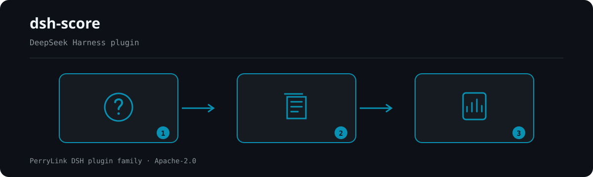

<div align="center">

# 🏆 dsh-score
- **1024 商店渠道**：先 `npm i -g dsh1024`，再 `dsh1024 plugin --profile web add dsh-score`（计入 [deepseek1024.com](https://deepseek1024.com) 安装排行）。

**为 DeepSeek Harness 插件提供多指标质量评分。**

*五个维度、真实 gh/npm 证据，一张加权风险卡与排行榜。*

[](LICENSE)
[](https://gitee.com/perrylink/dsh-score)
[](https://github.com/topics/dsh-plugin)
[](https://github.com/PerryLink/dsh-plugin-doctor#verified-徽章)
[](https://dsh.market/)
[](#)
[](https://github.com/PerryLink/dsh-score/actions)
[](https://github.com/PerryLink/dsh-score/releases)
[](https://www.npmjs.com/package/dsh-score)
[](https://www.npmjs.com/package/dsh-score)
[](https://dshfind.com/zh/plugins/PerryLink/dsh-score?ref=badge)

[English](README.md) · [简体中文](README-zh.md) · [Español](README-es.md) · [Português](README-pt.md) · [हिन्दी](README-hi.md)

```sh
dsh plugin --profile <name> add dsh-score
```


</div>

---


**📖 生态实测知识库**（实测数据，不是营销）：[插件开发指南 · 选型实测数据 · 维护取舍判据](https://perrylink.github.io/dsh-plugin-guide/)。

<!-- star-cta -->
## ⭐ 如果它帮到了你

这个插件是 [DSH 插件家族](https://github.com/PerryLink)的一员（95 个，全部 Apache-2.0）。如果你在用，**给个 star** —— 它不会解锁任何功能，但会让下一个人在搜索里更容易找到它。

*English:* part of a 95 plugin family for DeepSeek Harness. If it is useful, **a star helps the next person find it** — nothing is gated behind it.

## What is dsh-score?

为 DeepSeek Harness 插件提供多指标质量评分。

五个维度、真实 gh/npm 证据，一张加权风险卡与排行榜。



*工作流概览：问题 → 封存来源 → 报告。下面的示例使用实际命令面。*


*同一次运行，动图版。*

## Comparison


## 兼容性

| 组件 | 版本 |
|---|---|
| DeepSeek Harness | **`dsh-v0.2.1-rc.2`** (GitHub tag). The `engines.dsh` gate is `>=0.2.1-0 <0.3.0`; dev/test pins and the `typecheck:ci` ruler measure `0.2.1-rc.2`. The `ctx.jobs` seam uses the `SessionId` contract. |
| Node.js | `^22.19.0 \|\| >=24.0.0` |
| 包管理器 | `pnpm@11.7.0` |
| 平台 | Windows / macOS / Linux（纯 host 插件） |
| 外部工具 | PATH 上的 `gh` CLI（已认证用于 API 读取）、PATH 上的 `npm` CLI |

## 你会得到什么

- `score` 工具——对单个目标跑五维评分流水线；返回结构化风险卡，传 `background: true` 时返回 `{ kind: 'background', jobId }`。
- `/score` 命令——把空白/逗号分隔的目标列表作为 `score-batch` 后台任务（`ctx.jobs`）批量评分，产出排行榜快照（JSON + Markdown）。
- `score_report` 工具——按 id 取回评分卡（`sc_...`）、排行榜（`lb_...`）或最新排行榜。
- **五个维度**（权重可配置，默认合计 100）：安装成功率 `25`、维护 `20`、文档 `20`、安全 `20`、合规 `15`。
- **证据纪律**——每个维度记录其审计链接（`source`、脱敏后的 `detail`、`observedAt`）；无证据的维度如实报告 `no-evidence`（得分 0，从加权总分中剔除），绝不编造数字。
- 结构化结果——每条记录带 `schema: "dsh-score/v1"` 判别符，字段一等公民化，是下游工具消费的机器可读契约。

## 快速开始

### git 通道

```sh
dsh plugin --profile web add github:PerryLink/dsh-score#<commit-sha>
```

首次 `add` 会因 pnpm 拦截该包的 `prepare` 构建而失败；把 pnpm 打印的精确键复制到 profile 的 `pnpm-workspace.yaml` 后重试：

```yaml
allowBuilds:
  'dsh-score': true
```

### npm 通道

```sh
dsh plugin --profile web add dsh-score
```

预构建包无需构建许可。重启 profile 后即可在会话中使用 `score` / `/score`。

## 安装与卸载

```sh
dsh plugin --profile web add dsh-score     # 安装（npm）——或上面的 git 形式
dsh plugin --profile web remove dsh-score  # 卸载
```

### 示例

以下为插件真实入口；安装后调用一个即可。

#### 详细示例

**命令**

~~~sh
score({ target: "owner/repo" })
~~~

**输出**

~~~text
# Score sc_65e817eec8cd71ed

- Target: `owner/repo` (repo)
- Grade: **B** — total 88/100
- Verdict: healthy (weighted total 88/100)

| Dimension | Status | Score | Weight | Summary |
|---|---|---|---|---|
| Install success | ⬜ no-evidence | 0 | 25 | no dsh-test-drive result recorded for this target (install success unmeasured) |
| Maintenance | ✅ pass | 100 | 20 | active (2026-08-15T00:00:00.000Z; 0 open issues) |
| Documentation | 🟠 warn | 70 | 20 | 1/4 language READMEs + CHANGELOG + SECURITY |
| Security | ✅ pass | 100 | 20 | license MIT |
| Protocol compliance | ✅ pass | 81 | 15 | dsh.bundle.patch declared |
~~~

*来源 `README.md:141-149,169-191; tests/tools.spec.ts:64-65; tests/score.spec.ts:50-55; src/report.ts:40-53`*

#### 简短示例


## 配置

所有键均可选（括号为默认值）；非法值在加载期响亮失败。

| 键 | 默认值 | 说明 |
|---|---|---|
| `probeTimeoutMs` | `60000` | 单条 `gh`/`npm` 探测命令的截止时间（毫秒）。 |
| `outputTailBytes` | `8000` | 每条探测记录的脱敏输出尾部上限（字节）。 |
| `cacheMaxAgeMs` | `86400000` | 缓存评分卡复用的时长（0 关闭缓存）。 |
| `staleCommitWarnDays` | `90` | 提交/发布年龄超过该值维护维度降为 `warn`。 |
| `staleCommitFailDays` | `365` | 提交/发布年龄超过该值维护维度降为 `fail`。 |
| `staleIssueWarnDays` | `30` | 最久未关闭 issue 年龄（响应代理）超过该值降为 `warn`。 |
| `staleIssueFailDays` | `180` | 最久未关闭 issue 年龄超过该值降为 `fail`。 |
| `maxBatchTargets` | `20` | `/score` 批量上限。 |
| `batchConcurrency` | `1` | 批量并发（串行可避免 API 限流竞争）。 |
| `weights` | `{install:25, maintenance:20, documentation:20, security:20, compliance:15}` | 各维度权重（每个 0–100；至少一个 > 0）。 |

## 工具与界面

### `score`

```
score(target: string, refresh?: boolean, background?: boolean)
```

- `target`——GitHub 仓库（`github:owner/repo`、`owner/repo`、git/https URL）或 npm 包名。
- `refresh: true` 绕过评分缓存重新采集证据。
- `background: true` 启动 `score-batch` 任务并返回其 id。

### `/score <targets...>`

启动一个后台批量任务；进度经任务输出流式返回，最后一行给出供 `score_report` 使用的排行榜 id。

### `score_report(id?)`

返回评分卡（`sc_...`）、排行榜（`lb_...`），或不传 id 时返回最新排行榜。

### `score_badge(target? | id?, refresh?)`

为某个目标生成可嵌入 README 的徽章与五维 JSON：

- `target` — 经缓存对 GitHub 仓库或 npm 包评分并生成徽章；与 `id` 互斥。
- `id` — 对已存评分卡（`sc_...`）生成徽章，不重新评分。
- `refresh: true` — 绕过评分缓存（仅对 `target` 生效）。

返回徽章（SVG + endpoint + Markdown 嵌入）与紧凑五维 JSON——见下文「徽章与 JSON API」。

### Structured result sample

```json
{
  "schema": "dsh-score/v1",
  "scoreId": "sc_8f1c2e4a9b3d7f01",
  "target": { "kind": "repo", "spec": "github:owner/dsh-click#abc123" },
  "scoredAt": "2026-08-16T00:00:00.000Z",
  "durationMs": 3210,
  "pluginVersion": "0.1.0",
  "dimensions": {
    "install": { "dimension": "install", "status": "no-evidence", "score": 0, "weight": 25,
                 "summary": "no dsh-test-drive result recorded for this target (install success unmeasured)",
                 "evidence": [{ "source": "test-drive", "detail": "no test-drive record found in the test_drive domain", "observedAt": "2026-08-16T00:00:00.000Z" }] },
    "maintenance": { "dimension": "maintenance", "status": "pass", "score": 100, "weight": 20,
                     "summary": "active (2026-08-10T00:00:00Z; 0 open issues)",
                     "evidence": [{ "source": "gh-api", "detail": "last activity 2026-08-10T00:00:00Z", "observedAt": "2026-08-16T00:00:00.000Z" }] }
  },
  "total": 88,
  "grade": "B",
  "verdict": "healthy (weighted total 88/100)"
}
```

计分：总分为收集到证据维度的加权平均（no-evidence 维度被剔除并重新归一）；`A` ≥ 90，`B` ≥ 75，`C` ≥ 60，`D` ≥ 40，否则 `F`，全无证据时为 `N/A`。

## 徽章与 JSON API

`score_badge` 为某个已评分目标生成可嵌入 README 的徽章与五维 JSON。

### 徽章

- **徽章**：shields.io 扁平 SVG（`badge.svg` 字段 / `renderScoreBadge`）、文档化端点 URL、以及 Markdown 嵌入片段。

嵌入总徽章：

```markdown

```

### 五维 JSON

- **五维 JSON**：`install`/`maintenance`/`documentation`/`security`/`compliance` 各自的 `status`/`score`/`weight`/`summary`，外加加权 `total` 与字母 `grade`（`schema: "dsh-score/badge/v1"`）。

`no-evidence` 维度保持诚实状态并计 0 分——徽章与 JSON 绝不伪造数字。

## 权限与数据

- 只消费公开服务：`ctx.subprocess`、`ctx.jobs`、`ctx.storageDomain`、`ctx.tools`、`ctx.commands`。
- 评分卡与排行榜存于 `score` 存储域（表 `scores`、`leaderboards`；最新排行榜指针）。组合里没有 `storageDomain`（如官方 headless profile）时工具仍可用，评分持久化被禁用并记录原因。官方 `dsh-base` bundle 自 `0.1.2-rc.1` 起就挂载 storage-domain（已对 `0.1.2-rc.1` 与 `0.1.5-alpha.1` 的 tarball 核验），因此已发布线上持久化是启用的。
- 子进程继承 provider 已剥离凭据的环境；`gh` 读取其自身的凭据存储。任何环境变量值都不被记录。
- 所有报告/日志字符串经过纯脱敏函数：token 字面量、URL 凭据、bearer 头被脱敏，尾部按字节截断。

## 安全边界

- **不执行代码**。流水线只运行 `gh api` 与 `npm view`；绝不安装、构建或运行目标。
- **仅 argv 子进程**。每次 CLI 调用都是 argv 数组，绝不经过 shell 解释；owner/repo 段在用于端点前先做受限字符集校验。
- **证据纪律**。不编造评分：探测失败或输出不可解析时返回 `no-evidence`，绝不填数字。
- **检测与脱敏分离**。密钥泄露与恶意安装脚本检测复用与脱敏同一套纯正则，二者均有极端输入单测。

## 已知限制

- 仓库探测需要 `gh` 已认证且有到 GitHub 的网络；npm 探测需要 `npm` 与 registry 访问。
- 无法解析出 GitHub 仓库的目标无法检查文档、安全或合规（这些维度报告 `no-evidence`）。
- 安装成功率依赖 `dsh-test-drive` 已挂载且已记录该目标；否则如实为 `no-evidence`。
- 维护维度的“issue 响应”是代理信号（最久未关闭 issue 年龄），不是直接响应时长测量。
- 评分按目标缓存；用 `refresh: true`（或等过 `cacheMaxAgeMs`）强制重评。

## 开发

```sh
pnpm install
pnpm run typecheck && pnpm run typecheck:ci && pnpm test
pnpm run build && pnpm run verify:self-contained && pnpm run verify:artifacts && pnpm pack
```

- `typecheck` 经本地 harness checkout 解析 `@deepseek-ai/*`；`typecheck:ci` 对照已发布的 `0.1.7-rc.2` 类型。
- 测试使用真实 `Context`/`Session`/`ToolRuntime`/`LocalJobRegistry`/存储栈，子进程 provider 为脚本化实现。
- 真实 CLI 评分（需 PATH 有 `gh`/`npm`，`gh` 已认证）：在已挂载 profile 中调用 `score`。
- 发布：`node scripts/release.mjs <x.y.z>`（升版本、盖 CHANGELOG、重跑门禁、提交 + tag；绝不 push）。

## 主题

`dsh`、`dsh-plugin`、`deepseek-harness`、`deepseek`、`cordis`、`plugin-scoring`、`quality-score`、`leaderboard`、`supply-chain`

## 贡献者

[PerryLink](https://github.com/PerryLink) — 设计与实现。

## PerryLink DSH Plugin Family

本项目是 [PerryLink](https://github.com/PerryLink) 维护的 DeepSeek Harness 插件家族成员。完整名单默认折叠，避免每个 README 的首屏被长表淹没；点击展开可查看每一行及其状态。

<details>
<summary>展开全部插件</summary>

| 插件 | 状态 |
|---|---|
| **[dsh-aqua-input-check](https://github.com/PerryLink/dsh-aqua-input-check)** |  |
| **[dsh-archive-check](https://github.com/PerryLink/dsh-archive-check)** |  |
| **[dsh-auto-review](https://github.com/PerryLink/dsh-auto-review)** |  |
| **[dsh-autotier](https://github.com/PerryLink/dsh-autotier)** |  |
| **[dsh-bid-ca-precheck](https://github.com/PerryLink/dsh-bid-ca-precheck)** |  |
| **[dsh-bid-qual-check](https://github.com/PerryLink/dsh-bid-qual-check)** |  |
| **[dsh-cert-mcp](https://github.com/PerryLink/dsh-cert-mcp)** |  |
| **[dsh-checkpoint-rewind](https://github.com/PerryLink/dsh-checkpoint-rewind)** |  |
| **[dsh-click](https://github.com/PerryLink/dsh-click)** |  |
| **[dsh-composer-history](https://github.com/PerryLink/dsh-composer-history)** |  |
| **[dsh-contract-stance](https://github.com/PerryLink/dsh-contract-stance)** |  |
| **[dsh-customs-doc-check](https://github.com/PerryLink/dsh-customs-doc-check)** |  |
| **[dsh-data-quality](https://github.com/PerryLink/dsh-data-quality)** |  |
| **[dsh-demurrage-ledger](https://github.com/PerryLink/dsh-demurrage-ledger)** |  |
| **[dsh-doublecheck](https://github.com/PerryLink/dsh-doublecheck)** |  |
| **[dsh-drill-script-check](https://github.com/PerryLink/dsh-drill-script-check)** |  |
| **[dsh-eia-guide-check](https://github.com/PerryLink/dsh-eia-guide-check)** |  |
| **[dsh-emergency-plan](https://github.com/PerryLink/dsh-emergency-plan)** |  |
| **[dsh-essay-rubric-check](https://github.com/PerryLink/dsh-essay-rubric-check)** |  |
| **[dsh-evidence-check](https://github.com/PerryLink/dsh-evidence-check)** |  |
| **[dsh-export-ctl-check](https://github.com/PerryLink/dsh-export-ctl-check)** |  |
| **[dsh-fast](https://github.com/PerryLink/dsh-fast)** |  |
| **[dsh-fmea-table-check](https://github.com/PerryLink/dsh-fmea-table-check)** |  |
| **[dsh-forecast-penalty](https://github.com/PerryLink/dsh-forecast-penalty)** |  |
| **[dsh-fund-research](https://github.com/PerryLink/dsh-fund-research)** |  |
| **[dsh-github](https://github.com/PerryLink/dsh-github)** |  |
| **[dsh-gongwen-flow-check](https://github.com/PerryLink/dsh-gongwen-flow-check)** |  |
| **[dsh-gongwen-word-check](https://github.com/PerryLink/dsh-gongwen-word-check)** |  |
| **[dsh-guard-plan-qc](https://github.com/PerryLink/dsh-guard-plan-qc)** |  |
| **[dsh-hazchem-check](https://github.com/PerryLink/dsh-hazchem-check)** |  |
| **[dsh-hazplan-check](https://github.com/PerryLink/dsh-hazplan-check)** |  |
| **[dsh-hidden-risk-map](https://github.com/PerryLink/dsh-hidden-risk-map)** |  |
| **[dsh-hs-classify](https://github.com/PerryLink/dsh-hs-classify)** |  |
| **[dsh-icd-rule-check](https://github.com/PerryLink/dsh-icd-rule-check)** |  |
| **[dsh-industry-research](https://github.com/PerryLink/dsh-industry-research)** |  |
| **[dsh-lawcite-adapter](https://github.com/PerryLink/dsh-lawcite-adapter)** |  |
| **[dsh-laya](https://github.com/PerryLink/dsh-laya)** |  |
| **[dsh-lc-doc-check](https://github.com/PerryLink/dsh-lc-doc-check)** |  |
| **[dsh-learning-gap-check](https://github.com/PerryLink/dsh-learning-gap-check)** |  |
| **[dsh-library](https://github.com/PerryLink/dsh-library)** |  |
| **[dsh-local-ai](https://github.com/PerryLink/dsh-local-ai)** |  |
| **[dsh-lsp-actions](https://github.com/PerryLink/dsh-lsp-actions)** |  |
| **[dsh-mask](https://github.com/PerryLink/dsh-mask)** |  |
| **[dsh-mcp-panel](https://github.com/PerryLink/dsh-mcp-panel)** |  |
| **[dsh-medrec-qc](https://github.com/PerryLink/dsh-medrec-qc)** |  |
| **[dsh-memento](https://github.com/PerryLink/dsh-memento)** |  |
| **[dsh-nsfc-form-check](https://github.com/PerryLink/dsh-nsfc-form-check)** |  |
| **[dsh-nurse-record-check](https://github.com/PerryLink/dsh-nurse-record-check)** |  |
| **[dsh-observe](https://github.com/PerryLink/dsh-observe)** |  |
| **[dsh-origin-rvc-check](https://github.com/PerryLink/dsh-origin-rvc-check)** |  |
| **[dsh-ota-review-check](https://github.com/PerryLink/dsh-ota-review-check)** |  |
| **[dsh-output-styles](https://github.com/PerryLink/dsh-output-styles)** |  |
| **[dsh-paper-doc-adapter](https://github.com/PerryLink/dsh-paper-doc-adapter)** |  |
| **[dsh-permission-rules](https://github.com/PerryLink/dsh-permission-rules)** |  |
| **[dsh-permit-report-check](https://github.com/PerryLink/dsh-permit-report-check)** |  |
| **[dsh-pipeline-check](https://github.com/PerryLink/dsh-pipeline-check)** |  |
| **[dsh-pleading-draft](https://github.com/PerryLink/dsh-pleading-draft)** |  |
| **[dsh-plugin-doctor](https://github.com/PerryLink/dsh-plugin-doctor)** |  |
| **[dsh-plugin-guide](https://github.com/PerryLink/dsh-plugin-guide)** |  |
| **[dsh-plugin-kit](https://github.com/PerryLink/dsh-plugin-kit)** |  |
| **[dsh-plugin-upgrade](https://github.com/PerryLink/dsh-plugin-upgrade)** |  |
| **[dsh-policy-brief-draft](https://github.com/PerryLink/dsh-policy-brief-draft)** |  |
| **[dsh-power-loss-split](https://github.com/PerryLink/dsh-power-loss-split)** |  |
| **[dsh-power-ticket-check](https://github.com/PerryLink/dsh-power-ticket-check)** |  |
| **[dsh-ppap-check](https://github.com/PerryLink/dsh-ppap-check)** |  |
| **[dsh-protest-deadline](https://github.com/PerryLink/dsh-protest-deadline)** |  |
| **[dsh-railway-window](https://github.com/PerryLink/dsh-railway-window)** |  |
| **[dsh-repair-order-qc](https://github.com/PerryLink/dsh-repair-order-qc)** |  |
| **[dsh-research-report](https://github.com/PerryLink/dsh-research-report)** |  |
| **[dsh-review-reply-check](https://github.com/PerryLink/dsh-review-reply-check)** |  |
| **[dsh-rulefile-check](https://github.com/PerryLink/dsh-rulefile-check)** |  |
| **[dsh-safety-brief-check](https://github.com/PerryLink/dsh-safety-brief-check)** |  |
| **[dsh-score](https://github.com/PerryLink/dsh-score)** |  |
| **[dsh-session-sync](https://github.com/PerryLink/dsh-session-sync)** |  |
| **[dsh-site-log-check](https://github.com/PerryLink/dsh-site-log-check)** |  |
| **[dsh-skill-pack-security](https://github.com/PerryLink/dsh-skill-pack-security)** |  |
| **[dsh-soe-decision-check](https://github.com/PerryLink/dsh-soe-decision-check)** |  |
| **[dsh-soilwater-check](https://github.com/PerryLink/dsh-soilwater-check)** |  |
| **[dsh-sop-sync-check](https://github.com/PerryLink/dsh-sop-sync-check)** |  |
| **[dsh-spc-gbt-adapter](https://github.com/PerryLink/dsh-spc-gbt-adapter)** |  |
| **[dsh-talk](https://github.com/PerryLink/dsh-talk)** |  |
| **[dsh-tender-extract](https://github.com/PerryLink/dsh-tender-extract)** |  |
| **[dsh-tender-matrix](https://github.com/PerryLink/dsh-tender-matrix)** |  |
| **[dsh-test-drive](https://github.com/PerryLink/dsh-test-drive)** |  |
| **[dsh-ticktick](https://github.com/PerryLink/dsh-ticktick)** |  |
| **[dsh-translate](https://github.com/PerryLink/dsh-translate)** |  |
| **[dsh-warranty-calc](https://github.com/PerryLink/dsh-warranty-calc)** |  |
| **[dsh-budget](https://github.com/PerryLink/dsh-budget)** | 🧊 已冻结 — 见仓库 README |
| **[dsh-claude-move](https://github.com/PerryLink/dsh-claude-move)** | 🧊 已冻结 — 见仓库 README |
| **[dsh-defend](https://github.com/PerryLink/dsh-defend)** | 🧊 已冻结 — 见仓库 README |
| **[dsh-draw](https://github.com/PerryLink/dsh-draw)** | 🧊 已冻结 — 见仓库 README |
| **[dsh-reach](https://github.com/PerryLink/dsh-reach)** | 🧊 已冻结 — 见仓库 README |
| **[dsh-background-agents](https://github.com/PerryLink/dsh-background-agents)** | 🚫 已退役 — 见仓库 README |
| **[dsh-session-pin](https://github.com/PerryLink/dsh-session-pin)** | 🚫 已退役 — 见仓库 README |
| **[dsh-team-rooms](https://github.com/PerryLink/dsh-team-rooms)** | 🚫 已退役 — 见仓库 README |

</details>

## 许可证

[Apache-2.0](LICENSE)
