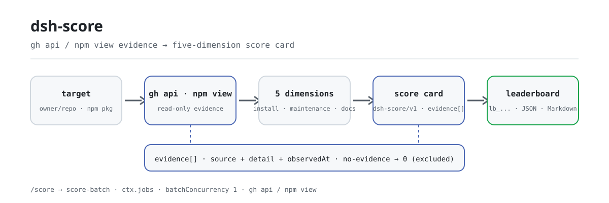

<div align="center">

<picture>
  <source media="(prefers-color-scheme: dark)" srcset="docs/assets/dsh-score-flow-dark.svg">
  
</picture>

# dsh-score

**Turn any repository or npm package into a five-dimension quality scorecard with evidence links — install, maintenance, docs, security, compliance, every point traceable.**

A local scorer for DeepSeek Harness: it collects evidence with `gh api` and `npm view` only — it never installs, builds, or runs the target — and records `no-evidence` instead of inventing a number.

[Install](#three-step-setup) · [Configuration](#configuration) · [FAQ](#faq) · [简体中文](README.md) · [English](README.en.md) · [Español](README.es.md) · [Português](README.pt.md) · [हिन्दी](README.hi.md)

[](LICENSE)
[](#compatibility)
[](https://www.npmjs.com/package/dsh-score)
[](https://github.com/PerryLink/dsh-score/actions/workflows/ci.yml)
[](#compatibility)

[](https://github.com/PerryLink/dsh-score/stargazers)
[](https://www.npmjs.com/package/dsh-score)
[](https://dshfind.com/plugins/PerryLink/dsh-score?ref=badge)
[](https://securityscorecards.dev/viewer/?uri=github.com/PerryLink/dsh-score)
[](https://dsh.market/)
[](https://gitee.com/perrylink/dsh-score)

```sh
dsh plugin --profile <name> add dsh-score
```

</div>

<sub>Community plugin, not affiliated with DeepSeek. Canonical repository: <https://github.com/PerryLink/dsh-score> (Gitee is a mirror).</sub>

## What it is

`dsh-score` is a local quality scorer for DeepSeek Harness: give it a GitHub repository or an npm package and it runs the five dimensions — install success, maintenance, documentation, security, and compliance — then returns a structured score card (`schema: "dsh-score/v1"`) or a JSON + Markdown leaderboard. Every conclusion comes from real `gh`/`npm` output and every piece of evidence carries `source`, sanitized `detail`, and `observedAt`; a dimension that gathers no evidence reports `no-evidence` (score 0, excluded from the weighted total) instead of a guessed number. Scoring is on demand only — nothing is installed, built, or executed. This plugin is the local on-demand scorer; the public evidence layer lives in [`dsh-attention-index`](https://github.com/PerryLink/dsh-attention-index).

## Three-step setup

1. **Install** (pick one channel):

   ```sh
   # git channel (latest main; equivalent to git+https://github.com/PerryLink/dsh-score.git)
   dsh plugin --profile web add github:PerryLink/dsh-score#<commit-sha>
   # npm channel (published releases)
   dsh plugin --profile web add dsh-score
   ```

   The first `add` through the git channel fails because pnpm blocks the package's `prepare` build; copy the exact key pnpm printed into the profile's `pnpm-workspace.yaml` and re-run:

   ```yaml
   allowBuilds:
     'dsh-score': true
   ```

   Prebuilt packages from the npm channel need no build allowance.

2. **Minimal config** (the defaults work; add keys only to change thresholds or weights):

   ```yaml
   - insert:
       - id: score
         name: dsh-score
         config:
           weights:
             install: 25
             maintenance: 20
             documentation: 20
             security: 20
             compliance: 15
   ```

3. **Verify it mounts**:

   ```sh
   dsh --profile web --dump-config | grep -A2 'id: score'
   ```

   ```
   > /score owner/repo
   [1/1] owner/repo → B (88/100, healthy (weighted total 88/100))
   ```

   *Observed from `src/batch.ts:70`*

**Uninstall**: `dsh plugin --profile web remove dsh-score` (or remove the row from the profile patch).

> `dsh-score` does not bundle the storage stack. When the composition has no `storageDomain`, the tools still work and score persistence is disabled with a logged reason; the published `dsh-base` bundle mounts storage-domain from `0.1.2-rc.1` on (verified against the `0.1.2-rc.1` and `0.1.5-alpha.1` tarballs), so persistence is active on the published line.

## Core capabilities

`dsh-score` compresses "can it be installed, is it maintained, are the docs complete, is it secure, does it comply" into one reviewable score card:

- **Five dimensions** — install success `25`, maintenance `20`, documentation `20`, security `20`, compliance `15` (weights configurable; defaults sum to 100).
- **Evidence discipline** — every dimension records its audit links (`source`, sanitized `detail`, `observedAt`); a dimension without evidence reports `no-evidence` (score 0, excluded from the weighted total) and never a fabricated number.
- **Structured results** — every record carries `schema: "dsh-score/v1"` with first-class fields; this is the machine-readable contract downstream tooling consumes.
- **Batch leaderboard** — `/score` hands a target list to a `score-batch` job over `ctx.jobs`, producing a JSON + Markdown leaderboard snapshot.
- **Cache and refresh** — score cards are cached per target (24 hours by default); `refresh: true` bypasses the cache and re-gathers evidence.
- **Embeddable badge** — `score_badge` returns a shields.io badge (endpoint / SVG / Markdown) plus the five-dimension JSON, and the total badge drops straight into any README.

```text
target ──gh api / npm view──▶ five dimensions of evidence ──weighted──▶ score card dsh-score/v1 ──▶ leaderboard lb_...
                                    │
                                    └─ no evidence → no-evidence (score 0, excluded)
```

## Tools & results

### Tool surface

| Entry | Type | Notes |
|---|---|---|
| `score` | tool | Scores one target through the five dimensions; `refresh: true` bypasses the cache, `background: true` starts a `score-batch` job |
| `/score <targets...>` | command | Scores a whitespace/comma-separated target list; progress streams through the job output and the final line names the `lb_...` for `score_report` |
| `score_report` | tool | Fetches a score card (`sc_...`), a leaderboard (`lb_...`), or — with no id — the latest leaderboard |
| `score_badge` | tool | Generates a shields.io badge and the five-dimension JSON for a target or a stored score card |
| `score-batch` | background job | The batch job over `ctx.jobs`; it scores serially and writes the leaderboard snapshot |

### Tool parameters

```
score(target: string, refresh?: boolean, background?: boolean)
```

- `target` — a GitHub repository (`github:owner/repo`, `owner/repo`, a git/https URL) or an npm package name.
- `refresh: true` — bypass the score cache and re-gather evidence.
- `background: true` — start a `score-batch` job and return its id.

`score_report(id?)` returns a score card (`sc_...`), a leaderboard (`lb_...`), or — with no id — the latest leaderboard.

`score_badge(target? | id?, refresh?)`:

- `target` — score a GitHub repo or npm package through the cache and badge it; mutually exclusive with `id`.
- `id` — badge a stored score card (`sc_...`) without re-scoring.
- `refresh: true` — bypass the score cache (only applies to `target`).

### Score card example

These are the plugin's real entry points; install once, then call one.

**Command**:

~~~sh
score({ target: "owner/repo" })
~~~

**Output**:

~~~text
# Score sc_65e817eec8cd71ed

- Target: `owner/repo` (repo)
- Grade: **B** — total 88/100
- Verdict: healthy (weighted total 88/100)

| Dimension | Status | Score | Weight | Summary |
|---|---|---|---|---|
| Install success | ⬜ no-evidence | 0 | 25 | no dsh-test-drive result recorded for this target (install success unmeasured) |
| Maintenance | ✅ pass | 100 | 20 | active (2026-08-15T00:00:00.000Z; 0 open issues) |
| Documentation | 🟠 warn | 70 | 20 | 1/4 language READMEs + CHANGELOG + SECURITY |
| Security | ✅ pass | 100 | 20 | license MIT |
| Protocol compliance | ✅ pass | 81 | 15 | dsh.bundle.patch declared |
~~~

*Observed from `README.md:141-149,169-191; tests/tools.spec.ts:64-65; tests/score.spec.ts:50-55; src/report.ts:40-53`*

**Failure branch** — input:

~~~text
{"id":"sc_nope"}
~~~

Output:

~~~text
isError=true; error.message=dsh-score: no score recorded with id sc_nope
~~~

*Observed from `plugins/dsh-score/src/tools.ts:351-354 (throw); plugins/dsh-score/tests/tools.spec.ts:95-99 (unknown id); plugins/dsh-score/README.md:179-181 (score_report); exercised through plugins/dsh-score/tests/harness.ts`*

**Brief examples**: `score({ target: "owner/dsh-click" })` · `score_report("sc_65e817eec8cd71ed")` · `score_badge("owner/dsh-click")`

### Structured result

```json
{
  "schema": "dsh-score/v1",
  "scoreId": "sc_8f1c2e4a9b3d7f01",
  "target": { "kind": "repo", "spec": "github:owner/dsh-click#abc123" },
  "scoredAt": "2026-08-16T00:00:00.000Z",
  "durationMs": 3210,
  "pluginVersion": "0.2.22",
  "dimensions": {
    "install": { "dimension": "install", "status": "no-evidence", "score": 0, "weight": 25,
                 "summary": "no dsh-test-drive result recorded for this target (install success unmeasured)",
                 "evidence": [{ "source": "test-drive", "detail": "no test-drive record found in the test_drive domain", "observedAt": "2026-08-16T00:00:00.000Z" }] },
    "maintenance": { "dimension": "maintenance", "status": "pass", "score": 100, "weight": 20,
                     "summary": "active (2026-08-10T00:00:00Z; 0 open issues)",
                     "evidence": [{ "source": "gh-api", "detail": "last activity 2026-08-10T00:00:00Z", "observedAt": "2026-08-16T00:00:00.000Z" }] }
  },
  "total": 88,
  "grade": "B",
  "verdict": "healthy (weighted total 88/100)"
}
```

Scoring: the total is a weighted average over the dimensions that gathered evidence (no-evidence dimensions are excluded and renormalized); `A` ≥ 90, `B` ≥ 75, `C` ≥ 60, `D` ≥ 40, else `F`, and `N/A` when nothing had evidence.

### Badge & five-dimension JSON

`score_badge` generates an embeddable README badge and the five-dimension JSON for one scored target. The badge comes in three forms derived from the same card: **endpoint** (a documented shields.io static URL, zero self-hosting), **SVG** (a self-contained shields.io flat-style SVG, `badge.svg` field / `renderScoreBadge`, for offline or self-hosted READMEs), and **Markdown** (the embed snippet combining both).

Embed the total badge:

```markdown

```

The same call returns the compact JSON API envelope (`schema: "dsh-score/badge/v1"`):

```json
{
  "schema": "dsh-score/badge/v1",
  "target": { "kind": "repo", "spec": "github:owner/dsh-click#abc123" },
  "scoredAt": "2026-08-16T00:00:00.000Z",
  "total": 84,
  "grade": "B",
  "dimensions": {
    "install":      { "label": "install", "status": "no-evidence", "score": 0,  "weight": 25, "summary": "no dsh-test-drive result recorded" },
    "maintenance":  { "label": "maintenance", "status": "pass", "score": 90, "weight": 20, "summary": "active (0 open issues)" },
    "documentation": { "label": "docs", "status": "pass", "score": 85, "weight": 20, "summary": "README + CHANGELOG + SECURITY" },
    "security":     { "label": "security", "status": "warn", "score": 60, "weight": 20, "summary": "permissive license" },
    "compliance":   { "label": "compliance", "status": "pass", "score": 100, "weight": 15, "summary": "dsh.bundle.patch + dsh-plugin topic" }
  }
}
```

A `no-evidence` dimension keeps its honest status and score 0 — the badge and JSON never fabricate a number.

## Configuration

All keys are optional (defaults shown); invalid values fail loudly at load.

Most-used keys:

| Key | Default | Meaning |
|---|---|---|
| `probeTimeoutMs` | `60000` | Deadline for one `gh`/`npm` probe command (ms) |
| `outputTailBytes` | `8000` | Cap on the sanitized output tail recorded per probe (bytes) |
| `cacheMaxAgeMs` | `86400000` | How long a cached score card is reused before re-scoring (0 disables the cache) |
| `staleCommitWarnDays` | `90` | Commit/publish age at which maintenance drops to `warn` |
| `staleCommitFailDays` | `365` | Commit/publish age at which maintenance drops to `fail` |
| `maxBatchTargets` | `20` | `/score` batch target cap |
| `batchConcurrency` | `1` | Batch concurrency (serial by default, avoiding API-rate contention) |
| `weights` | `{install:25, maintenance:20, documentation:20, security:20, compliance:15}` | Per-dimension weights (each 0–100; at least one must be > 0) |

<details>
<summary>Full configuration table (10 keys)</summary>

| Key | Default | Meaning |
|---|---|---|
| `probeTimeoutMs` | `60000` | Deadline for one `gh`/`npm` probe command (ms) |
| `outputTailBytes` | `8000` | Cap on the sanitized output tail recorded per probe (bytes) |
| `cacheMaxAgeMs` | `86400000` | How long a cached score card is reused before re-scoring (0 disables the cache) |
| `staleCommitWarnDays` | `90` | Commit/publish age at which maintenance drops to `warn` |
| `staleCommitFailDays` | `365` | Commit/publish age at which maintenance drops to `fail` |
| `staleIssueWarnDays` | `30` | Oldest-open-issue age (response proxy) at which maintenance drops to `warn` |
| `staleIssueFailDays` | `180` | Oldest-open-issue age at which maintenance drops to `fail` |
| `maxBatchTargets` | `20` | `/score` batch target cap |
| `batchConcurrency` | `1` | Batch concurrency (serial by default, avoiding API-rate contention) |
| `weights` | `{install:25, maintenance:20, documentation:20, security:20, compliance:15}` | Per-dimension weights (each 0–100; at least one must be > 0) |

</details>

Example override in your profile patch:

```yaml
- insert:
    - id: score
      name: dsh-score
      config:
        cacheMaxAgeMs: 0
        maxBatchTargets: 10
        weights:
          install: 25
          maintenance: 20
          documentation: 20
          security: 20
          compliance: 15
```

## FAQ

<details>
<summary>Where do score cards and leaderboards live? Are they lost without storage?</summary>

Score cards and leaderboards are stored in the `score` storage domain (tables `scores`, `leaderboards`, plus the latest-leaderboard pointer). When the composition has no `storageDomain` (a headless profile older than the base bundle's storage rows, for example), the tools still work but score persistence is disabled with a logged reason. The published `dsh-base` bundle mounts storage-domain from `0.1.2-rc.1` on (verified against the `0.1.2-rc.1` and `0.1.5-alpha.1` tarballs), so persistence is active on the published line.

</details>

<details>
<summary>When evidence is missing, does it just make up a score?</summary>

No. A failed probe, unparsable output, or a target with no resolvable GitHub repository makes that dimension report `no-evidence` (score 0, excluded from the weighted total and renormalized); when nothing has evidence the total is `N/A`. A `no-evidence` dimension also carries the failure reason (`exit N`, `timeout`, the redacted stderr tail, or `invalid JSON`) instead of an invented number.

</details>

<details>
<summary>Does it install, build, or run the target package?</summary>

No. The pipeline runs only the read-only `gh api` and `npm view` commands — it never installs, builds, or executes the target. Every CLI invocation is an argv array, never shell-interpreted, and the `owner`/`repo` segments are validated against a restricted character set before they reach an endpoint.

</details>

<details>
<summary>Can credentials leak into reports or logs?</summary>

No. Child processes inherit the provider's credential-scrubbed environment and `gh` reads its own credential store; no environment value is ever logged. All report/log strings pass through pure sanitizers: token literals, URL credentials, and bearer headers are redacted, and output tails are byte-capped.

</details>

<details>
<summary>How expensive is scoring? Will it hit GitHub API rate limits?</summary>

Score cards are cached per target (`cacheMaxAgeMs` = 24 hours by default), so repeat lookups do not re-gather evidence; use `refresh: true` or set the cache age to 0 when you need fresh data. `/score` defaults to `batchConcurrency: 1` (serial) to avoid concurrent probes competing for API quota, and a single probe waits at most `probeTimeoutMs` (60 seconds by default).

</details>

## Security boundaries

- **No code execution.** The pipeline runs `gh api` and `npm view` only; it never installs, builds, or runs a target.
- **Argv-only subprocesses.** Every CLI invocation is an argv array, never shell-interpreted; repo owner/repo segments are validated against a restricted character set before use in an endpoint.
- **Evidence discipline.** No score is fabricated: a probe that fails or returns unparsable output yields `no-evidence`, never a number.
- **Detection vs redaction.** Secret-leak and malicious-install-script detection share the same pure regexes as redaction; both are unit-tested against extreme inputs.

## Permissions & data

- **Permissions**: only public services are consumed — `ctx.subprocess`, `ctx.jobs`, `ctx.storageDomain`, `ctx.tools`, `ctx.commands`; the plugin provides no Cordis service key.
- **Data**: score cards and leaderboards live in the `score` storage domain (tables `scores`, `leaderboards`, plus the latest-leaderboard pointer). Without `storageDomain` the tools still work and persistence is disabled with a logged reason.
- **Environment**: child processes inherit the provider's credential-scrubbed environment; `gh` reads its own credential store. No environment value is ever logged, and every report/log string passes through pure sanitizers with byte-capped tails.

## Known limitations

- Repository probes require `gh` to be authenticated and network access to GitHub; npm probes require `npm` and registry access.
- A target without a resolvable GitHub repository cannot be inspected for documentation, security, or compliance (those dimensions report `no-evidence`).
- Install success depends on `dsh-test-drive` being mounted and having recorded the target; otherwise it is honestly `no-evidence`.
- The maintenance "issue response" signal is a proxy (oldest open issue age), not a direct response-time measurement.
- Score results are cached per target; use `refresh: true` (or wait past `cacheMaxAgeMs`) to force re-scoring.

## Interoperability with other DSH plugins

`dsh-score` only exposes its own scoring surface and never takes over another plugin's lane:

- **Self-contained tool surface.** It registers exactly three tools (`score`, `score_report`, `score_badge`) and one command (`/score`), all through `ctx.effect`, so stop/hot-reload removes them.
- **No service key.** `inject` declares only `tools`, `commands`, `subprocess`, and `jobs`; `storageDomain` is read optionally through `ctx.get` and never required.
- **No client lane.** It registers no client slot key and no `webServer` route prefix.
- **No patch-layer collision.** The bundle patch only `insert`s its own row (`id: score`); it never overrides a built-in row's `config`.
- **No global mutation.** It does not patch prototypes, rewrite `process.env`, or replace the global fetch dispatcher.
- **No shared-event listeners.** It registers no waterfall listener (including `agent/pre-step`), so it takes no part in event-chain ordering and cannot short-circuit another plugin's chain.

Static evidence: the `dsh-plugin-doctor` verification badge is driven by this repository's CI output (see "Ecosystem & quality").

## Compatibility

| Component | Version |
|---|---|
| DeepSeek Harness | **`dsh-v0.2.2-rc.1`** (GitHub tag). The `engines.dsh` gate is `>=0.2.1-0 <0.3.0 \|\| >=0.2.2-0 <0.3.0`; dev/test pins and the `typecheck:ci` ruler measure `0.2.2-rc.1`. The `ctx.jobs` seam uses the `SessionId` contract. |
| Node.js | `^22.19.0 \|\| >=24.9.0` |
| Package manager | `pnpm@11.7.0` |
| Platform | Windows / macOS / Linux (host-only plugin) |
| External tools | `gh` CLI on PATH (authenticated for API reads), `npm` CLI on PATH |

## Ecosystem & quality

- [Gitee mirror](https://gitee.com/perrylink/dsh-score) (sync mirror; GitHub is canonical)
- [dshfind plugin page](https://dshfind.com/plugins/PerryLink/dsh-score) (installs and ranking)
- [OpenSSF Scorecard report](https://securityscorecards.dev/viewer/?uri=github.com/PerryLink/dsh-score) (driven by [.github/workflows/scorecard.yml](.github/workflows/scorecard.yml))
- [dsh-plugin-doctor verification report](https://github.com/PerryLink/dsh-plugin-doctor#verified-徽章) (badge source)
- [DSH Market](https://dsh.market/) (listed)
- **1024 store channel**: `npm i -g dsh1024` once, then `dsh1024 plugin --profile web add dsh-score` (counts toward the [deepseek1024.com](https://deepseek1024.com) install ranking)
- [Ecosystem knowledge base](https://perrylink.github.io/dsh-plugin-guide/) — measured data, not marketing: plugin development guide · plugin-selection data · maintenance criteria

## Development

```sh
pnpm install                                       # node ^22.19 || >=24.9
pnpm run typecheck && pnpm run typecheck:ci && pnpm test   # local checkout face + published-line face + vitest
pnpm run build && pnpm run verify:self-contained && pnpm run verify:artifacts && pnpm pack
pnpm run check:readmes                             # five-language README consistency
```

- `typecheck` resolves `@deepseek-ai/*` through the local harness checkout; `typecheck:ci` checks against the published `0.2.2-rc.1` types.
- Tests use the real `Context`/`Session`/`ToolRuntime`/`LocalJobRegistry`/storage stack with a scripted subprocess provider.
- Real-CLI scoring (requires `gh`/`npm` on PATH and `gh` authenticated): invoke `score` from a mounted profile.
- Release: `node scripts/release.mjs <x.y.z>` (bumps, stamps CHANGELOG, re-runs the gate, commits + tags; never pushes).
- The README images are generated programmatically by [`scripts/gen-readme-assets.py`](scripts/gen-readme-assets.py) (Python + Pillow), safe to re-run; it writes `docs/assets/dsh-score-flow-{light,dark}.svg`.

Topics: `dsh`, `dsh-plugin`, `deepseek-harness`, `deepseek`, `cordis`, `plugin-scoring`, `quality-score`, `leaderboard`, `supply-chain`

## Family & thanks

This project is part of the DeepSeek Harness plugin family from [PerryLink](https://github.com/PerryLink) (all Apache-2.0). If it is useful, **a star helps the next person find it** — nothing is gated behind it.

- [@PerryLink](https://github.com/PerryLink) — creator and maintainer: the five-dimension pipeline, the `gh`/`npm` evidence probes, the structured `dsh-score/v1` contract, the `/score` batch job, the badge, and the five-language docs.

<details>
<summary>Expand all plugins</summary>

| Plugin | Status |
|---|---|
| **[dsh-aqua-input-check](https://github.com/PerryLink/dsh-aqua-input-check)** |  |
| **[dsh-archive-check](https://github.com/PerryLink/dsh-archive-check)** |  |
| **[dsh-auto-review](https://github.com/PerryLink/dsh-auto-review)** |  |
| **[dsh-autotier](https://github.com/PerryLink/dsh-autotier)** | 🧊 FROZEN — see the repo README |
| **[dsh-bid-ca-precheck](https://github.com/PerryLink/dsh-bid-ca-precheck)** |  |
| **[dsh-bid-qual-check](https://github.com/PerryLink/dsh-bid-qual-check)** |  |
| **[dsh-cert-mcp](https://github.com/PerryLink/dsh-cert-mcp)** | 🧊 FROZEN — see the repo README |
| **[dsh-checkpoint-rewind](https://github.com/PerryLink/dsh-checkpoint-rewind)** |  |
| **[dsh-click](https://github.com/PerryLink/dsh-click)** |  |
| **[dsh-composer-history](https://github.com/PerryLink/dsh-composer-history)** |  |
| **[dsh-contract-stance](https://github.com/PerryLink/dsh-contract-stance)** |  |
| **[dsh-customs-doc-check](https://github.com/PerryLink/dsh-customs-doc-check)** |  |
| **[dsh-data-quality](https://github.com/PerryLink/dsh-data-quality)** | 🧊 FROZEN — see the repo README |
| **[dsh-demurrage-ledger](https://github.com/PerryLink/dsh-demurrage-ledger)** |  |
| **[dsh-doublecheck](https://github.com/PerryLink/dsh-doublecheck)** |  |
| **[dsh-drill-script-check](https://github.com/PerryLink/dsh-drill-script-check)** |  |
| **[dsh-eia-guide-check](https://github.com/PerryLink/dsh-eia-guide-check)** |  |
| **[dsh-emergency-plan](https://github.com/PerryLink/dsh-emergency-plan)** |  |
| **[dsh-essay-rubric-check](https://github.com/PerryLink/dsh-essay-rubric-check)** |  |
| **[dsh-evidence-check](https://github.com/PerryLink/dsh-evidence-check)** |  |
| **[dsh-export-ctl-check](https://github.com/PerryLink/dsh-export-ctl-check)** |  |
| **[dsh-fast](https://github.com/PerryLink/dsh-fast)** |  |
| **[dsh-fmea-table-check](https://github.com/PerryLink/dsh-fmea-table-check)** |  |
| **[dsh-forecast-penalty](https://github.com/PerryLink/dsh-forecast-penalty)** |  |
| **[dsh-fund-research](https://github.com/PerryLink/dsh-fund-research)** |  |
| **[dsh-github](https://github.com/PerryLink/dsh-github)** |  |
| **[dsh-gongwen-flow-check](https://github.com/PerryLink/dsh-gongwen-flow-check)** |  |
| **[dsh-gongwen-word-check](https://github.com/PerryLink/dsh-gongwen-word-check)** |  |
| **[dsh-guard-plan-qc](https://github.com/PerryLink/dsh-guard-plan-qc)** |  |
| **[dsh-hazchem-check](https://github.com/PerryLink/dsh-hazchem-check)** |  |
| **[dsh-hazplan-check](https://github.com/PerryLink/dsh-hazplan-check)** |  |
| **[dsh-hidden-risk-map](https://github.com/PerryLink/dsh-hidden-risk-map)** |  |
| **[dsh-hs-classify](https://github.com/PerryLink/dsh-hs-classify)** |  |
| **[dsh-icd-rule-check](https://github.com/PerryLink/dsh-icd-rule-check)** |  |
| **[dsh-industry-research](https://github.com/PerryLink/dsh-industry-research)** |  |
| **[dsh-lawcite-adapter](https://github.com/PerryLink/dsh-lawcite-adapter)** |  |
| **[dsh-laya](https://github.com/PerryLink/dsh-laya)** |  |
| **[dsh-lc-doc-check](https://github.com/PerryLink/dsh-lc-doc-check)** |  |
| **[dsh-learning-gap-check](https://github.com/PerryLink/dsh-learning-gap-check)** |  |
| **[dsh-library](https://github.com/PerryLink/dsh-library)** |  |
| **[dsh-local-ai](https://github.com/PerryLink/dsh-local-ai)** |  |
| **[dsh-lsp-actions](https://github.com/PerryLink/dsh-lsp-actions)** |  |
| **[dsh-mask](https://github.com/PerryLink/dsh-mask)** |  |
| **[dsh-mcp-panel](https://github.com/PerryLink/dsh-mcp-panel)** |  |
| **[dsh-medrec-qc](https://github.com/PerryLink/dsh-medrec-qc)** |  |
| **[dsh-memento](https://github.com/PerryLink/dsh-memento)** | 🧊 FROZEN — see the repo README |
| **[dsh-nsfc-form-check](https://github.com/PerryLink/dsh-nsfc-form-check)** |  |
| **[dsh-nurse-record-check](https://github.com/PerryLink/dsh-nurse-record-check)** |  |
| **[dsh-observe](https://github.com/PerryLink/dsh-observe)** |  |
| **[dsh-origin-rvc-check](https://github.com/PerryLink/dsh-origin-rvc-check)** |  |
| **[dsh-ota-review-check](https://github.com/PerryLink/dsh-ota-review-check)** |  |
| **[dsh-output-styles](https://github.com/PerryLink/dsh-output-styles)** |  |
| **[dsh-paper-doc-adapter](https://github.com/PerryLink/dsh-paper-doc-adapter)** |  |
| **[dsh-permission-rules](https://github.com/PerryLink/dsh-permission-rules)** |  |
| **[dsh-permit-report-check](https://github.com/PerryLink/dsh-permit-report-check)** |  |
| **[dsh-pipeline-check](https://github.com/PerryLink/dsh-pipeline-check)** |  |
| **[dsh-pleading-draft](https://github.com/PerryLink/dsh-pleading-draft)** |  |
| **[dsh-plugin-doctor](https://github.com/PerryLink/dsh-plugin-doctor)** | 🚫 RETIRED (repo archived) |
| **[dsh-plugin-guide](https://github.com/PerryLink/dsh-plugin-guide)** |  |
| **[dsh-plugin-kit](https://github.com/PerryLink/dsh-plugin-kit)** | 🚫 RETIRED (repo archived) |
| **[dsh-plugin-upgrade](https://github.com/PerryLink/dsh-plugin-upgrade)** | 🚫 RETIRED (repo archived) |
| **[dsh-policy-brief-draft](https://github.com/PerryLink/dsh-policy-brief-draft)** |  |
| **[dsh-power-loss-split](https://github.com/PerryLink/dsh-power-loss-split)** |  |
| **[dsh-power-ticket-check](https://github.com/PerryLink/dsh-power-ticket-check)** |  |
| **[dsh-ppap-check](https://github.com/PerryLink/dsh-ppap-check)** |  |
| **[dsh-protest-deadline](https://github.com/PerryLink/dsh-protest-deadline)** |  |
| **[dsh-railway-window](https://github.com/PerryLink/dsh-railway-window)** |  |
| **[dsh-repair-order-qc](https://github.com/PerryLink/dsh-repair-order-qc)** |  |
| **[dsh-research-report](https://github.com/PerryLink/dsh-research-report)** |  |
| **[dsh-review-reply-check](https://github.com/PerryLink/dsh-review-reply-check)** |  |
| **[dsh-rulefile-check](https://github.com/PerryLink/dsh-rulefile-check)** |  |
| **[dsh-safety-brief-check](https://github.com/PerryLink/dsh-safety-brief-check)** |  |
| **[dsh-score](https://github.com/PerryLink/dsh-score)** | 🧊 FROZEN — see the repo README |
| **[dsh-session-sync](https://github.com/PerryLink/dsh-session-sync)** |  |
| **[dsh-site-log-check](https://github.com/PerryLink/dsh-site-log-check)** |  |
| **[dsh-skill-pack-security](https://github.com/PerryLink/dsh-skill-pack-security)** |  |
| **[dsh-soe-decision-check](https://github.com/PerryLink/dsh-soe-decision-check)** |  |
| **[dsh-soilwater-check](https://github.com/PerryLink/dsh-soilwater-check)** |  |
| **[dsh-sop-sync-check](https://github.com/PerryLink/dsh-sop-sync-check)** |  |
| **[dsh-spc-gbt-adapter](https://github.com/PerryLink/dsh-spc-gbt-adapter)** |  |
| **[dsh-talk](https://github.com/PerryLink/dsh-talk)** |  |
| **[dsh-tender-extract](https://github.com/PerryLink/dsh-tender-extract)** |  |
| **[dsh-tender-matrix](https://github.com/PerryLink/dsh-tender-matrix)** |  |
| **[dsh-test-drive](https://github.com/PerryLink/dsh-test-drive)** |  |
| **[dsh-ticktick](https://github.com/PerryLink/dsh-ticktick)** | 🚫 RETIRED (repo archived) |
| **[dsh-translate](https://github.com/PerryLink/dsh-translate)** |  |
| **[dsh-warranty-calc](https://github.com/PerryLink/dsh-warranty-calc)** |  |
| **[dsh-budget](https://github.com/PerryLink/dsh-budget)** | 🧊 FROZEN — see the repo README |
| **[dsh-claude-move](https://github.com/PerryLink/dsh-claude-move)** | 🧊 FROZEN — see the repo README |
| **[dsh-defend](https://github.com/PerryLink/dsh-defend)** | 🧊 FROZEN — see the repo README |
| **[dsh-draw](https://github.com/PerryLink/dsh-draw)** | 🧊 FROZEN — see the repo README |
| **[dsh-reach](https://github.com/PerryLink/dsh-reach)** | 🧊 FROZEN — see the repo README |
| **[dsh-background-agents](https://github.com/PerryLink/dsh-background-agents)** | 🚫 RETIRED (repo archived) |
| **[dsh-session-pin](https://github.com/PerryLink/dsh-session-pin)** | 🚫 RETIRED (repo archived) |
| **[dsh-team-rooms](https://github.com/PerryLink/dsh-team-rooms)** | 🚫 RETIRED (repo archived) |

</details>

## License

[LICENSE](LICENSE) (Apache License 2.0) © 2026 dsh-score contributors

<p align="center"><sub>Apache-2.0 · Community plugin, not affiliated with DeepSeek.</sub></p>
