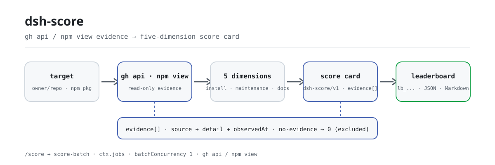

<div align="center">

<picture>
  <source media="(prefers-color-scheme: dark)" srcset="docs/assets/dsh-score-flow-dark.svg">
  
</picture>

# dsh-score

**Convierte cualquier repositorio o paquete npm en una tarjeta de calidad de cinco dimensiones con enlaces de evidencia: instalación, mantenimiento, documentación, seguridad y cumplimiento, cada punto trazable.**

Puntuador local para DeepSeek Harness: recoge evidencia solo con `gh api` y `npm view` — nunca instala, construye ni ejecuta el objetivo — y registra `no-evidence` en lugar de inventar un número.

[Instalar](#instalación-en-tres-pasos) · [Configuración](#configuración) · [FAQ](#faq) · [简体中文](README.md) · [English](README.en.md) · [Español](README.es.md) · [Português](README.pt.md) · [हिन्दी](README.hi.md)

[](LICENSE)
[](#compatibilidad)
[](https://www.npmjs.com/package/dsh-score)
[](https://github.com/PerryLink/dsh-score/actions/workflows/ci.yml)
[](#compatibilidad)

[](https://github.com/PerryLink/dsh-score/stargazers)
[](https://www.npmjs.com/package/dsh-score)
[](https://dshfind.com/plugins/PerryLink/dsh-score?ref=badge)
[](https://securityscorecards.dev/viewer/?uri=github.com/PerryLink/dsh-score)
[](https://dsh.market/)
[](https://gitee.com/perrylink/dsh-score)

```sh
dsh plugin --profile <name> add dsh-score
```

</div>

<sub>Plugin de la comunidad, no afiliado a DeepSeek. Repositorio canónico: <https://github.com/PerryLink/dsh-score> (Gitee es un espejo).</sub>

## Qué es

`dsh-score` es un puntuador de calidad local para DeepSeek Harness: dale un repositorio de GitHub o un paquete npm y ejecuta las cinco dimensiones — éxito de instalación, mantenimiento, documentación, seguridad y cumplimiento — y devuelve una tarjeta estructurada (`schema: "dsh-score/v1"`) o una tabla JSON + Markdown. Cada conclusión sale de salida real de `gh`/`npm` y cada evidencia lleva `source`, `detail` saneado y `observedAt`; una dimensión sin evidencia reporta `no-evidence` (puntuación 0, excluida del total ponderado) en vez de un número inventado. La puntuación es solo bajo demanda: no se instala, construye ni ejecuta nada. Este plugin es el puntuador local bajo demanda; la capa de evidencia pública vive en [`dsh-attention-index`](https://github.com/PerryLink/dsh-attention-index).

## Instalación en tres pasos

1. **Instalar** (elige un canal):

   ```sh
   # canal git (main más reciente; equivale a git+https://github.com/PerryLink/dsh-score.git)
   dsh plugin --profile web add github:PerryLink/dsh-score#<commit-sha>
   # canal npm (versiones publicadas)
   dsh plugin --profile web add dsh-score
   ```

   El primer `add` por el canal git falla porque pnpm bloquea el build `prepare` del paquete; copia la clave exacta que imprimió pnpm en el `pnpm-workspace.yaml` del perfil y reintenta:

   ```yaml
   allowBuilds:
     'dsh-score': true
   ```

   Los paquetes precompilados del canal npm no necesitan permiso de build.

2. **Configuración mínima** (los valores por defecto funcionan; añade claves solo para cambiar umbrales o pesos):

   ```yaml
   - insert:
       - id: score
         name: dsh-score
         config:
           weights:
             install: 25
             maintenance: 20
             documentation: 20
             security: 20
             compliance: 15
   ```

3. **Verificar que monta**:

   ```sh
   dsh --profile web --dump-config | grep -A2 'id: score'
   ```

   ```
   > /score owner/repo
   [1/1] owner/repo → B (88/100, healthy (weighted total 88/100))
   ```

   *Observed from `src/batch.ts:70`*

**Desinstalar**: `dsh plugin --profile web remove dsh-score` (o elimina la fila del patch del perfil).

> `dsh-score` no incluye el stack de storage. Cuando la composición no tiene `storageDomain`, las herramientas siguen funcionando y la persistencia de puntuaciones se desactiva con un motivo registrado; el bundle publicado `dsh-base` monta storage-domain desde `0.1.2-rc.1` (verificado con los tarballs `0.1.2-rc.1` y `0.1.5-alpha.1`), así que la persistencia está activa en la línea publicada.

## Capacidades clave

`dsh-score` comprime «¿se puede instalar, sigue mantenido, están completos los docs, es seguro, cumple el protocolo?» en una tarjeta revisable:

- **Cinco dimensiones** — éxito de instalación `25`, mantenimiento `20`, documentación `20`, seguridad `20`, cumplimiento `15` (pesos configurables; los valores por defecto suman 100).
- **Disciplina de evidencia** — cada dimensión registra sus enlaces de auditoría (`source`, `detail` saneado, `observedAt`); una dimensión sin evidencia reporta `no-evidence` (puntuación 0, excluida del total ponderado) y nunca un número inventado.
- **Resultados estructurados** — cada registro lleva `schema: "dsh-score/v1"` con campos de primera clase; es el contrato legible por máquina que consume el tooling aguas abajo.
- **Tabla por lotes** — `/score` entrega una lista de objetivos a un trabajo `score-batch` sobre `ctx.jobs` y produce una instantánea de tabla JSON + Markdown.
- **Caché y refresco** — las tarjetas se cachean por objetivo (24 horas por defecto); `refresh: true` omite la caché y vuelve a recoger evidencia.
- **Insignia embebible** — `score_badge` devuelve una insignia shields.io (endpoint / SVG / Markdown) más el JSON de cinco dimensiones; la insignia total se pega directamente en cualquier README.

```text
objetivo ──gh api / npm view──▶ cinco dimensiones de evidencia ──ponderado──▶ tarjeta dsh-score/v1 ──▶ tabla lb_...
                                      │
                                      └─ sin evidencia → no-evidence (0, excluida)
```

## Herramientas y resultados

### Superficie de herramientas

| Entrada | Tipo | Notas |
|---|---|---|
| `score` | herramienta | Puntúa un objetivo por las cinco dimensiones; `refresh: true` omite la caché, `background: true` inicia un trabajo `score-batch` |
| `/score <targets...>` | comando | Puntúa una lista separada por espacios/comas; el progreso sale por la salida del trabajo y la última línea nombra el `lb_...` para `score_report` |
| `score_report` | herramienta | Recupera una tarjeta (`sc_...`), una tabla (`lb_...`) o, sin id, la última tabla |
| `score_badge` | herramienta | Genera una insignia shields.io y el JSON de cinco dimensiones para un objetivo o una tarjeta guardada |
| `score-batch` | trabajo en segundo plano | Trabajo por lotes sobre `ctx.jobs`; puntúa en serie y escribe la instantánea de la tabla |

### Parámetros de las herramientas

```
score(target: string, refresh?: boolean, background?: boolean)
```

- `target` — un repositorio de GitHub (`github:owner/repo`, `owner/repo`, URL git/https) o un nombre de paquete npm.
- `refresh: true` — omite la caché y vuelve a recoger evidencia.
- `background: true` — inicia un trabajo `score-batch` y devuelve su id.

`score_report(id?)` devuelve una tarjeta (`sc_...`), una tabla (`lb_...`) o, sin id, la última tabla.

`score_badge(target? | id?, refresh?)`:

- `target` — puntúa un repositorio de GitHub o un paquete npm a través de la caché y le pone insignia; mutuamente excluyente con `id`.
- `id` — pone insignia a una tarjeta almacenada (`sc_...`) sin volver a puntuar.
- `refresh: true` — omite la caché de puntuación (solo aplica a `target`).

### Ejemplo de tarjeta

Estos son los puntos de entrada reales; instala una vez y llama a uno.

**Comando**:

~~~sh
score({ target: "owner/repo" })
~~~

**Salida**:

~~~text
# Score sc_65e817eec8cd71ed

- Target: `owner/repo` (repo)
- Grade: **B** — total 88/100
- Verdict: healthy (weighted total 88/100)

| Dimension | Status | Score | Weight | Summary |
|---|---|---|---|---|
| Install success | ⬜ no-evidence | 0 | 25 | no dsh-test-drive result recorded for this target (install success unmeasured) |
| Maintenance | ✅ pass | 100 | 20 | active (2026-08-15T00:00:00.000Z; 0 open issues) |
| Documentation | 🟠 warn | 70 | 20 | 1/4 language READMEs + CHANGELOG + SECURITY |
| Security | ✅ pass | 100 | 20 | license MIT |
| Protocol compliance | ✅ pass | 81 | 15 | dsh.bundle.patch declared |
~~~

*Observed from `README.md:141-149,169-191; tests/tools.spec.ts:64-65; tests/score.spec.ts:50-55; src/report.ts:40-53`*

**Rama de fallo** — entrada:

~~~text
{"id":"sc_nope"}
~~~

Salida:

~~~text
isError=true; error.message=dsh-score: no score recorded with id sc_nope
~~~

*Observed from `plugins/dsh-score/src/tools.ts:351-354 (throw); plugins/dsh-score/tests/tools.spec.ts:95-99 (unknown id); plugins/dsh-score/README.md:179-181 (score_report); exercised through plugins/dsh-score/tests/harness.ts`*

**Ejemplos breves**: `score({ target: "owner/dsh-click" })` · `score_report("sc_65e817eec8cd71ed")` · `score_badge("owner/dsh-click")`

### Resultado estructurado

```json
{
  "schema": "dsh-score/v1",
  "scoreId": "sc_8f1c2e4a9b3d7f01",
  "target": { "kind": "repo", "spec": "github:owner/dsh-click#abc123" },
  "scoredAt": "2026-08-16T00:00:00.000Z",
  "durationMs": 3210,
  "pluginVersion": "0.2.22",
  "dimensions": {
    "install": { "dimension": "install", "status": "no-evidence", "score": 0, "weight": 25,
                 "summary": "no dsh-test-drive result recorded for this target (install success unmeasured)",
                 "evidence": [{ "source": "test-drive", "detail": "no test-drive record found in the test_drive domain", "observedAt": "2026-08-16T00:00:00.000Z" }] },
    "maintenance": { "dimension": "maintenance", "status": "pass", "score": 100, "weight": 20,
                     "summary": "active (2026-08-10T00:00:00Z; 0 open issues)",
                     "evidence": [{ "source": "gh-api", "detail": "last activity 2026-08-10T00:00:00Z", "observedAt": "2026-08-16T00:00:00.000Z" }] }
  },
  "total": 88,
  "grade": "B",
  "verdict": "healthy (weighted total 88/100)"
}
```

Puntuación: el total es una media ponderada sobre las dimensiones con evidencia (las dimensiones no-evidence se excluyen y se renormalizan); `A` ≥ 90, `B` ≥ 75, `C` ≥ 60, `D` ≥ 40, si no `F`, y `N/A` cuando nada tuvo evidencia.

### Insignia y JSON de cinco dimensiones

`score_badge` genera una insignia embebible en README y el JSON de cinco dimensiones para un objetivo puntuado. La insignia tiene tres formas derivadas de la misma tarjeta: **endpoint** (URL estática documentada de shields.io, sin auto-hospedaje), **SVG** (SVG plano autocontenido de shields.io, campo `badge.svg` / `renderScoreBadge`, para READMEs offline o auto-hospedados) y **Markdown** (el fragmento que combina ambos).

Inserta la insignia total:

```markdown

```

La misma llamada devuelve el sobre JSON compacto (`schema: "dsh-score/badge/v1"`):

```json
{
  "schema": "dsh-score/badge/v1",
  "target": { "kind": "repo", "spec": "github:owner/dsh-click#abc123" },
  "scoredAt": "2026-08-16T00:00:00.000Z",
  "total": 84,
  "grade": "B",
  "dimensions": {
    "install":      { "label": "install", "status": "no-evidence", "score": 0,  "weight": 25, "summary": "no dsh-test-drive result recorded" },
    "maintenance":  { "label": "maintenance", "status": "pass", "score": 90, "weight": 20, "summary": "active (0 open issues)" },
    "documentation": { "label": "docs", "status": "pass", "score": 85, "weight": 20, "summary": "README + CHANGELOG + SECURITY" },
    "security":     { "label": "security", "status": "warn", "score": 60, "weight": 20, "summary": "permissive license" },
    "compliance":   { "label": "compliance", "status": "pass", "score": 100, "weight": 15, "summary": "dsh.bundle.patch + dsh-plugin topic" }
  }
}
```

Una dimensión `no-evidence` conserva su estado honesto y puntúa 0 — la insignia y el JSON nunca inventan números.

## Configuración

Todas las claves son opcionales (valores por defecto mostrados); los valores inválidos fallan en voz alta al cargar.

Claves más usadas:

| Clave | Predeterminado | Descripción |
|---|---|---|
| `probeTimeoutMs` | `60000` | Plazo para un comando de sondeo `gh`/`npm` (ms) |
| `outputTailBytes` | `8000` | Tope de la cola de salida saneada por sondeo (bytes) |
| `cacheMaxAgeMs` | `86400000` | Tiempo de reutilización de una tarjeta cacheada antes de re-puntuar (0 desactiva la caché) |
| `staleCommitWarnDays` | `90` | Edad de commit/publicación a la que el mantenimiento baja a `warn` |
| `staleCommitFailDays` | `365` | Edad de commit/publicación a la que el mantenimiento baja a `fail` |
| `maxBatchTargets` | `20` | Tope de objetivos por lote de `/score` |
| `batchConcurrency` | `1` | Concurrencia del lote (serial por defecto, evita competir por la tasa de la API) |
| `weights` | `{install:25, maintenance:20, documentation:20, security:20, compliance:15}` | Pesos por dimensión (cada uno 0–100; al menos uno > 0) |

<details>
<summary>Tabla de configuración completa (10 claves)</summary>

| Clave | Predeterminado | Descripción |
|---|---|---|
| `probeTimeoutMs` | `60000` | Plazo para un comando de sondeo `gh`/`npm` (ms) |
| `outputTailBytes` | `8000` | Tope de la cola de salida saneada por sondeo (bytes) |
| `cacheMaxAgeMs` | `86400000` | Tiempo de reutilización de una tarjeta cacheada antes de re-puntuar (0 desactiva la caché) |
| `staleCommitWarnDays` | `90` | Edad de commit/publicación a la que el mantenimiento baja a `warn` |
| `staleCommitFailDays` | `365` | Edad de commit/publicación a la que el mantenimiento baja a `fail` |
| `staleIssueWarnDays` | `30` | Edad del issue abierto más antiguo (proxy de respuesta) a la que el mantenimiento baja a `warn` |
| `staleIssueFailDays` | `180` | Edad del issue abierto más antiguo a la que el mantenimiento baja a `fail` |
| `maxBatchTargets` | `20` | Tope de objetivos por lote de `/score` |
| `batchConcurrency` | `1` | Concurrencia del lote (serial por defecto, evita competir por la tasa de la API) |
| `weights` | `{install:25, maintenance:20, documentation:20, security:20, compliance:15}` | Pesos por dimensión (cada uno 0–100; al menos uno > 0) |

</details>

Ejemplo de override en el patch del perfil:

```yaml
- insert:
    - id: score
      name: dsh-score
      config:
        cacheMaxAgeMs: 0
        maxBatchTargets: 10
        weights:
          install: 25
          maintenance: 20
          documentation: 20
          security: 20
          compliance: 15
```

## FAQ

<details>
<summary>¿Dónde viven las tarjetas y tablas? ¿Se pierden sin storage?</summary>

Las tarjetas y tablas se guardan en el dominio de storage `score` (tablas `scores`, `leaderboards`, más el puntero a la última tabla). Cuando la composición no tiene `storageDomain` (por ejemplo, un perfil headless anterior a las filas de storage del bundle base), las herramientas siguen funcionando pero la persistencia se desactiva con un motivo registrado. El bundle publicado `dsh-base` monta storage-domain desde `0.1.2-rc.1` (verificado con los tarballs `0.1.2-rc.1` y `0.1.5-alpha.1`), así que la persistencia está activa en la línea publicada.

</details>

<details>
<summary>Cuando falta evidencia, ¿se inventa una puntuación?</summary>

No. Un sondeo fallido, una salida no parseable o un objetivo sin repositorio de GitHub resoluble hacen que esa dimensión reporte `no-evidence` (puntuación 0, excluida del total ponderado y renormalizada); si nada tiene evidencia, el total es `N/A`. Una dimensión `no-evidence` además lleva el motivo del fallo (`exit N`, `timeout`, la cola de stderr saneada o `invalid JSON`) en lugar de un número inventado.

</details>

<details>
<summary>¿Instala, construye o ejecuta el paquete objetivo?</summary>

No. La canalización solo ejecuta los comandos de solo lectura `gh api` y `npm view`; nunca instala, construye ni ejecuta el objetivo. Cada invocación CLI es un array argv, nunca interpretado por un shell, y los segmentos `owner`/`repo` se validan contra un conjunto de caracteres restringido antes de llegar a un endpoint.

</details>

<details>
<summary>¿Pueden filtrarse credenciales a los informes o logs?</summary>

No. Los procesos hijos heredan un entorno sin credenciales y `gh` usa su propio almacén; ningún valor de entorno se registra. Todas las cadenas de informe/log pasan por saneadores puros: literales de token, credenciales de URL y cabeceras bearer se redactan, y las colas de salida se recortan por bytes.

</details>

<details>
<summary>¿Cuánto cuesta puntuar? ¿Se puede agotar la tasa de la API de GitHub?</summary>

Las tarjetas se cachean por objetivo (`cacheMaxAgeMs` = 24 horas por defecto), así que las consultas repetidas no vuelven a recoger evidencia; usa `refresh: true` o pon la edad de caché a 0 cuando necesites datos frescos. `/score` usa `batchConcurrency: 1` (serial) por defecto para evitar que sondeos concurrentes compitan por la cuota de la API, y un sondeo espera como máximo `probeTimeoutMs` (60 segundos por defecto).

</details>

## Límites de seguridad

- **Sin ejecución de código.** La canalización solo ejecuta `gh api` y `npm view`; nunca instala, construye ni ejecuta un objetivo.
- **Subprocesos solo argv.** Cada invocación CLI es un array argv, nunca interpretado por un shell; los segmentos owner/repo se validan contra un conjunto de caracteres restringido antes de usarse en un endpoint.
- **Disciplina de evidencia.** No se fabrica ninguna puntuación: un sondeo fallido o con salida no parseable produce `no-evidence`, nunca un número.
- **Detección vs saneado.** La detección de fugas de secretos y scripts de instalación maliciosos comparte las mismas regex puras que el saneado; ambas tienen tests unitarios con entradas extremas.

## Permisos y datos

- **Permisos**: solo se consumen servicios públicos — `ctx.subprocess`, `ctx.jobs`, `ctx.storageDomain`, `ctx.tools`, `ctx.commands`; el plugin no provee ninguna clave de servicio Cordis.
- **Datos**: las tarjetas y tablas viven en el dominio de storage `score` (tablas `scores`, `leaderboards`, más el puntero a la última tabla). Sin `storageDomain` las herramientas siguen funcionando y la persistencia se desactiva con un motivo registrado.
- **Entorno**: los procesos hijos heredan un entorno sin credenciales; `gh` lee su propio almacén. Ningún valor de entorno se registra y todas las cadenas de informe/log pasan por saneadores puros con colas recortadas por bytes.

## Limitaciones conocidas

- Los sondeos de repositorio requieren `gh` autenticado y red; los de npm requieren `npm` y acceso al registry.
- Sin un repositorio de GitHub resoluble, documentación/seguridad/cumplimiento reportan `no-evidence`.
- El éxito de instalación depende de `dsh-test-drive` montado con el objetivo registrado; si no, es honestamente `no-evidence`.
- La «respuesta a issues» del mantenimiento es un proxy (edad del issue abierto más antiguo), no una medición directa del tiempo de respuesta.
- Los resultados se cachean por objetivo; usa `refresh: true` (o espera a superar `cacheMaxAgeMs`) para forzar la re-puntuación.

## Interoperabilidad con otros plugins DSH

`dsh-score` solo expone su propia superficie de puntuación y nunca ocupa el carril de otro plugin:

- **Superficie propia.** Registra exactamente tres herramientas (`score`, `score_report`, `score_badge`) y un comando (`/score`), todas vía `ctx.effect`, así que parar/recargar en caliente las retira.
- **Sin clave de servicio.** `inject` declara solo `tools`, `commands`, `subprocess` y `jobs`; `storageDomain` se lee opcionalmente con `ctx.get` y nunca se exige.
- **Sin carril de cliente.** No registra ninguna clave de slot de cliente ni prefijo de ruta `webServer`.
- **Sin colisión de patch.** El patch del bundle solo `insert`a su propia fila (`id: score`); nunca sobrescribe el `config` de una fila integrada.
- **Sin mutación global.** No parchea prototipos, no reescribe `process.env` ni reemplaza el dispatcher global de fetch.
- **Sin listeners de eventos compartidos.** No registra ningún listener waterfall (incluido `agent/pre-step`), así que no participa en el orden de la cadena de eventos y no puede cortocircuitar la de otro plugin.

Evidencia estática: la insignia de verificación de `dsh-plugin-doctor` se alimenta de la salida de CI de este repositorio (ver «Ecosistema y calidad»).

## Compatibilidad

| Componente | Versión |
|---|---|
| DeepSeek Harness | **`dsh-v0.2.2-rc.1`** (tag de GitHub). El gate `engines.dsh` es `>=0.2.1-0 <0.3.0 \|\| >=0.2.2-0 <0.3.0`; los pins de dev/test y la regla `typecheck:ci` miden `0.2.2-rc.1`. El seam `ctx.jobs` usa el contrato `SessionId`. |
| Node.js | `^22.19.0 \|\| >=24.9.0` |
| Gestor de paquetes | `pnpm@11.7.0` |
| Plataforma | Windows / macOS / Linux (plugin solo host) |
| Herramientas externas | CLI `gh` en PATH (autenticado para lecturas de API), CLI `npm` en PATH |

## Ecosistema y calidad

- [Espejo en Gitee](https://gitee.com/perrylink/dsh-score) (espejo sincronizado; GitHub es el canónico)
- [Página de dshfind](https://dshfind.com/plugins/PerryLink/dsh-score) (instalaciones y ranking)
- [Informe OpenSSF Scorecard](https://securityscorecards.dev/viewer/?uri=github.com/PerryLink/dsh-score) (impulsado por [.github/workflows/scorecard.yml](.github/workflows/scorecard.yml))
- [Informe de verificación de dsh-plugin-doctor](https://github.com/PerryLink/dsh-plugin-doctor#verified-徽章) (fuente de la insignia)
- [DSH Market](https://dsh.market/) (listado)
- **Canal de la tienda 1024**: `npm i -g dsh1024` una vez y luego `dsh1024 plugin --profile web add dsh-score` (cuenta para el ranking de instalaciones de [deepseek1024.com](https://deepseek1024.com))
- [Base de conocimiento del ecosistema](https://perrylink.github.io/dsh-plugin-guide/): datos medidos, no marketing — guía de desarrollo de plugins · datos de selección · criterios de mantenimiento

## Desarrollo

```sh
pnpm install                                       # node ^22.19 || >=24.9
pnpm run typecheck && pnpm run typecheck:ci && pnpm test   # cara checkout local + cara línea publicada + vitest
pnpm run build && pnpm run verify:self-contained && pnpm run verify:artifacts && pnpm pack
pnpm run check:readmes                             # consistencia de los README en cinco idiomas
```

- `typecheck` resuelve `@deepseek-ai/*` a través del checkout local del harness; `typecheck:ci` comprueba contra los tipos publicados `0.2.2-rc.1`.
- Los tests usan el `Context`/`Session`/`ToolRuntime`/`LocalJobRegistry`/stack de storage reales con un proveedor de subprocesos scriptado.
- Puntuación con CLI real (requiere `gh`/`npm` en PATH y `gh` autenticado): invoca `score` desde un perfil montado.
- Release: `node scripts/release.mjs <x.y.z>` (sube versión, sella CHANGELOG, re-ejecuta el gate, commit + tag; nunca push).
- Las imágenes del README se generan programáticamente con [`scripts/gen-readme-assets.py`](scripts/gen-readme-assets.py) (Python + Pillow), se pueden re-ejecutar; escribe `docs/assets/dsh-score-flow-{light,dark}.svg`.

Temas: `dsh`, `dsh-plugin`, `deepseek-harness`, `deepseek`, `cordis`, `plugin-scoring`, `quality-score`, `leaderboard`, `supply-chain`

## Familia y agradecimientos

Este proyecto forma parte de la familia de plugins de DeepSeek Harness de [PerryLink](https://github.com/PerryLink) (todos Apache-2.0). Si te resulta útil, **una estrella ayuda a que la siguiente persona lo encuentre** — no desbloquea ninguna función.

- [@PerryLink](https://github.com/PerryLink) — creador y mantenedor: la canalización de cinco dimensiones, los sondeos de evidencia `gh`/`npm`, el contrato estructurado `dsh-score/v1`, el trabajo por lotes `/score`, la insignia y la documentación en cinco idiomas.

<details>
<summary>Expandir todos los plugins</summary>

| Plugin | Estado |
|---|---|
| **[dsh-aqua-input-check](https://github.com/PerryLink/dsh-aqua-input-check)** |  |
| **[dsh-archive-check](https://github.com/PerryLink/dsh-archive-check)** |  |
| **[dsh-auto-review](https://github.com/PerryLink/dsh-auto-review)** |  |
| **[dsh-autotier](https://github.com/PerryLink/dsh-autotier)** | 🧊 CONGELADO — ver el README del repo |
| **[dsh-bid-ca-precheck](https://github.com/PerryLink/dsh-bid-ca-precheck)** |  |
| **[dsh-bid-qual-check](https://github.com/PerryLink/dsh-bid-qual-check)** |  |
| **[dsh-cert-mcp](https://github.com/PerryLink/dsh-cert-mcp)** | 🧊 CONGELADO — ver el README del repo |
| **[dsh-checkpoint-rewind](https://github.com/PerryLink/dsh-checkpoint-rewind)** |  |
| **[dsh-click](https://github.com/PerryLink/dsh-click)** |  |
| **[dsh-composer-history](https://github.com/PerryLink/dsh-composer-history)** |  |
| **[dsh-contract-stance](https://github.com/PerryLink/dsh-contract-stance)** |  |
| **[dsh-customs-doc-check](https://github.com/PerryLink/dsh-customs-doc-check)** |  |
| **[dsh-data-quality](https://github.com/PerryLink/dsh-data-quality)** | 🧊 CONGELADO — ver el README del repo |
| **[dsh-demurrage-ledger](https://github.com/PerryLink/dsh-demurrage-ledger)** |  |
| **[dsh-doublecheck](https://github.com/PerryLink/dsh-doublecheck)** |  |
| **[dsh-drill-script-check](https://github.com/PerryLink/dsh-drill-script-check)** |  |
| **[dsh-eia-guide-check](https://github.com/PerryLink/dsh-eia-guide-check)** |  |
| **[dsh-emergency-plan](https://github.com/PerryLink/dsh-emergency-plan)** |  |
| **[dsh-essay-rubric-check](https://github.com/PerryLink/dsh-essay-rubric-check)** |  |
| **[dsh-evidence-check](https://github.com/PerryLink/dsh-evidence-check)** |  |
| **[dsh-export-ctl-check](https://github.com/PerryLink/dsh-export-ctl-check)** |  |
| **[dsh-fast](https://github.com/PerryLink/dsh-fast)** |  |
| **[dsh-fmea-table-check](https://github.com/PerryLink/dsh-fmea-table-check)** |  |
| **[dsh-forecast-penalty](https://github.com/PerryLink/dsh-forecast-penalty)** |  |
| **[dsh-fund-research](https://github.com/PerryLink/dsh-fund-research)** |  |
| **[dsh-github](https://github.com/PerryLink/dsh-github)** |  |
| **[dsh-gongwen-flow-check](https://github.com/PerryLink/dsh-gongwen-flow-check)** |  |
| **[dsh-gongwen-word-check](https://github.com/PerryLink/dsh-gongwen-word-check)** |  |
| **[dsh-guard-plan-qc](https://github.com/PerryLink/dsh-guard-plan-qc)** |  |
| **[dsh-hazchem-check](https://github.com/PerryLink/dsh-hazchem-check)** |  |
| **[dsh-hazplan-check](https://github.com/PerryLink/dsh-hazplan-check)** |  |
| **[dsh-hidden-risk-map](https://github.com/PerryLink/dsh-hidden-risk-map)** |  |
| **[dsh-hs-classify](https://github.com/PerryLink/dsh-hs-classify)** |  |
| **[dsh-icd-rule-check](https://github.com/PerryLink/dsh-icd-rule-check)** |  |
| **[dsh-industry-research](https://github.com/PerryLink/dsh-industry-research)** |  |
| **[dsh-lawcite-adapter](https://github.com/PerryLink/dsh-lawcite-adapter)** |  |
| **[dsh-laya](https://github.com/PerryLink/dsh-laya)** |  |
| **[dsh-lc-doc-check](https://github.com/PerryLink/dsh-lc-doc-check)** |  |
| **[dsh-learning-gap-check](https://github.com/PerryLink/dsh-learning-gap-check)** |  |
| **[dsh-library](https://github.com/PerryLink/dsh-library)** |  |
| **[dsh-local-ai](https://github.com/PerryLink/dsh-local-ai)** |  |
| **[dsh-lsp-actions](https://github.com/PerryLink/dsh-lsp-actions)** |  |
| **[dsh-mask](https://github.com/PerryLink/dsh-mask)** |  |
| **[dsh-mcp-panel](https://github.com/PerryLink/dsh-mcp-panel)** |  |
| **[dsh-medrec-qc](https://github.com/PerryLink/dsh-medrec-qc)** |  |
| **[dsh-memento](https://github.com/PerryLink/dsh-memento)** | 🧊 CONGELADO — ver el README del repo |
| **[dsh-nsfc-form-check](https://github.com/PerryLink/dsh-nsfc-form-check)** |  |
| **[dsh-nurse-record-check](https://github.com/PerryLink/dsh-nurse-record-check)** |  |
| **[dsh-observe](https://github.com/PerryLink/dsh-observe)** |  |
| **[dsh-origin-rvc-check](https://github.com/PerryLink/dsh-origin-rvc-check)** |  |
| **[dsh-ota-review-check](https://github.com/PerryLink/dsh-ota-review-check)** |  |
| **[dsh-output-styles](https://github.com/PerryLink/dsh-output-styles)** |  |
| **[dsh-paper-doc-adapter](https://github.com/PerryLink/dsh-paper-doc-adapter)** |  |
| **[dsh-permission-rules](https://github.com/PerryLink/dsh-permission-rules)** |  |
| **[dsh-permit-report-check](https://github.com/PerryLink/dsh-permit-report-check)** |  |
| **[dsh-pipeline-check](https://github.com/PerryLink/dsh-pipeline-check)** |  |
| **[dsh-pleading-draft](https://github.com/PerryLink/dsh-pleading-draft)** |  |
| **[dsh-plugin-doctor](https://github.com/PerryLink/dsh-plugin-doctor)** | 🚫 RETIRADO (repo archivado) |
| **[dsh-plugin-guide](https://github.com/PerryLink/dsh-plugin-guide)** |  |
| **[dsh-plugin-kit](https://github.com/PerryLink/dsh-plugin-kit)** | 🚫 RETIRADO (repo archivado) |
| **[dsh-plugin-upgrade](https://github.com/PerryLink/dsh-plugin-upgrade)** | 🚫 RETIRADO (repo archivado) |
| **[dsh-policy-brief-draft](https://github.com/PerryLink/dsh-policy-brief-draft)** |  |
| **[dsh-power-loss-split](https://github.com/PerryLink/dsh-power-loss-split)** |  |
| **[dsh-power-ticket-check](https://github.com/PerryLink/dsh-power-ticket-check)** |  |
| **[dsh-ppap-check](https://github.com/PerryLink/dsh-ppap-check)** |  |
| **[dsh-protest-deadline](https://github.com/PerryLink/dsh-protest-deadline)** |  |
| **[dsh-railway-window](https://github.com/PerryLink/dsh-railway-window)** |  |
| **[dsh-repair-order-qc](https://github.com/PerryLink/dsh-repair-order-qc)** |  |
| **[dsh-research-report](https://github.com/PerryLink/dsh-research-report)** |  |
| **[dsh-review-reply-check](https://github.com/PerryLink/dsh-review-reply-check)** |  |
| **[dsh-rulefile-check](https://github.com/PerryLink/dsh-rulefile-check)** |  |
| **[dsh-safety-brief-check](https://github.com/PerryLink/dsh-safety-brief-check)** |  |
| **[dsh-score](https://github.com/PerryLink/dsh-score)** | 🧊 CONGELADO — ver el README del repo |
| **[dsh-session-sync](https://github.com/PerryLink/dsh-session-sync)** |  |
| **[dsh-site-log-check](https://github.com/PerryLink/dsh-site-log-check)** |  |
| **[dsh-skill-pack-security](https://github.com/PerryLink/dsh-skill-pack-security)** |  |
| **[dsh-soe-decision-check](https://github.com/PerryLink/dsh-soe-decision-check)** |  |
| **[dsh-soilwater-check](https://github.com/PerryLink/dsh-soilwater-check)** |  |
| **[dsh-sop-sync-check](https://github.com/PerryLink/dsh-sop-sync-check)** |  |
| **[dsh-spc-gbt-adapter](https://github.com/PerryLink/dsh-spc-gbt-adapter)** |  |
| **[dsh-talk](https://github.com/PerryLink/dsh-talk)** |  |
| **[dsh-tender-extract](https://github.com/PerryLink/dsh-tender-extract)** |  |
| **[dsh-tender-matrix](https://github.com/PerryLink/dsh-tender-matrix)** |  |
| **[dsh-test-drive](https://github.com/PerryLink/dsh-test-drive)** |  |
| **[dsh-ticktick](https://github.com/PerryLink/dsh-ticktick)** | 🚫 RETIRADO (repo archivado) |
| **[dsh-translate](https://github.com/PerryLink/dsh-translate)** |  |
| **[dsh-warranty-calc](https://github.com/PerryLink/dsh-warranty-calc)** |  |
| **[dsh-budget](https://github.com/PerryLink/dsh-budget)** | 🧊 CONGELADO — ver el README del repo |
| **[dsh-claude-move](https://github.com/PerryLink/dsh-claude-move)** | 🧊 CONGELADO — ver el README del repo |
| **[dsh-defend](https://github.com/PerryLink/dsh-defend)** | 🧊 CONGELADO — ver el README del repo |
| **[dsh-draw](https://github.com/PerryLink/dsh-draw)** | 🧊 CONGELADO — ver el README del repo |
| **[dsh-reach](https://github.com/PerryLink/dsh-reach)** | 🧊 CONGELADO — ver el README del repo |
| **[dsh-background-agents](https://github.com/PerryLink/dsh-background-agents)** | 🚫 RETIRADO (repo archivado) |
| **[dsh-session-pin](https://github.com/PerryLink/dsh-session-pin)** | 🚫 RETIRADO (repo archivado) |
| **[dsh-team-rooms](https://github.com/PerryLink/dsh-team-rooms)** | 🚫 RETIRADO (repo archivado) |

</details>

## Licencia

[LICENSE](LICENSE) (Apache License 2.0) © 2026 dsh-score contributors

<p align="center"><sub>Apache-2.0 · Plugin de la comunidad, no afiliado a DeepSeek.</sub></p>
