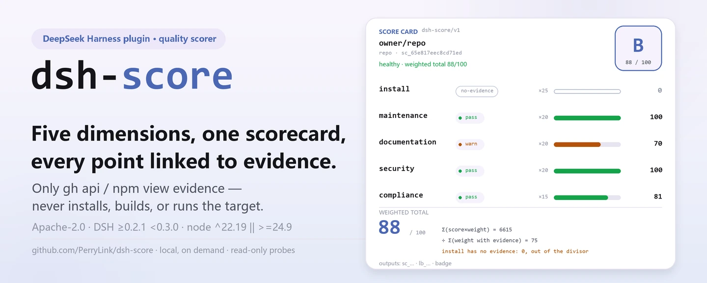
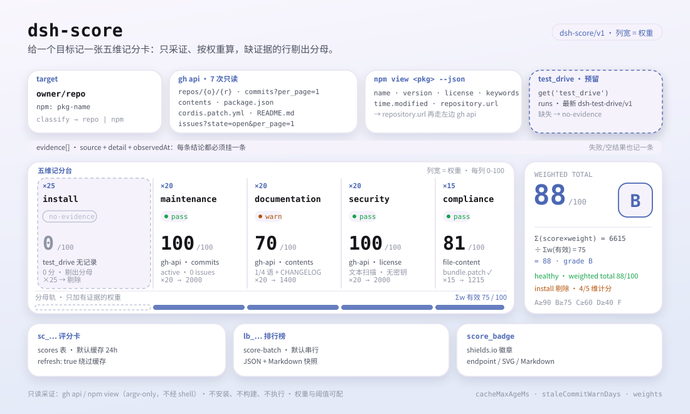

<div align="center">

<picture>
  <source media="(prefers-color-scheme: dark)" srcset="docs/assets/dsh-score-hero-en-dark.webp">
  
</picture>

# dsh-score

**किसी भी रिपॉज़िटरी या npm पैकेज को साक्ष्य-लिंक वाले पाँच-आयामी गुणवत्ता कार्ड में बदलें — इंस्टॉल, रखरखाव, दस्तावेज़, सुरक्षा, अनुपालन; हर अंक ट्रेस करने योग्य।**

DeepSeek Harness के लिए स्थानीय स्कोरर: साक्ष्य केवल `gh api` और `npm view` से इकट्ठा करता है — लक्ष्य को कभी इंस्टॉल, बिल्ड या चलाता नहीं — और संख्या गढ़ने के बजाय `no-evidence` दर्ज करता है।

[इंस्टॉल](#तीन-चरणों-में-शुरुआत) · [कॉन्फ़िगरेशन](#कॉन्फ़िगरेशन) · [FAQ](#faq) · [简体中文](README.md) · [English](README.en.md) · [Español](README.es.md) · [Português](README.pt.md) · [हिन्दी](README.hi.md)

[](LICENSE)
[](#संगतता)
[](https://www.npmjs.com/package/dsh-score)
[](https://github.com/PerryLink/dsh-score/actions/workflows/ci.yml)
[](#संगतता)

[](https://github.com/PerryLink/dsh-score/stargazers)
[](https://www.npmjs.com/package/dsh-score)
[](https://dshfind.com/plugins/PerryLink/dsh-score?ref=badge)
[](https://securityscorecards.dev/viewer/?uri=github.com/PerryLink/dsh-score)
[](https://dsh.market/)
[](https://gitee.com/perrylink/dsh-score)

```sh
dsh plugin --profile <name> add dsh-score
```

</div>

<sub>सामुदायिक प्लगइन, DeepSeek से आधिकारिक रूप से संबद्ध नहीं। एकमात्र रेपो: <https://github.com/PerryLink/dsh-score> (Gitee प्रतिबिंब है)।</sub>

## यह क्या है

`dsh-score` DeepSeek Harness के लिए एक स्थानीय गुणवत्ता स्कोरर है: इसे कोई GitHub रिपॉज़िटरी या npm पैकेज दें, और यह इंस्टॉल सफलता, रखरखाव, दस्तावेज़ीकरण, सुरक्षा और अनुपालन — पाँचों आयाम चलाकर एक संरचित स्कोर कार्ड (`schema: "dsh-score/v1"`) या JSON + Markdown लीडरबोर्ड लौटाता है। हर निष्कर्ष वास्तविक `gh`/`npm` आउटपुट से आता है और हर साक्ष्य के साथ `source`, सैनिटाइज़ किया `detail` और `observedAt` होता है; जिस आयाम को साक्ष्य नहीं मिलता वह अनुमानित संख्या के बजाय ईमानदारी से `no-evidence` (स्कोर 0, भारित कुल से बाहर) दर्ज करता है। स्कोरिंग पूरी तरह माँग पर है — कुछ भी इंस्टॉल, बिल्ड या चलाया नहीं जाता। यह प्लगइन स्थानीय ऑन-डिमांड स्कोरर है; सार्वजनिक साक्ष्य परत [`dsh-attention-index`](https://github.com/PerryLink/dsh-attention-index) में है।

<picture>
  <source media="(prefers-color-scheme: dark)" srcset="docs/assets/dsh-score-flow-v5-dark.svg">
  
</picture>

## तीन चरणों में शुरुआत

1. **इंस्टॉल** (कोई एक चैनल चुनें):

   ```sh
   # git चैनल (नवीनतम main; git+https://github.com/PerryLink/dsh-score.git के बराबर)
   dsh plugin --profile web add github:PerryLink/dsh-score#<commit-sha>
   # npm चैनल (प्रकाशित संस्करण)
   dsh plugin --profile web add dsh-score
   ```

   git चैनल से पहला `add` विफल होता है क्योंकि pnpm इस पैकेज का `prepare` बिल्ड रोकता है; pnpm द्वारा छापी गई सटीक कुंजी को profile के `pnpm-workspace.yaml` में कॉपी करके फिर चलाएँ:

   ```yaml
   allowBuilds:
     'dsh-score': true
   ```

   npm चैनल के पहले से बने पैकेजों को बिल्ड अनुमति नहीं चाहिए।

2. **न्यूनतम कॉन्फ़िग** (डिफ़ॉल्ट काम करते हैं; सीमा या भार बदलने पर ही कुंजियाँ जोड़ें):

   ```yaml
   - insert:
       - id: score
         name: dsh-score
         config:
           weights:
             install: 25
             maintenance: 20
             documentation: 20
             security: 20
             compliance: 15
   ```

3. **माउंट होने की पुष्टि**:

   ```sh
   dsh --profile web --dump-config | grep -A2 'id: score'
   ```

   ```
   > /score owner/repo
   [1/1] owner/repo → B (88/100, healthy (weighted total 88/100))
   ```

   *Observed from `src/batch.ts:70`*

**अनइंस्टॉल**: `dsh plugin --profile web remove dsh-score` (या profile patch से वह पंक्ति हटाएँ)।

> `dsh-score` storage स्टैक नहीं लाता। जब कंपोज़िशन में `storageDomain` न हो, टूल तब भी काम करते हैं और स्कोर स्थायित्व कारण सहित अक्षम रहता है; प्रकाशित `dsh-base` बंडल `0.1.2-rc.1` से storage-domain माउंट करता है (`0.1.2-rc.1` और `0.1.5-alpha.1` tarballs से सत्यापित), इसलिए प्रकाशित लाइन पर स्थायित्व सक्रिय है।

## मुख्य क्षमताएँ

`dsh-score` «क्या यह इंस्टॉल होता है, रखरखाव में है, दस्तावेज़ पूरे हैं, सुरक्षित है, प्रोटोकॉल का पालन करता है» को एक समीक्षा-योग्य स्कोर कार्ड में समेटता है:

- **पाँच आयाम** — इंस्टॉल सफलता `25`, रखरखाव `20`, दस्तावेज़ीकरण `20`, सुरक्षा `20`, अनुपालन `15` (भार विन्यास योग्य; डिफ़ॉल्ट योग 100)।
- **साक्ष्य अनुशासन** — हर आयाम अपने ऑडिट लिंक दर्ज करता है (`source`, सैनिटाइज़ `detail`, `observedAt`); साक्ष्य के बिना वह `no-evidence` (स्कोर 0, भारित कुल से बाहर) रिपोर्ट करता है, कभी बनाया हुआ नंबर नहीं।
- **संरचित परिणाम** — हर रिकॉर्ड `schema: "dsh-score/v1"` रखता है; यह डाउनस्ट्रीम टूलिंग के लिए मशीन-पठनीय अनुबंध है।
- **बैच लीडरबोर्ड** — `/score` लक्ष्य सूची को `ctx.jobs` पर `score-batch` कार्य सौंपता है और JSON + Markdown लीडरबोर्ड स्नैपशॉट बनाता है।
- **कैश और रीफ़्रेश** — स्कोर कार्ड प्रति लक्ष्य कैश होते हैं (डिफ़ॉल्ट 24 घंटे); `refresh: true` कैश छोड़कर साक्ष्य फिर इकट्ठा करता है।
- **एम्बेड करने योग्य बैज** — `score_badge` shields.io बैज (endpoint / SVG / Markdown) और पाँच-आयामी JSON देता है; कुल बैज सीधे किसी भी README में लगता है।

```text
लक्ष्य ──gh api / npm view──▶ पाँच आयामों का साक्ष्य ──भारित──▶ स्कोर कार्ड dsh-score/v1 ──▶ लीडरबोर्ड lb_...
                                    │
                                    └─ साक्ष्य नहीं → no-evidence (0, बाहर)
```

## टूल और परिणाम

### टूल सतह

| प्रवेश | प्रकार | नोट |
|---|---|---|
| `score` | टूल | एक लक्ष्य का पाँच-आयामी स्कोर; `refresh: true` कैश छोड़ता है, `background: true` `score-batch` कार्य शुरू करता है |
| `/score <targets...>` | कमांड | स्पेस/कॉमा से अलग लक्ष्य सूची का बैच स्कोर; प्रगति कार्य आउटपुट से, अंतिम पंक्ति `score_report` के लिए `lb_...` बताती है |
| `score_report` | टूल | स्कोर कार्ड (`sc_...`), लीडरबोर्ड (`lb_...`), या बिना id के नवीनतम लीडरबोर्ड लाता है |
| `score_badge` | टूल | किसी लक्ष्य या संग्रहीत कार्ड के लिए shields.io बैज और पाँच-आयामी JSON बनाता है |
| `score-batch` | पृष्ठभूमि कार्य | `ctx.jobs` पर बैच कार्य; श्रृंखलाबद्ध स्कोर करता है और लीडरबोर्ड स्नैपशॉट लिखता है |

### टूल पैरामीटर

```
score(target: string, refresh?: boolean, background?: boolean)
```

- `target` — कोई GitHub रिपॉज़िटरी (`github:owner/repo`, `owner/repo`, git/https URL) या npm पैकेज नाम।
- `refresh: true` — स्कोर कैश छोड़कर साक्ष्य फिर इकट्ठा करता है।
- `background: true` — एक `score-batch` कार्य शुरू करके उसका id लौटाता है।

`score_report(id?)` एक स्कोर कार्ड (`sc_...`), लीडरबोर्ड (`lb_...`), या बिना id के नवीनतम लीडरबोर्ड लौटाता है।

`score_badge(target? | id?, refresh?)`:

- `target` — कैश के माध्यम से GitHub रिपॉज़िटरी या npm पैकेज स्कोर कर बैज देता है; `id` के साथ परस्पर अनन्य।
- `id` — बिना पुनः स्कोर किए संग्रहीत कार्ड (`sc_...`) का बैज देता है।
- `refresh: true` — स्कोर कैश छोड़ता है (केवल `target` पर लागू)।

### स्कोर कार्ड उदाहरण

ये प्लगइन के वास्तविक प्रवेश हैं; एक बार इंस्टॉल करें और एक चलाएँ।

**कमांड**:

~~~sh
score({ target: "owner/repo" })
~~~

**आउटपुट**:

~~~text
# Score sc_65e817eec8cd71ed

- Target: `owner/repo` (repo)
- Grade: **B** — total 88/100
- Verdict: healthy (weighted total 88/100)

| Dimension | Status | Score | Weight | Summary |
|---|---|---|---|---|
| Install success | ⬜ no-evidence | 0 | 25 | no dsh-test-drive result recorded for this target (install success unmeasured) |
| Maintenance | ✅ pass | 100 | 20 | active (2026-08-15T00:00:00.000Z; 0 open issues) |
| Documentation | 🟠 warn | 70 | 20 | 1/4 language READMEs + CHANGELOG + SECURITY |
| Security | ✅ pass | 100 | 20 | license MIT |
| Protocol compliance | ✅ pass | 81 | 15 | dsh.bundle.patch declared |
~~~

*Observed from `README.md:141-149,169-191; tests/tools.spec.ts:64-65; tests/score.spec.ts:50-55; src/report.ts:40-53`*

**विफलता शाखा** — इनपुट:

~~~text
{"id":"sc_nope"}
~~~

आउटपुट:

~~~text
isError=true; error.message=dsh-score: no score recorded with id sc_nope
~~~

*Observed from `plugins/dsh-score/src/tools.ts:351-354 (throw); plugins/dsh-score/tests/tools.spec.ts:95-99 (unknown id); plugins/dsh-score/README.md:179-181 (score_report); exercised through plugins/dsh-score/tests/harness.ts`*

**संक्षिप्त उदाहरण**: `score({ target: "owner/dsh-click" })` · `score_report("sc_65e817eec8cd71ed")` · `score_badge("owner/dsh-click")`

### संरचित परिणाम

```json
{
  "schema": "dsh-score/v1",
  "scoreId": "sc_8f1c2e4a9b3d7f01",
  "target": { "kind": "repo", "spec": "github:owner/dsh-click#abc123" },
  "scoredAt": "2026-08-16T00:00:00.000Z",
  "durationMs": 3210,
  "pluginVersion": "0.2.22",
  "dimensions": {
    "install": { "dimension": "install", "status": "no-evidence", "score": 0, "weight": 25,
                 "summary": "no dsh-test-drive result recorded for this target (install success unmeasured)",
                 "evidence": [{ "source": "test-drive", "detail": "no test-drive record found in the test_drive domain", "observedAt": "2026-08-16T00:00:00.000Z" }] },
    "maintenance": { "dimension": "maintenance", "status": "pass", "score": 100, "weight": 20,
                     "summary": "active (2026-08-10T00:00:00Z; 0 open issues)",
                     "evidence": [{ "source": "gh-api", "detail": "last activity 2026-08-10T00:00:00Z", "observedAt": "2026-08-16T00:00:00.000Z" }] }
  },
  "total": 88,
  "grade": "B",
  "verdict": "healthy (weighted total 88/100)"
}
```

स्कोरिंग: कुल साक्ष्य जुटाने वाले आयामों का भारित औसत है (no-evidence आयाम बाहर होते हैं और पुनः सामान्यीकृत होते हैं); `A` ≥ 90, `B` ≥ 75, `C` ≥ 60, `D` ≥ 40, अन्यथा `F`, और `N/A` जब किसी के पास साक्ष्य न हो।

### बैज और पाँच-आयामी JSON

`score_badge` किसी अंकित लक्ष्य के लिए README में एम्बेड करने योग्य बैज और पाँच-आयामी JSON बनाता है। बैज उसी कार्ड से तीन रूपों में आता है: **endpoint** (दस्तावेज़ित shields.io स्थिर URL, शून्य सेल्फ-होस्टिंग), **SVG** (स्वयंपूर्ण shields.io फ्लैट-शैली SVG, `badge.svg` फ़ील्ड / `renderScoreBadge`, ऑफ़लाइन या सेल्फ-होस्टेड README के लिए) और **Markdown** (दोनों को जोड़ने वाला एम्बेड स्निपेट)।

कुल बैज एम्बेड करें:

```markdown

```

वही कॉल compact JSON API लिफ़ाफ़ा लौटाता है (`schema: "dsh-score/badge/v1"`):

```json
{
  "schema": "dsh-score/badge/v1",
  "target": { "kind": "repo", "spec": "github:owner/dsh-click#abc123" },
  "scoredAt": "2026-08-16T00:00:00.000Z",
  "total": 84,
  "grade": "B",
  "dimensions": {
    "install":      { "label": "install", "status": "no-evidence", "score": 0,  "weight": 25, "summary": "no dsh-test-drive result recorded" },
    "maintenance":  { "label": "maintenance", "status": "pass", "score": 90, "weight": 20, "summary": "active (0 open issues)" },
    "documentation": { "label": "docs", "status": "pass", "score": 85, "weight": 20, "summary": "README + CHANGELOG + SECURITY" },
    "security":     { "label": "security", "status": "warn", "score": 60, "weight": 20, "summary": "permissive license" },
    "compliance":   { "label": "compliance", "status": "pass", "score": 100, "weight": 15, "summary": "dsh.bundle.patch + dsh-plugin topic" }
  }
}
```

`no-evidence` आयाम अपनी ईमानदार स्थिति और 0 स्कोर बनाए रखता है — बैज और JSON कभी संख्या नहीं गढ़ते।

## कॉन्फ़िगरेशन

सभी कुंजियाँ वैकल्पिक हैं (डिफ़ॉल्ट तालिका में); अमान्य मान लोड पर ज़ोर से विफल होते हैं।

सबसे अधिक उपयोग होने वाली कुंजियाँ:

| कुंजी | डिफ़ॉल्ट | अर्थ |
|---|---|---|
| `probeTimeoutMs` | `60000` | एक `gh`/`npm` प्रोब कमांड की समय-सीमा (ms) |
| `outputTailBytes` | `8000` | प्रति प्रोब सैनिटाइज़ आउटपुट टेल की सीमा (बाइट) |
| `cacheMaxAgeMs` | `86400000` | पुनः स्कोर से पहले कैश किए कार्ड का पुनः उपयोग समय (0 कैश बंद करता है) |
| `staleCommitWarnDays` | `90` | कमिट/प्रकाशन आयु जिस पर रखरखाव `warn` हो जाता है |
| `staleCommitFailDays` | `365` | कमिट/प्रकाशन आयु जिस पर रखरखाव `fail` हो जाता है |
| `maxBatchTargets` | `20` | `/score` बैच लक्ष्य सीमा |
| `batchConcurrency` | `1` | बैच समवर्तीता (डिफ़ॉल्ट श्रृंखलाबद्ध, API दर-स्पर्धा से बचने के लिए) |
| `weights` | `{install:25, maintenance:20, documentation:20, security:20, compliance:15}` | प्रति-आयाम भार (हर एक 0–100; कम से कम एक > 0) |

<details>
<summary>पूर्ण कॉन्फ़िगरेशन तालिका (10 कुंजियाँ)</summary>

| कुंजी | डिफ़ॉल्ट | अर्थ |
|---|---|---|
| `probeTimeoutMs` | `60000` | एक `gh`/`npm` प्रोब कमांड की समय-सीमा (ms) |
| `outputTailBytes` | `8000` | प्रति प्रोब सैनिटाइज़ आउटपुट टेल की सीमा (बाइट) |
| `cacheMaxAgeMs` | `86400000` | पुनः स्कोर से पहले कैश किए कार्ड का पुनः उपयोग समय (0 कैश बंद करता है) |
| `staleCommitWarnDays` | `90` | कमिट/प्रकाशन आयु जिस पर रखरखाव `warn` हो जाता है |
| `staleCommitFailDays` | `365` | कमिट/प्रकाशन आयु जिस पर रखरखाव `fail` हो जाता है |
| `staleIssueWarnDays` | `30` | सबसे पुराने खुले issue की आयु (प्रतिक्रिया प्रॉक्सी) जिस पर रखरखाव `warn` हो जाता है |
| `staleIssueFailDays` | `180` | सबसे पुराने खुले issue की आयु जिस पर रखरखाव `fail` हो जाता है |
| `maxBatchTargets` | `20` | `/score` बैच लक्ष्य सीमा |
| `batchConcurrency` | `1` | बैच समवर्तीता (डिफ़ॉल्ट श्रृंखलाबद्ध, API दर-स्पर्धा से बचने के लिए) |
| `weights` | `{install:25, maintenance:20, documentation:20, security:20, compliance:15}` | प्रति-आयाम भार (हर एक 0–100; कम से कम एक > 0) |

</details>

profile patch में ओवरराइड का उदाहरण:

```yaml
- insert:
    - id: score
      name: dsh-score
      config:
        cacheMaxAgeMs: 0
        maxBatchTargets: 10
        weights:
          install: 25
          maintenance: 20
          documentation: 20
          security: 20
          compliance: 15
```

## FAQ

<details>
<summary>स्कोर कार्ड और लीडरबोर्ड कहाँ रहते हैं? storage के बिना खो जाते हैं?</summary>

स्कोर कार्ड और लीडरबोर्ड `score` स्टोरेज डोमेन में रहते हैं (तालिकाएँ `scores`, `leaderboards`, साथ में नवीनतम-लीडरबोर्ड पॉइंटर)। जब कंपोज़िशन में `storageDomain` न हो (जैसे base bundle की storage पंक्तियों से पुराना headless profile), टूल तब भी काम करते हैं पर स्थायित्व कारण सहित अक्षम रहता है। प्रकाशित `dsh-base` बंडल `0.1.2-rc.1` से storage-domain माउंट करता है (`0.1.2-rc.1` और `0.1.5-alpha.1` tarballs से सत्यापित), इसलिए प्रकाशित लाइन पर स्थायित्व सक्रिय है।

</details>

<details>
<summary>साक्ष्य न मिलने पर क्या कोई अंक गढ़ देता है?</summary>

नहीं। विफल प्रोब, अपार्सेबल आउटपुट या हल न होने वाली GitHub रिपॉज़िटरी वाला लक्ष्य उस आयाम को `no-evidence` (स्कोर 0, भारित कुल से बाहर और पुनः सामान्यीकृत) रिपोर्ट कराता है; जब किसी के पास साक्ष्य न हो तो कुल `N/A` होता है। `no-evidence` आयाम गढ़े हुए नंबर के बजाय विफलता का कारण भी लाता है (`exit N`, `timeout`, सैनिटाइज़ stderr टेल या `invalid JSON`)।

</details>

<details>
<summary>क्या यह लक्ष्य पैकेज को इंस्टॉल, बिल्ड या चलाता है?</summary>

नहीं। पाइपलाइन केवल रीड-ओनली `gh api` और `npm view` कमांड चलाती है; लक्ष्य को कभी इंस्टॉल, बिल्ड या निष्पादित नहीं करती। हर CLI कॉल argv ऐरे है, कभी शेल से व्याख्यायित नहीं, और `owner`/`repo` खंड endpoint तक पहुँचने से पहले सीमित वर्ण-समूह के विरुद्ध सत्यापित होते हैं।

</details>

<details>
<summary>क्या क्रेडेंशियल रिपोर्ट या लॉग में लीक हो सकते हैं?</summary>

नहीं। चाइल्ड प्रोसेस क्रेडेंशियल-रहित वातावरण पाते हैं और `gh` अपना स्वयं का भंडार पढ़ता है; कोई वातावरण मान लॉग नहीं होता। हर रिपोर्ट/लॉग स्ट्रिंग शुद्ध सैनिटाइज़र से गुज़रती है: टोकन लिटरल, URL क्रेडेंशियल और bearer हेडर रिडैक्ट होते हैं, और आउटपुट टेल बाइट-सीमित रहते हैं।

</details>

<details>
<summary>स्कोरिंग कितनी महँगी है? क्या GitHub API की दर-सीमा टकरा सकती है?</summary>

कार्ड प्रति लक्ष्य कैश होते हैं (`cacheMaxAgeMs` = डिफ़ॉल्ट 24 घंटे), इसलिए दोहराए गए पूछताछ साक्ष्य फिर नहीं जुटाते; ताज़ा डेटा चाहिए तो `refresh: true` दें या कैश आयु 0 करें। `/score` डिफ़ॉल्ट रूप से `batchConcurrency: 1` (श्रृंखलाबद्ध) रखता है ताकि समवर्ती प्रोब API कोटा न लूटें, और एक प्रोब अधिकतम `probeTimeoutMs` (डिफ़ॉल्ट 60 सेकंड) प्रतीक्षा करता है।

</details>

## सुरक्षा सीमाएँ

- **कोई कोड निष्पादन नहीं।** पाइपलाइन केवल `gh api` और `npm view` चलाती है; लक्ष्य को कभी इंस्टॉल, बिल्ड या निष्पादित नहीं करती।
- **केवल-argv सबप्रोसेस।** हर CLI कॉल argv ऐरे है, कभी शेल से व्याख्यायित नहीं; owner/repo खंड endpoint में उपयोग से पहले सीमित वर्ण-समूह के विरुद्ध सत्यापित होते हैं।
- **साक्ष्य अनुशासन।** कोई स्कोर नहीं गढ़ा जाता: विफल या अपार्सेबल प्रोब `no-evidence` देता है, कभी संख्या नहीं।
- **पहचान बनाम सैनिटाइज़ेशन।** सीक्रेट-लीक और दुर्भावनापूर्ण इंस्टॉल-स्क्रिप्ट पहचान सैनिटाइज़ेशन की ही शुद्ध regex साझा करती है; दोनों के चरम-इनपुट यूनिट टेस्ट हैं।

## अनुमतियाँ और डेटा

- **अनुमतियाँ**: केवल सार्वजनिक सेवाएँ ली जाती हैं — `ctx.subprocess`, `ctx.jobs`, `ctx.storageDomain`, `ctx.tools`, `ctx.commands`; प्लगइन कोई Cordis सेवा-कुंजी नहीं देता।
- **डेटा**: स्कोर कार्ड और लीडरबोर्ड `score` स्टोरेज डोमेन में रहते हैं (तालिकाएँ `scores`, `leaderboards`, साथ में नवीनतम-लीडरबोर्ड पॉइंटर)। `storageDomain` के बिना टूल तब भी काम करते हैं और स्थायित्व कारण सहित अक्षम रहता है।
- **वातावरण**: चाइल्ड प्रोसेस क्रेडेंशियल-रहित वातावरण पाते हैं; `gh` अपना स्वयं का भंडार पढ़ता है। कोई वातावरण मान लॉग नहीं होता, और हर रिपोर्ट/लॉग स्ट्रिंग बाइट-सीमित टेल के साथ शुद्ध सैनिटाइज़र से गुज़रती है।

## ज्ञात सीमाएँ

- रिपॉज़िटरी प्रोब के लिए प्रमाणित `gh` और नेटवर्क चाहिए; npm प्रोब के लिए `npm` और registry पहुँच चाहिए।
- बिना हल होने वाली GitHub रिपॉज़िटरी के, दस्तावेज़ीकरण/सुरक्षा/अनुपालन `no-evidence` रिपोर्ट करते हैं।
- इंस्टॉल सफलता लक्ष्य दर्ज किए `dsh-test-drive` के माउंट होने पर निर्भर है; अन्यथा ईमानदारी से `no-evidence`।
- रखरखाव का «issue प्रतिक्रिया» संकेत एक प्रॉक्सी है (सबसे पुराने खुले issue की आयु), प्रतिक्रिया-समय का सीधा माप नहीं।
- परिणाम प्रति लक्ष्य कैश होते हैं; पुनः स्कोर के लिए `refresh: true` दें (या `cacheMaxAgeMs` बीतने तक रुकें)।

## अन्य DSH प्लगइनों के साथ इंटरऑपरेबिलिटी

`dsh-score` केवल अपनी स्कोरिंग सतह खोलता है और कभी दूसरे प्लगइन की लेन नहीं लेता:

- **स्वयंपूर्ण टूल सतह।** ठीक तीन टूल (`score`, `score_report`, `score_badge`) और एक कमांड (`/score`) पंजीकृत करता है, सभी `ctx.effect` से, इसलिए रोकना/हॉट-रीलोड उन्हें हटा देता है।
- **कोई सेवा-कुंजी नहीं।** `inject` केवल `tools`, `commands`, `subprocess` और `jobs` घोषित करता है; `storageDomain` `ctx.get` से वैकल्पिक रूप से पढ़ा जाता है, कभी अनिवार्य नहीं।
- **कोई क्लाइंट लेन नहीं।** कोई क्लाइंट slot कुंजी और कोई `webServer` रूट प्रीफ़िक्स पंजीकृत नहीं करता।
- **कोई patch-लेयर टकराव नहीं।** बंडल patch केवल अपनी पंक्ति (`id: score`) `insert` करता है; कभी किसी अंतर्निहित पंक्ति का `config` नहीं लिखता।
- **कोई ग्लोबल बदलाव नहीं।** प्रोटोटाइप patch, `process.env` पुनर्लेखन या वैश्विक fetch dispatcher प्रतिस्थापन नहीं करता।
- **कोई साझा इवेंट listener नहीं।** कोई waterfall listener (जिसमें `agent/pre-step` भी) पंजीकृत नहीं करता, इसलिए इवेंट-चेन क्रम में भाग नहीं लेता और किसी दूसरे प्लगइन की चेन को छोटा नहीं कर सकता।

स्थिर साक्ष्य: `dsh-plugin-doctor` का सत्यापन बैज इसी रेपो के CI आउटपुट से चलता है (देखें «इकोसिस्टम और गुणवत्ता»)।

## संगतता

| घटक | संस्करण |
|---|---|
| DeepSeek Harness | **`dsh-v0.2.2-rc.1`** (GitHub tag)। `engines.dsh` गेट `>=0.2.1-0 <0.3.0 \|\| >=0.2.2-0 <0.3.0` है; dev/test pins और `typecheck:ci` रूलर `0.2.2-rc.1` मापते हैं। `ctx.jobs` seam `SessionId` अनुबंध का उपयोग करता है। |
| Node.js | `^22.19.0 \|\| >=24.9.0` |
| पैकेज प्रबंधक | `pnpm@11.7.0` |
| प्लेटफ़ॉर्म | Windows / macOS / Linux (केवल-होस्ट प्लगइन) |
| बाहरी उपकरण | PATH पर `gh` CLI (API पढ़ने के लिए प्रमाणित), PATH पर `npm` CLI |

## इकोसिस्टम और गुणवत्ता

- [Gitee प्रतिबिंब](https://gitee.com/perrylink/dsh-score) (सिंक प्रतिबिंब; GitHub ही मानक है)
- [dshfind प्लगइन पेज](https://dshfind.com/plugins/PerryLink/dsh-score) (इंस्टॉल और रैंकिंग)
- [OpenSSF Scorecard रिपोर्ट](https://securityscorecards.dev/viewer/?uri=github.com/PerryLink/dsh-score) ([.github/workflows/scorecard.yml](.github/workflows/scorecard.yml) से संचालित)
- [dsh-plugin-doctor सत्यापन रिपोर्ट](https://github.com/PerryLink/dsh-plugin-doctor#verified-徽章) (बैज स्रोत)
- [DSH Market](https://dsh.market/) (सूचीबद्ध)
- **1024 स्टोर चैनल**: एक बार `npm i -g dsh1024`, फिर `dsh1024 plugin --profile web add dsh-score` ([deepseek1024.com](https://deepseek1024.com) इंस्टॉल रैंकिंग में गिना जाता है)
- [इकोसिस्टम ज्ञानकोश](https://perrylink.github.io/dsh-plugin-guide/): मापा गया डेटा, मार्केटिंग नहीं — प्लगइन विकास गाइड · चयन डेटा · रखरखाव मानदंड

## डेवलपमेंट

```sh
pnpm install                                       # node ^22.19 || >=24.9
pnpm run typecheck && pnpm run typecheck:ci && pnpm test   # स्थानीय checkout फ़ेस + प्रकाशित-लाइन फ़ेस + vitest
pnpm run build && pnpm run verify:self-contained && pnpm run verify:artifacts && pnpm pack
pnpm run check:readmes                             # पाँच-भाषा README स्थिरता
```

- `typecheck` स्थानीय harness checkout से `@deepseek-ai/*` हल करता है; `typecheck:ci` प्रकाशित `0.2.2-rc.1` प्रकारों के विरुद्ध जाँचता है।
- टेस्ट असली `Context`/`Session`/`ToolRuntime`/`LocalJobRegistry`/storage स्टैक और स्क्रिप्टेड subprocess provider का उपयोग करते हैं।
- असली CLI स्कोरिंग (`gh`/`npm` PATH पर और `gh` प्रमाणित होना चाहिए): माउंटेड profile से `score` चलाएँ।
- रिलीज़: `node scripts/release.mjs <x.y.z>` (संस्करण बढ़ाता, CHANGELOG सील करता, गेट फिर चलाता, commit + tag; कभी push नहीं)।
- README चित्र [`scripts/gen-readme-assets.py`](scripts/gen-readme-assets.py) से क्रमादेशित रूप से बनते हैं (hero बैनर Pillow से, संरचना आरेख हाथ से लिखे SVG से) और दोबारा चलाना सुरक्षित है; पुराना एक-रूप फ़्लो आरेख और डेमो चित्र बाहरी लिंक के लिए `docs/assets/` में रहते हैं, जबकि README केवल नए hero और flow-v5 संरचना आरेख का संदर्भ देते हैं, दोनों के हल्के और गहरे संस्करण।

विषय: `dsh`, `dsh-plugin`, `deepseek-harness`, `deepseek`, `cordis`, `plugin-scoring`, `quality-score`, `leaderboard`, `supply-chain`

## परिवार और आभार

यह प्रोजेक्ट [PerryLink](https://github.com/PerryLink) के DeepSeek Harness प्लगइन परिवार का हिस्सा है (सभी Apache-2.0)। अगर यह उपयोगी है, **एक स्टार अगले व्यक्ति को इसे खोजने में मदद करता है** — इससे कोई सुविधा अनलॉक नहीं होती।

- [@PerryLink](https://github.com/PerryLink) — निर्माता और अनुरक्षक: पाँच-आयामी पाइपलाइन, `gh`/`npm` साक्ष्य प्रोब, संरचित `dsh-score/v1` अनुबंध, `/score` बैच कार्य, बैज और पाँच-भाषा दस्तावेज़।

<details>
<summary>सभी प्लगइन खोलें</summary>

| प्लगइन | स्थिति |
|---|---|
| **[dsh-aqua-input-check](https://github.com/PerryLink/dsh-aqua-input-check)** |  |
| **[dsh-archive-check](https://github.com/PerryLink/dsh-archive-check)** |  |
| **[dsh-auto-review](https://github.com/PerryLink/dsh-auto-review)** |  |
| **[dsh-autotier](https://github.com/PerryLink/dsh-autotier)** | 🧊 फ़्रोज़न — रेपो README देखें |
| **[dsh-bid-ca-precheck](https://github.com/PerryLink/dsh-bid-ca-precheck)** |  |
| **[dsh-bid-qual-check](https://github.com/PerryLink/dsh-bid-qual-check)** |  |
| **[dsh-cert-mcp](https://github.com/PerryLink/dsh-cert-mcp)** | 🧊 फ़्रोज़न — रेपो README देखें |
| **[dsh-checkpoint-rewind](https://github.com/PerryLink/dsh-checkpoint-rewind)** |  |
| **[dsh-click](https://github.com/PerryLink/dsh-click)** |  |
| **[dsh-composer-history](https://github.com/PerryLink/dsh-composer-history)** |  |
| **[dsh-contract-stance](https://github.com/PerryLink/dsh-contract-stance)** |  |
| **[dsh-customs-doc-check](https://github.com/PerryLink/dsh-customs-doc-check)** |  |
| **[dsh-data-quality](https://github.com/PerryLink/dsh-data-quality)** | 🧊 फ़्रोज़न — रेपो README देखें |
| **[dsh-demurrage-ledger](https://github.com/PerryLink/dsh-demurrage-ledger)** |  |
| **[dsh-doublecheck](https://github.com/PerryLink/dsh-doublecheck)** |  |
| **[dsh-drill-script-check](https://github.com/PerryLink/dsh-drill-script-check)** |  |
| **[dsh-eia-guide-check](https://github.com/PerryLink/dsh-eia-guide-check)** |  |
| **[dsh-emergency-plan](https://github.com/PerryLink/dsh-emergency-plan)** |  |
| **[dsh-essay-rubric-check](https://github.com/PerryLink/dsh-essay-rubric-check)** |  |
| **[dsh-evidence-check](https://github.com/PerryLink/dsh-evidence-check)** |  |
| **[dsh-export-ctl-check](https://github.com/PerryLink/dsh-export-ctl-check)** |  |
| **[dsh-fast](https://github.com/PerryLink/dsh-fast)** |  |
| **[dsh-fmea-table-check](https://github.com/PerryLink/dsh-fmea-table-check)** |  |
| **[dsh-forecast-penalty](https://github.com/PerryLink/dsh-forecast-penalty)** |  |
| **[dsh-fund-research](https://github.com/PerryLink/dsh-fund-research)** |  |
| **[dsh-github](https://github.com/PerryLink/dsh-github)** |  |
| **[dsh-gongwen-flow-check](https://github.com/PerryLink/dsh-gongwen-flow-check)** |  |
| **[dsh-gongwen-word-check](https://github.com/PerryLink/dsh-gongwen-word-check)** |  |
| **[dsh-guard-plan-qc](https://github.com/PerryLink/dsh-guard-plan-qc)** |  |
| **[dsh-hazchem-check](https://github.com/PerryLink/dsh-hazchem-check)** |  |
| **[dsh-hazplan-check](https://github.com/PerryLink/dsh-hazplan-check)** |  |
| **[dsh-hidden-risk-map](https://github.com/PerryLink/dsh-hidden-risk-map)** |  |
| **[dsh-hs-classify](https://github.com/PerryLink/dsh-hs-classify)** |  |
| **[dsh-icd-rule-check](https://github.com/PerryLink/dsh-icd-rule-check)** |  |
| **[dsh-industry-research](https://github.com/PerryLink/dsh-industry-research)** |  |
| **[dsh-lawcite-adapter](https://github.com/PerryLink/dsh-lawcite-adapter)** |  |
| **[dsh-laya](https://github.com/PerryLink/dsh-laya)** |  |
| **[dsh-lc-doc-check](https://github.com/PerryLink/dsh-lc-doc-check)** |  |
| **[dsh-learning-gap-check](https://github.com/PerryLink/dsh-learning-gap-check)** |  |
| **[dsh-library](https://github.com/PerryLink/dsh-library)** |  |
| **[dsh-local-ai](https://github.com/PerryLink/dsh-local-ai)** |  |
| **[dsh-lsp-actions](https://github.com/PerryLink/dsh-lsp-actions)** |  |
| **[dsh-mask](https://github.com/PerryLink/dsh-mask)** |  |
| **[dsh-mcp-panel](https://github.com/PerryLink/dsh-mcp-panel)** |  |
| **[dsh-medrec-qc](https://github.com/PerryLink/dsh-medrec-qc)** |  |
| **[dsh-memento](https://github.com/PerryLink/dsh-memento)** | 🧊 फ़्रोज़न — रेपो README देखें |
| **[dsh-nsfc-form-check](https://github.com/PerryLink/dsh-nsfc-form-check)** |  |
| **[dsh-nurse-record-check](https://github.com/PerryLink/dsh-nurse-record-check)** |  |
| **[dsh-observe](https://github.com/PerryLink/dsh-observe)** |  |
| **[dsh-origin-rvc-check](https://github.com/PerryLink/dsh-origin-rvc-check)** |  |
| **[dsh-ota-review-check](https://github.com/PerryLink/dsh-ota-review-check)** |  |
| **[dsh-output-styles](https://github.com/PerryLink/dsh-output-styles)** |  |
| **[dsh-paper-doc-adapter](https://github.com/PerryLink/dsh-paper-doc-adapter)** |  |
| **[dsh-permission-rules](https://github.com/PerryLink/dsh-permission-rules)** |  |
| **[dsh-permit-report-check](https://github.com/PerryLink/dsh-permit-report-check)** |  |
| **[dsh-pipeline-check](https://github.com/PerryLink/dsh-pipeline-check)** |  |
| **[dsh-pleading-draft](https://github.com/PerryLink/dsh-pleading-draft)** |  |
| **[dsh-plugin-doctor](https://github.com/PerryLink/dsh-plugin-doctor)** | 🚫 रिटायर्ड (रेपो संग्रहीत) |
| **[dsh-plugin-guide](https://github.com/PerryLink/dsh-plugin-guide)** |  |
| **[dsh-plugin-kit](https://github.com/PerryLink/dsh-plugin-kit)** | 🚫 रिटायर्ड (रेपो संग्रहीत) |
| **[dsh-plugin-upgrade](https://github.com/PerryLink/dsh-plugin-upgrade)** | 🚫 रिटायर्ड (रेपो संग्रहीत) |
| **[dsh-policy-brief-draft](https://github.com/PerryLink/dsh-policy-brief-draft)** |  |
| **[dsh-power-loss-split](https://github.com/PerryLink/dsh-power-loss-split)** |  |
| **[dsh-power-ticket-check](https://github.com/PerryLink/dsh-power-ticket-check)** |  |
| **[dsh-ppap-check](https://github.com/PerryLink/dsh-ppap-check)** |  |
| **[dsh-protest-deadline](https://github.com/PerryLink/dsh-protest-deadline)** |  |
| **[dsh-railway-window](https://github.com/PerryLink/dsh-railway-window)** |  |
| **[dsh-repair-order-qc](https://github.com/PerryLink/dsh-repair-order-qc)** |  |
| **[dsh-research-report](https://github.com/PerryLink/dsh-research-report)** |  |
| **[dsh-review-reply-check](https://github.com/PerryLink/dsh-review-reply-check)** |  |
| **[dsh-rulefile-check](https://github.com/PerryLink/dsh-rulefile-check)** |  |
| **[dsh-safety-brief-check](https://github.com/PerryLink/dsh-safety-brief-check)** |  |
| **[dsh-score](https://github.com/PerryLink/dsh-score)** | 🧊 फ़्रोज़न — रेपो README देखें |
| **[dsh-session-sync](https://github.com/PerryLink/dsh-session-sync)** |  |
| **[dsh-site-log-check](https://github.com/PerryLink/dsh-site-log-check)** |  |
| **[dsh-skill-pack-security](https://github.com/PerryLink/dsh-skill-pack-security)** |  |
| **[dsh-soe-decision-check](https://github.com/PerryLink/dsh-soe-decision-check)** |  |
| **[dsh-soilwater-check](https://github.com/PerryLink/dsh-soilwater-check)** |  |
| **[dsh-sop-sync-check](https://github.com/PerryLink/dsh-sop-sync-check)** |  |
| **[dsh-spc-gbt-adapter](https://github.com/PerryLink/dsh-spc-gbt-adapter)** |  |
| **[dsh-talk](https://github.com/PerryLink/dsh-talk)** |  |
| **[dsh-tender-extract](https://github.com/PerryLink/dsh-tender-extract)** |  |
| **[dsh-tender-matrix](https://github.com/PerryLink/dsh-tender-matrix)** |  |
| **[dsh-test-drive](https://github.com/PerryLink/dsh-test-drive)** |  |
| **[dsh-ticktick](https://github.com/PerryLink/dsh-ticktick)** | 🚫 रिटायर्ड (रेपो संग्रहीत) |
| **[dsh-translate](https://github.com/PerryLink/dsh-translate)** |  |
| **[dsh-warranty-calc](https://github.com/PerryLink/dsh-warranty-calc)** |  |
| **[dsh-budget](https://github.com/PerryLink/dsh-budget)** | 🧊 फ़्रोज़न — रेपो README देखें |
| **[dsh-claude-move](https://github.com/PerryLink/dsh-claude-move)** | 🧊 फ़्रोज़न — रेपो README देखें |
| **[dsh-defend](https://github.com/PerryLink/dsh-defend)** | 🧊 फ़्रोज़न — रेपो README देखें |
| **[dsh-draw](https://github.com/PerryLink/dsh-draw)** | 🧊 फ़्रोज़न — रेपो README देखें |
| **[dsh-reach](https://github.com/PerryLink/dsh-reach)** | 🧊 फ़्रोज़न — रेपो README देखें |
| **[dsh-background-agents](https://github.com/PerryLink/dsh-background-agents)** | 🚫 रिटायर्ड (रेपो संग्रहीत) |
| **[dsh-session-pin](https://github.com/PerryLink/dsh-session-pin)** | 🚫 रिटायर्ड (रेपो संग्रहीत) |
| **[dsh-team-rooms](https://github.com/PerryLink/dsh-team-rooms)** | 🚫 रिटायर्ड (रेपो संग्रहीत) |

</details>

## लाइसेंस

[LICENSE](LICENSE) (Apache License 2.0) © 2026 dsh-score contributors

<p align="center"><sub>Apache-2.0 · सामुदायिक प्लगइन, DeepSeek से असंबद्ध।</sub></p>
