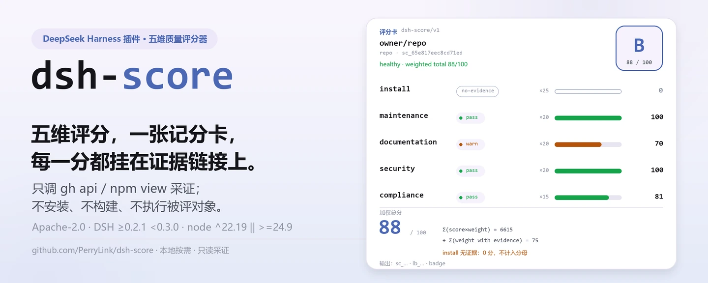
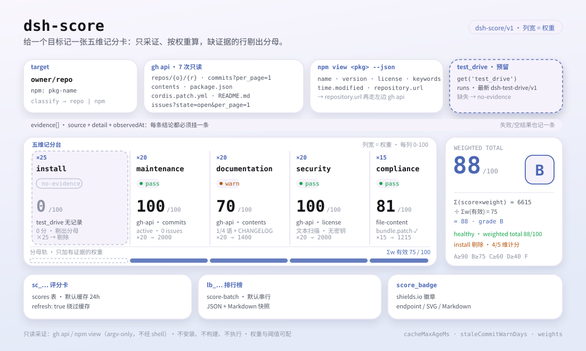

<div align="center">

<picture>
  <source media="(prefers-color-scheme: dark)" srcset="docs/assets/dsh-score-hero-zh-dark.webp">
  
</picture>

# dsh-score

**给任意仓库或 npm 包打一张带证据链接的五维质量评分卡——安装、维护、文档、安全、合规，每一分都能追溯。**

面向 DeepSeek Harness 的本地评分器：只调 `gh api` 与 `npm view` 采证，不安装、不构建、不执行被评对象；证据缺失时如实记 `no-evidence`，绝不编数字。

[安装](#三步上手) · [配置](#配置) · [FAQ](#faq) · [简体中文](README.md) · [English](README.en.md) · [Español](README.es.md) · [Português](README.pt.md) · [हिन्दी](README.hi.md)

[](LICENSE)
[](#兼容性)
[](https://www.npmjs.com/package/dsh-score)
[](https://github.com/PerryLink/dsh-score/actions/workflows/ci.yml)
[](#兼容性)

[](https://github.com/PerryLink/dsh-score/stargazers)
[](https://www.npmjs.com/package/dsh-score)
[](https://dshfind.com/plugins/PerryLink/dsh-score?ref=badge)
[](https://securityscorecards.dev/viewer/?uri=github.com/PerryLink/dsh-score)
[](https://dsh.market/)
[](https://gitee.com/perrylink/dsh-score)

```sh
dsh plugin --profile <name> add dsh-score
```

</div>

<sub>社区插件，与 DeepSeek 官方无关。唯一仓库：<https://github.com/PerryLink/dsh-score>（Gitee 为镜像）。</sub>

## 它是什么

`dsh-score` 是 DeepSeek Harness 的本地质量评分器：给它一个 GitHub 仓库或 npm 包，它跑完安装成功率、维护、文档、安全、合规五个维度，输出一张结构化评分卡（`schema: "dsh-score/v1"`）或一份 JSON + Markdown 排行榜。所有结论都来自真实的 `gh`/`npm` 输出，每条证据都带 `source`、脱敏后的 `detail` 与 `observedAt`；某个维度采不到证据就如实记 `no-evidence`（0 分、不参与加权），绝不用估算数字填空。评分完全按需，不安装、不构建、不运行被评对象。本插件是本地按需评分器；公开证据层在 [`dsh-attention-index`](https://github.com/PerryLink/dsh-attention-index)。

<picture>
  <source media="(prefers-color-scheme: dark)" srcset="docs/assets/dsh-score-flow-v5-dark.svg">
  
</picture>

## 三步上手

1. **安装**（二选一）：

   ```sh
   # git 通道（最新 main；等价于 git+https://github.com/PerryLink/dsh-score.git）
   dsh plugin --profile web add github:PerryLink/dsh-score#<commit-sha>
   # npm 通道（已发布版本）
   dsh plugin --profile web add dsh-score
   ```

   首次走 git 通道会因 pnpm 拦截该包的 `prepare` 构建而失败；把 pnpm 打印的精确键写进 profile 的 `pnpm-workspace.yaml` 后重试：

   ```yaml
   allowBuilds:
     'dsh-score': true
   ```

   npm 通道的预构建包无需构建许可。

2. **最小配置**（默认即可用；要改阈值或权重再加）：

   ```yaml
   - insert:
       - id: score
         name: dsh-score
         config:
           weights:
             install: 25
             maintenance: 20
             documentation: 20
             security: 20
             compliance: 15
   ```

3. **验证已生效**：

   ```sh
   dsh --profile web --dump-config | grep -A2 'id: score'
   ```

   ```
   > /score owner/repo
   [1/1] owner/repo → B (88/100, healthy (weighted total 88/100))
   ```

   *Observed from `src/batch.ts:70`*

**卸载**：`dsh plugin --profile web remove dsh-score`（或从 profile patch 删掉该行）。

> `dsh-score` 不自带 storage 栈。组合里没有 `storageDomain` 时工具照常可用，评分持久化被禁用并记录原因；已发布的 `dsh-base` bundle 自 `0.1.2-rc.1` 起挂载 storage-domain（已对 `0.1.2-rc.1` 与 `0.1.5-alpha.1` 的 tarball 核验），所以发布线上的持久化默认开启。

## 核心能力

`dsh-score` 把「这个插件能不能装、还在不在维护、文档全不全、安不安全、合不合规」压成一张可复核的分数卡：

- **五维评分** —— 安装成功率 `25`、维护 `20`、文档 `20`、安全 `20`、合规 `15`（权重可配置，默认合计 100）。
- **证据纪律** —— 每个维度记录其审计链接（`source`、脱敏后的 `detail`、`observedAt`）；无证据的维度报 `no-evidence`（得分 0，从加权总分中剔除），绝不编造数字。
- **结构化结果** —— 每条记录带 `schema: "dsh-score/v1"` 判别符，字段一等公民化，是下游工具消费的机器可读契约。
- **批量排行榜** —— `/score` 把目标列表交给 `ctx.jobs` 上的 `score-batch` 任务，产出 JSON + Markdown 排行榜快照。
- **缓存与刷新** —— 评分卡按目标缓存（默认 24 小时），`refresh: true` 绕过缓存重新采证。
- **可嵌入徽章** —— `score_badge` 输出 shields.io 徽章（endpoint / SVG / Markdown）与五维 JSON，总徽章可直接贴进任何 README。

```text
target ──gh api / npm view──▶ 五维证据 ──weighted──▶ 评分卡 dsh-score/v1 ──▶ 排行榜 lb_...
                                    │
                                    └─ 无证据 → no-evidence（0 分，剔除）
```

## 工具与结果

### 工具面

| 入口 | 类型 | 说明 |
|---|---|---|
| `score` | 工具 | 单目标五维评分；`refresh: true` 绕过缓存，`background: true` 启动 `score-batch` 后台任务 |
| `/score <targets...>` | 命令 | 空白/逗号分隔的目标列表批量评分；进度走任务输出，末行给出供 `score_report` 使用的 `lb_...` |
| `score_report` | 工具 | 取回评分卡（`sc_...`）、排行榜（`lb_...`），不传 id 时返回最新排行榜 |
| `score_badge` | 工具 | 为一个目标或已存评分卡生成 shields.io 徽章与五维 JSON |
| `score-batch` | 后台任务 | `ctx.jobs` 上的批量作业；串行评分并写排行榜快照 |

### 工具参数

```
score(target: string, refresh?: boolean, background?: boolean)
```

- `target` —— GitHub 仓库（`github:owner/repo`、`owner/repo`、git/https URL）或 npm 包名。
- `refresh: true` —— 绕过评分缓存，重新采集证据。
- `background: true` —— 启动 `score-batch` 任务并返回其 id。

`score_report(id?)` 返回评分卡（`sc_...`）、排行榜（`lb_...`），或不传 id 时返回最新排行榜。

`score_badge(target? | id?, refresh?)`：

- `target` —— 经缓存对 GitHub 仓库或 npm 包评分并生成徽章；与 `id` 互斥。
- `id` —— 对已存评分卡（`sc_...`）生成徽章，不重新评分。
- `refresh: true` —— 绕过评分缓存（仅对 `target` 生效）。

### 评分卡样例

以下为插件真实入口；安装后调用一个即可。

**命令**：

~~~sh
score({ target: "owner/repo" })
~~~

**输出**：

~~~text
# Score sc_65e817eec8cd71ed

- Target: `owner/repo` (repo)
- Grade: **B** — total 88/100
- Verdict: healthy (weighted total 88/100)

| Dimension | Status | Score | Weight | Summary |
|---|---|---|---|---|
| Install success | ⬜ no-evidence | 0 | 25 | no dsh-test-drive result recorded for this target (install success unmeasured) |
| Maintenance | ✅ pass | 100 | 20 | active (2026-08-15T00:00:00.000Z; 0 open issues) |
| Documentation | 🟠 warn | 70 | 20 | 1/4 language READMEs + CHANGELOG + SECURITY |
| Security | ✅ pass | 100 | 20 | license MIT |
| Protocol compliance | ✅ pass | 81 | 15 | dsh.bundle.patch declared |
~~~

*Observed from `README.md:141-149,169-191; tests/tools.spec.ts:64-65; tests/score.spec.ts:50-55; src/report.ts:40-53`*

**失败分支** —— 输入：

~~~text
{"id":"sc_nope"}
~~~

输出：

~~~text
isError=true; error.message=dsh-score: no score recorded with id sc_nope
~~~

*Observed from `plugins/dsh-score/src/tools.ts:351-354 (throw); plugins/dsh-score/tests/tools.spec.ts:95-99 (unknown id); plugins/dsh-score/README.md:179-181 (score_report); exercised through plugins/dsh-score/tests/harness.ts`*

**简短示例**：`score({ target: "owner/dsh-click" })` · `score_report("sc_65e817eec8cd71ed")` · `score_badge("owner/dsh-click")`

### 结构化结果

```json
{
  "schema": "dsh-score/v1",
  "scoreId": "sc_8f1c2e4a9b3d7f01",
  "target": { "kind": "repo", "spec": "github:owner/dsh-click#abc123" },
  "scoredAt": "2026-08-16T00:00:00.000Z",
  "durationMs": 3210,
  "pluginVersion": "0.2.22",
  "dimensions": {
    "install": { "dimension": "install", "status": "no-evidence", "score": 0, "weight": 25,
                 "summary": "no dsh-test-drive result recorded for this target (install success unmeasured)",
                 "evidence": [{ "source": "test-drive", "detail": "no test-drive record found in the test_drive domain", "observedAt": "2026-08-16T00:00:00.000Z" }] },
    "maintenance": { "dimension": "maintenance", "status": "pass", "score": 100, "weight": 20,
                     "summary": "active (2026-08-10T00:00:00Z; 0 open issues)",
                     "evidence": [{ "source": "gh-api", "detail": "last activity 2026-08-10T00:00:00Z", "observedAt": "2026-08-16T00:00:00.000Z" }] }
  },
  "total": 88,
  "grade": "B",
  "verdict": "healthy (weighted total 88/100)"
}
```

计分：总分为收集到证据维度的加权平均（no-evidence 维度被剔除并重新归一）；`A` ≥ 90，`B` ≥ 75，`C` ≥ 60，`D` ≥ 40，否则 `F`，全无证据时为 `N/A`。

### 徽章与五维 JSON

`score_badge` 为某个已评分目标生成可嵌入 README 的徽章与五维 JSON。徽章有三种同源形态：**endpoint**（文档化的 shields.io 静态 URL，零自托管）、**SVG**（自包含的 shields.io flat 风格 SVG，`badge.svg` 字段 / `renderScoreBadge`，供离线或自托管 README）、**Markdown**（两者组合的嵌入片段）。

嵌入总徽章：

```markdown

```

同一次调用返回紧凑的 JSON API 信封（`schema: "dsh-score/badge/v1"`）：

```json
{
  "schema": "dsh-score/badge/v1",
  "target": { "kind": "repo", "spec": "github:owner/dsh-click#abc123" },
  "scoredAt": "2026-08-16T00:00:00.000Z",
  "total": 84,
  "grade": "B",
  "dimensions": {
    "install":      { "label": "install", "status": "no-evidence", "score": 0,  "weight": 25, "summary": "no dsh-test-drive result recorded" },
    "maintenance":  { "label": "maintenance", "status": "pass", "score": 90, "weight": 20, "summary": "active (0 open issues)" },
    "documentation": { "label": "docs", "status": "pass", "score": 85, "weight": 20, "summary": "README + CHANGELOG + SECURITY" },
    "security":     { "label": "security", "status": "warn", "score": 60, "weight": 20, "summary": "permissive license" },
    "compliance":   { "label": "compliance", "status": "pass", "score": 100, "weight": 15, "summary": "dsh.bundle.patch + dsh-plugin topic" }
  }
}
```

`no-evidence` 维度保持诚实状态并计 0 分——徽章与 JSON 绝不伪造数字。

## 配置

所有键均可选（默认值如表）；非法值在加载期响亮失败。

最常用键：

| 键 | 默认值 | 说明 |
|---|---|---|
| `probeTimeoutMs` | `60000` | 单条 `gh`/`npm` 探测命令的截止时间（毫秒） |
| `outputTailBytes` | `8000` | 每条探测记录的脱敏输出尾部上限（字节） |
| `cacheMaxAgeMs` | `86400000` | 缓存评分卡复用的时长（0 关闭缓存） |
| `staleCommitWarnDays` | `90` | 提交/发布年龄超过该值，维护维度降为 `warn` |
| `staleCommitFailDays` | `365` | 提交/发布年龄超过该值，维护维度降为 `fail` |
| `maxBatchTargets` | `20` | `/score` 批量目标上限 |
| `batchConcurrency` | `1` | 批量并发（默认串行，避免 API 限流竞争） |
| `weights` | `{install:25, maintenance:20, documentation:20, security:20, compliance:15}` | 各维度权重（每个 0–100；至少一个 > 0） |

<details>
<summary>完整配置表（10 个键）</summary>

| 键 | 默认值 | 说明 |
|---|---|---|
| `probeTimeoutMs` | `60000` | 单条 `gh`/`npm` 探测命令的截止时间（毫秒） |
| `outputTailBytes` | `8000` | 每条探测记录的脱敏输出尾部上限（字节） |
| `cacheMaxAgeMs` | `86400000` | 缓存评分卡复用的时长（0 关闭缓存） |
| `staleCommitWarnDays` | `90` | 提交/发布年龄超过该值，维护维度降为 `warn` |
| `staleCommitFailDays` | `365` | 提交/发布年龄超过该值，维护维度降为 `fail` |
| `staleIssueWarnDays` | `30` | 最久未关闭 issue 年龄（响应代理）超过该值，维护维度降为 `warn` |
| `staleIssueFailDays` | `180` | 最久未关闭 issue 年龄超过该值，维护维度降为 `fail` |
| `maxBatchTargets` | `20` | `/score` 批量目标上限 |
| `batchConcurrency` | `1` | 批量并发（默认串行，避免 API 限流竞争） |
| `weights` | `{install:25, maintenance:20, documentation:20, security:20, compliance:15}` | 各维度权重（每个 0–100；至少一个 > 0） |

</details>

profile patch 覆盖示例：

```yaml
- insert:
    - id: score
      name: dsh-score
      config:
        cacheMaxAgeMs: 0
        maxBatchTargets: 10
        weights:
          install: 25
          maintenance: 20
          documentation: 20
          security: 20
          compliance: 15
```

## FAQ

<details>
<summary>评分卡和排行榜存哪？没有 storage 会丢吗？</summary>

评分卡与排行榜存进 `score` 存储域（表 `scores`、`leaderboards`，外加最新排行榜指针）。组合里没有 `storageDomain`（例如早于 base bundle storage 行的 headless profile）时，工具照常工作，但评分持久化被禁用并记录原因。已发布的 `dsh-base` bundle 自 `0.1.2-rc.1` 起挂载 storage-domain（已对 `0.1.2-rc.1` 与 `0.1.5-alpha.1` 的 tarball 核验），所以发布线上持久化是开启的。

</details>

<details>
<summary>采不到证据时会不会随手给个分？</summary>

不会。探测失败、输出不可解析或目标没有可解析的 GitHub 仓库时，对应维度报 `no-evidence`（0 分，从加权总分中剔除并重新归一）；全部维度都无证据时总分为 `N/A`。`no-evidence` 的维度还会带上失败原因（`exit N`、`timeout`、脱敏后的 stderr 尾部或 `invalid JSON`），而不是一个编出来的数字。

</details>

<details>
<summary>会不会安装、构建或运行被评的包？</summary>

不会。流水线只运行 `gh api` 与 `npm view` 两类只读命令，绝不安装、构建或执行目标；每次 CLI 调用都是 argv 数组、绝不经过 shell 解释，`owner`/`repo` 段在拼进端点前先做受限字符集校验。

</details>

<details>
<summary>凭据会不会漏进报告或日志？</summary>

不会。子进程继承 provider 已剥离凭据的环境，`gh` 读取它自己的凭据存储；任何环境变量值都不被记录。所有报告/日志字符串都过纯脱敏函数：token 字面量、URL 凭据、bearer 头被脱敏，输出尾部按字节截断。

</details>

<details>
<summary>评分开销大吗？会不会把 GitHub API 打限流？</summary>

评分卡按目标缓存（默认 `cacheMaxAgeMs` = 24 小时），重复查询不会重复采证；需要最新结果时用 `refresh: true` 或把缓存时长设为 0。`/score` 默认 `batchConcurrency: 1` 串行执行，避免并发探测争抢 API 配额，单条探测最多等 `probeTimeoutMs`（默认 60 秒）。

</details>

## 安全边界

- **不执行代码。** 流水线只运行 `gh api` 与 `npm view`；绝不安装、构建或运行目标。
- **仅 argv 子进程。** 每次 CLI 调用都是 argv 数组，绝不经过 shell 解释；owner/repo 段在用于端点前先做受限字符集校验。
- **证据纪律。** 不编造评分：探测失败或输出不可解析时返回 `no-evidence`，绝不填数字。
- **检测与脱敏分离。** 密钥泄露与恶意安装脚本检测复用与脱敏同一套纯正则，二者均有极端输入单测。

## 权限与数据

- **权限**：只消费公开服务 `ctx.subprocess`、`ctx.jobs`、`ctx.storageDomain`、`ctx.tools`、`ctx.commands`；不提供 Cordis service key。
- **数据**：评分卡与排行榜存于 `score` 存储域（表 `scores`、`leaderboards`；最新排行榜指针）。组合里没有 `storageDomain` 时工具仍可用，评分持久化被禁用并记录原因。
- **环境**：子进程继承 provider 已剥离凭据的环境；`gh` 读取其自身的凭据存储。任何环境变量值都不被记录；所有报告/日志字符串经过纯脱敏函数，尾部按字节截断。

## 已知限制

- 仓库探测需要 `gh` 已认证且有到 GitHub 的网络；npm 探测需要 `npm` 与 registry 访问。
- 无法解析出 GitHub 仓库的目标无法检查文档、安全或合规（这些维度报告 `no-evidence`）。
- 安装成功率依赖 `dsh-test-drive` 已挂载且已记录该目标；否则如实为 `no-evidence`。
- 维护维度的「issue 响应」是代理信号（最久未关闭 issue 年龄），不是直接响应时长测量。
- 评分按目标缓存；用 `refresh: true`（或等过 `cacheMaxAgeMs`）强制重评。

## 与其他 DSH 插件的互操作性

`dsh-score` 只挂自己的评分面，不占用别人的走廊：

- **工具面自持。** 只注册 `score`、`score_report`、`score_badge` 三个工具与 `/score` 一个命令，全部经 `ctx.effect` 注册，停止/热重载即撤销。
- **不提供服务键。** `inject` 只声明 `tools`、`commands`、`subprocess`、`jobs`；`storageDomain` 经 `ctx.get` 可选读取，从不 require。
- **无客户端走廊。** 不注册客户端 slot、不注册 `webServer` 路由前缀。
- **无 patch 层冲突。** 组合包 patch 只 `insert` 自己那一行（`id: score`），从不覆写内置行的 `config`。
- **不改全局。** 不改原型、不改写 `process.env`、不替换全局 fetch dispatcher。
- **不挂共享事件。** 不注册任何 waterfall 监听器（含 `agent/pre-step`），因此不参与事件链排序，不可能短路其他插件的链条。

静态证据：`dsh-plugin-doctor` 的验证徽章即由本仓 CI 产物驱动（见「生态与质量」）。

## 兼容性

| 组件 | 版本 |
|---|---|
| DeepSeek Harness | **`dsh-v0.2.2-rc.1`**（GitHub tag）。`engines.dsh` 门控为 `>=0.2.1-0 <0.3.0 \|\| >=0.2.2-0 <0.3.0`；dev/test 固定版本与 `typecheck:ci` 尺子都测 `0.2.2-rc.1`。`ctx.jobs` seam 使用 `SessionId` 契约。 |
| Node.js | `^22.19.0 \|\| >=24.9.0` |
| 包管理器 | `pnpm@11.7.0` |
| 平台 | Windows / macOS / Linux（纯 host 插件） |
| 外部工具 | PATH 上的 `gh` CLI（已认证用于 API 读取）、PATH 上的 `npm` CLI |

## 生态与质量

- [Gitee 镜像](https://gitee.com/perrylink/dsh-score)（同步镜像，以 GitHub 为准）
- [dshfind 插件页](https://dshfind.com/plugins/PerryLink/dsh-score)（安装量与排名）
- [OpenSSF Scorecard 报告](https://securityscorecards.dev/viewer/?uri=github.com/PerryLink/dsh-score)（由 [.github/workflows/scorecard.yml](.github/workflows/scorecard.yml) 驱动）
- [dsh-plugin-doctor 验证报告](https://github.com/PerryLink/dsh-plugin-doctor#verified-徽章)（徽章数据源）
- [DSH Market](https://dsh.market/)（已上架）
- **1024 商店渠道**：先 `npm i -g dsh1024`，再 `dsh1024 plugin --profile web add dsh-score`（计入 [deepseek1024.com](https://deepseek1024.com) 安装排行）
- [生态实测知识库](https://perrylink.github.io/dsh-plugin-guide/)：插件开发指南 · 选型实测数据 · 维护取舍判据

## 开发

```sh
pnpm install                                       # node ^22.19 || >=24.9
pnpm run typecheck && pnpm run typecheck:ci && pnpm test   # 本地 checkout 面 + 已发布线面 + vitest
pnpm run build && pnpm run verify:self-contained && pnpm run verify:artifacts && pnpm pack
pnpm run check:readmes                             # 五语 README 一致性
```

- `typecheck` 经本地 harness checkout 解析 `@deepseek-ai/*`；`typecheck:ci` 对照已发布的 `0.2.2-rc.1` 类型。
- 测试使用真实 `Context`/`Session`/`ToolRuntime`/`LocalJobRegistry`/存储栈，子进程 provider 为脚本化实现。
- 真实 CLI 评分（需 PATH 有 `gh`/`npm`，`gh` 已认证）：在已挂载 profile 中调用 `score`。
- 发布：`node scripts/release.mjs <x.y.z>`（升版本、盖 CHANGELOG、重跑门禁、提交 + tag；绝不 push）。
- README 配图由 [`scripts/gen-readme-assets.py`](scripts/gen-readme-assets.py) 程序化生成（Pillow 画 hero 横幅、手写 SVG 画结构图），可重复执行；旧的单版流程图与演示图保留在 `docs/assets/` 供外链使用，README 只引用新的 hero 与 flow-v5 结构图（各含深浅双版）。

Topics：`dsh`、`dsh-plugin`、`deepseek-harness`、`deepseek`、`cordis`、`plugin-scoring`、`quality-score`、`leaderboard`、`supply-chain`

## 家族与致谢

本项目是 [PerryLink](https://github.com/PerryLink) 维护的 DeepSeek Harness 插件家族成员（全部 Apache-2.0）。如果这个插件帮到了你，**给个 star**——它不解锁任何功能，但会让下一个人更容易找到它。

- [@PerryLink](https://github.com/PerryLink) —— 创建者与维护者：五维评分流水线、`gh`/`npm` 证据探测、结构化 `dsh-score/v1` 契约、`/score` 批量作业、徽章与五语文档。

<details>
<summary>展开全部插件</summary>

| 插件 | 状态 |
|---|---|
| **[dsh-aqua-input-check](https://github.com/PerryLink/dsh-aqua-input-check)** |  |
| **[dsh-archive-check](https://github.com/PerryLink/dsh-archive-check)** |  |
| **[dsh-auto-review](https://github.com/PerryLink/dsh-auto-review)** |  |
| **[dsh-autotier](https://github.com/PerryLink/dsh-autotier)** | 🧊 已冻结 — 见仓库 README |
| **[dsh-bid-ca-precheck](https://github.com/PerryLink/dsh-bid-ca-precheck)** |  |
| **[dsh-bid-qual-check](https://github.com/PerryLink/dsh-bid-qual-check)** |  |
| **[dsh-cert-mcp](https://github.com/PerryLink/dsh-cert-mcp)** | 🧊 已冻结 — 见仓库 README |
| **[dsh-checkpoint-rewind](https://github.com/PerryLink/dsh-checkpoint-rewind)** |  |
| **[dsh-click](https://github.com/PerryLink/dsh-click)** |  |
| **[dsh-composer-history](https://github.com/PerryLink/dsh-composer-history)** |  |
| **[dsh-contract-stance](https://github.com/PerryLink/dsh-contract-stance)** |  |
| **[dsh-customs-doc-check](https://github.com/PerryLink/dsh-customs-doc-check)** |  |
| **[dsh-data-quality](https://github.com/PerryLink/dsh-data-quality)** | 🧊 已冻结 — 见仓库 README |
| **[dsh-demurrage-ledger](https://github.com/PerryLink/dsh-demurrage-ledger)** |  |
| **[dsh-doublecheck](https://github.com/PerryLink/dsh-doublecheck)** |  |
| **[dsh-drill-script-check](https://github.com/PerryLink/dsh-drill-script-check)** |  |
| **[dsh-eia-guide-check](https://github.com/PerryLink/dsh-eia-guide-check)** |  |
| **[dsh-emergency-plan](https://github.com/PerryLink/dsh-emergency-plan)** |  |
| **[dsh-essay-rubric-check](https://github.com/PerryLink/dsh-essay-rubric-check)** |  |
| **[dsh-evidence-check](https://github.com/PerryLink/dsh-evidence-check)** |  |
| **[dsh-export-ctl-check](https://github.com/PerryLink/dsh-export-ctl-check)** |  |
| **[dsh-fast](https://github.com/PerryLink/dsh-fast)** |  |
| **[dsh-fmea-table-check](https://github.com/PerryLink/dsh-fmea-table-check)** |  |
| **[dsh-forecast-penalty](https://github.com/PerryLink/dsh-forecast-penalty)** |  |
| **[dsh-fund-research](https://github.com/PerryLink/dsh-fund-research)** |  |
| **[dsh-github](https://github.com/PerryLink/dsh-github)** |  |
| **[dsh-gongwen-flow-check](https://github.com/PerryLink/dsh-gongwen-flow-check)** |  |
| **[dsh-gongwen-word-check](https://github.com/PerryLink/dsh-gongwen-word-check)** |  |
| **[dsh-guard-plan-qc](https://github.com/PerryLink/dsh-guard-plan-qc)** |  |
| **[dsh-hazchem-check](https://github.com/PerryLink/dsh-hazchem-check)** |  |
| **[dsh-hazplan-check](https://github.com/PerryLink/dsh-hazplan-check)** |  |
| **[dsh-hidden-risk-map](https://github.com/PerryLink/dsh-hidden-risk-map)** |  |
| **[dsh-hs-classify](https://github.com/PerryLink/dsh-hs-classify)** |  |
| **[dsh-icd-rule-check](https://github.com/PerryLink/dsh-icd-rule-check)** |  |
| **[dsh-industry-research](https://github.com/PerryLink/dsh-industry-research)** |  |
| **[dsh-lawcite-adapter](https://github.com/PerryLink/dsh-lawcite-adapter)** |  |
| **[dsh-laya](https://github.com/PerryLink/dsh-laya)** |  |
| **[dsh-lc-doc-check](https://github.com/PerryLink/dsh-lc-doc-check)** |  |
| **[dsh-learning-gap-check](https://github.com/PerryLink/dsh-learning-gap-check)** |  |
| **[dsh-library](https://github.com/PerryLink/dsh-library)** |  |
| **[dsh-local-ai](https://github.com/PerryLink/dsh-local-ai)** |  |
| **[dsh-lsp-actions](https://github.com/PerryLink/dsh-lsp-actions)** |  |
| **[dsh-mask](https://github.com/PerryLink/dsh-mask)** |  |
| **[dsh-mcp-panel](https://github.com/PerryLink/dsh-mcp-panel)** |  |
| **[dsh-medrec-qc](https://github.com/PerryLink/dsh-medrec-qc)** |  |
| **[dsh-memento](https://github.com/PerryLink/dsh-memento)** | 🧊 已冻结 — 见仓库 README |
| **[dsh-nsfc-form-check](https://github.com/PerryLink/dsh-nsfc-form-check)** |  |
| **[dsh-nurse-record-check](https://github.com/PerryLink/dsh-nurse-record-check)** |  |
| **[dsh-observe](https://github.com/PerryLink/dsh-observe)** |  |
| **[dsh-origin-rvc-check](https://github.com/PerryLink/dsh-origin-rvc-check)** |  |
| **[dsh-ota-review-check](https://github.com/PerryLink/dsh-ota-review-check)** |  |
| **[dsh-output-styles](https://github.com/PerryLink/dsh-output-styles)** |  |
| **[dsh-paper-doc-adapter](https://github.com/PerryLink/dsh-paper-doc-adapter)** |  |
| **[dsh-permission-rules](https://github.com/PerryLink/dsh-permission-rules)** |  |
| **[dsh-permit-report-check](https://github.com/PerryLink/dsh-permit-report-check)** |  |
| **[dsh-pipeline-check](https://github.com/PerryLink/dsh-pipeline-check)** |  |
| **[dsh-pleading-draft](https://github.com/PerryLink/dsh-pleading-draft)** |  |
| **[dsh-plugin-doctor](https://github.com/PerryLink/dsh-plugin-doctor)** | 🚫 已退役（仓库已归档） |
| **[dsh-plugin-guide](https://github.com/PerryLink/dsh-plugin-guide)** |  |
| **[dsh-plugin-kit](https://github.com/PerryLink/dsh-plugin-kit)** | 🚫 已退役（仓库已归档） |
| **[dsh-plugin-upgrade](https://github.com/PerryLink/dsh-plugin-upgrade)** | 🚫 已退役（仓库已归档） |
| **[dsh-policy-brief-draft](https://github.com/PerryLink/dsh-policy-brief-draft)** |  |
| **[dsh-power-loss-split](https://github.com/PerryLink/dsh-power-loss-split)** |  |
| **[dsh-power-ticket-check](https://github.com/PerryLink/dsh-power-ticket-check)** |  |
| **[dsh-ppap-check](https://github.com/PerryLink/dsh-ppap-check)** |  |
| **[dsh-protest-deadline](https://github.com/PerryLink/dsh-protest-deadline)** |  |
| **[dsh-railway-window](https://github.com/PerryLink/dsh-railway-window)** |  |
| **[dsh-repair-order-qc](https://github.com/PerryLink/dsh-repair-order-qc)** |  |
| **[dsh-research-report](https://github.com/PerryLink/dsh-research-report)** |  |
| **[dsh-review-reply-check](https://github.com/PerryLink/dsh-review-reply-check)** |  |
| **[dsh-rulefile-check](https://github.com/PerryLink/dsh-rulefile-check)** |  |
| **[dsh-safety-brief-check](https://github.com/PerryLink/dsh-safety-brief-check)** |  |
| **[dsh-score](https://github.com/PerryLink/dsh-score)** | 🧊 已冻结 — 见仓库 README |
| **[dsh-session-sync](https://github.com/PerryLink/dsh-session-sync)** |  |
| **[dsh-site-log-check](https://github.com/PerryLink/dsh-site-log-check)** |  |
| **[dsh-skill-pack-security](https://github.com/PerryLink/dsh-skill-pack-security)** |  |
| **[dsh-soe-decision-check](https://github.com/PerryLink/dsh-soe-decision-check)** |  |
| **[dsh-soilwater-check](https://github.com/PerryLink/dsh-soilwater-check)** |  |
| **[dsh-sop-sync-check](https://github.com/PerryLink/dsh-sop-sync-check)** |  |
| **[dsh-spc-gbt-adapter](https://github.com/PerryLink/dsh-spc-gbt-adapter)** |  |
| **[dsh-talk](https://github.com/PerryLink/dsh-talk)** |  |
| **[dsh-tender-extract](https://github.com/PerryLink/dsh-tender-extract)** |  |
| **[dsh-tender-matrix](https://github.com/PerryLink/dsh-tender-matrix)** |  |
| **[dsh-test-drive](https://github.com/PerryLink/dsh-test-drive)** |  |
| **[dsh-ticktick](https://github.com/PerryLink/dsh-ticktick)** | 🚫 已退役（仓库已归档） |
| **[dsh-translate](https://github.com/PerryLink/dsh-translate)** |  |
| **[dsh-warranty-calc](https://github.com/PerryLink/dsh-warranty-calc)** |  |
| **[dsh-budget](https://github.com/PerryLink/dsh-budget)** | 🧊 已冻结 — 见仓库 README |
| **[dsh-claude-move](https://github.com/PerryLink/dsh-claude-move)** | 🧊 已冻结 — 见仓库 README |
| **[dsh-defend](https://github.com/PerryLink/dsh-defend)** | 🧊 已冻结 — 见仓库 README |
| **[dsh-draw](https://github.com/PerryLink/dsh-draw)** | 🧊 已冻结 — 见仓库 README |
| **[dsh-reach](https://github.com/PerryLink/dsh-reach)** | 🧊 已冻结 — 见仓库 README |
| **[dsh-background-agents](https://github.com/PerryLink/dsh-background-agents)** | 🚫 已退役（仓库已归档） |
| **[dsh-session-pin](https://github.com/PerryLink/dsh-session-pin)** | 🚫 已退役（仓库已归档） |
| **[dsh-team-rooms](https://github.com/PerryLink/dsh-team-rooms)** | 🚫 已退役（仓库已归档） |

</details>

## License

[LICENSE](LICENSE)（Apache License 2.0）© 2026 dsh-score contributors

<p align="center"><sub>Apache-2.0 · 社区插件，与 DeepSeek 无关。</sub></p>
