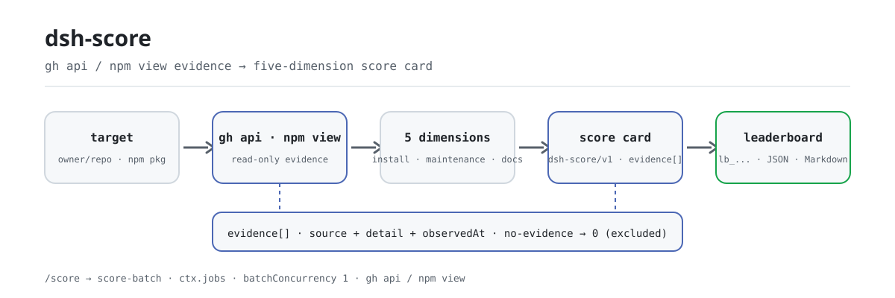

<div align="center">

<picture>
  <source media="(prefers-color-scheme: dark)" srcset="docs/assets/dsh-score-flow-dark.svg">
  
</picture>

# dsh-score

**Transforme qualquer repositório ou pacote npm em um cartão de qualidade de cinco dimensões com links de evidência — instalação, manutenção, documentação, segurança e conformidade, cada ponto rastreável.**

Pontuador local para DeepSeek Harness: coleta evidência apenas com `gh api` e `npm view` — nunca instala, compila ou executa o alvo — e registra `no-evidence` em vez de inventar um número.

[Instalar](#instalação-em-três-passos) · [Configuração](#configuração) · [FAQ](#faq) · [简体中文](README.md) · [English](README.en.md) · [Español](README.es.md) · [Português](README.pt.md) · [हिन्दी](README.hi.md)

[](LICENSE)
[](#compatibilidade)
[](https://www.npmjs.com/package/dsh-score)
[](https://github.com/PerryLink/dsh-score/actions/workflows/ci.yml)
[](#compatibilidade)

[](https://github.com/PerryLink/dsh-score/stargazers)
[](https://www.npmjs.com/package/dsh-score)
[](https://dshfind.com/plugins/PerryLink/dsh-score?ref=badge)
[](https://securityscorecards.dev/viewer/?uri=github.com/PerryLink/dsh-score)
[](https://dsh.market/)
[](https://gitee.com/perrylink/dsh-score)

```sh
dsh plugin --profile <name> add dsh-score
```

</div>

<sub>Plugin da comunidade, sem afiliação com a DeepSeek. Repositório canônico: <https://github.com/PerryLink/dsh-score> (Gitee é um espelho).</sub>

## O que é

`dsh-score` é um pontuador de qualidade local para DeepSeek Harness: dê a ele um repositório do GitHub ou um pacote npm e ele roda as cinco dimensões — sucesso de instalação, manutenção, documentação, segurança e conformidade — devolvendo um cartão estruturado (`schema: "dsh-score/v1"`) ou um ranking JSON + Markdown. Toda conclusão vem de saída real de `gh`/`npm` e cada evidência carrega `source`, `detail` sanitizado e `observedAt`; uma dimensão sem evidência reporta `no-evidence` (pontuação 0, excluída do total ponderado) em vez de um número inventado. A pontuação é somente sob demanda: nada é instalado, compilado ou executado. Este plugin é o pontuador local sob demanda; a camada de evidência pública fica em [`dsh-attention-index`](https://github.com/PerryLink/dsh-attention-index).

## Instalação em três passos

1. **Instalar** (escolha um canal):

   ```sh
   # canal git (main mais recente; equivale a git+https://github.com/PerryLink/dsh-score.git)
   dsh plugin --profile web add github:PerryLink/dsh-score#<commit-sha>
   # canal npm (versões publicadas)
   dsh plugin --profile web add dsh-score
   ```

   O primeiro `add` pelo canal git falha porque o pnpm bloqueia o build `prepare` do pacote; copie a chave exata impressa pelo pnpm para o `pnpm-workspace.yaml` do perfil e execute de novo:

   ```yaml
   allowBuilds:
     'dsh-score': true
   ```

   Pacotes pré-compilados do canal npm não precisam de permissão de build.

2. **Configuração mínima** (os padrões funcionam; adicione chaves só para mudar limites ou pesos):

   ```yaml
   - insert:
       - id: score
         name: dsh-score
         config:
           weights:
             install: 25
             maintenance: 20
             documentation: 20
             security: 20
             compliance: 15
   ```

3. **Verificar que monta**:

   ```sh
   dsh --profile web --dump-config | grep -A2 'id: score'
   ```

   ```
   > /score owner/repo
   [1/1] owner/repo → B (88/100, healthy (weighted total 88/100))
   ```

   *Observed from `src/batch.ts:70`*

**Desinstalar**: `dsh plugin --profile web remove dsh-score` (ou remova a linha do patch do perfil).

> `dsh-score` não inclui a stack de storage. Quando a composição não tem `storageDomain`, as ferramentas continuam funcionando e a persistência de pontuações é desativada com um motivo registrado; o bundle publicado `dsh-base` monta storage-domain desde `0.1.2-rc.1` (verificado com os tarballs `0.1.2-rc.1` e `0.1.5-alpha.1`), então a persistência está ativa na linha publicada.

## Capacidades principais

`dsh-score` comprime «dá para instalar, continua mantido, os docs estão completos, é seguro, cumpre o protocolo?» em um cartão revisável:

- **Cinco dimensões** — sucesso de instalação `25`, manutenção `20`, documentação `20`, segurança `20`, conformidade `15` (pesos configuráveis; os padrões somam 100).
- **Disciplina de evidência** — cada dimensão registra seus links de auditoria (`source`, `detail` sanitizado, `observedAt`); uma dimensão sem evidência reporta `no-evidence` (pontuação 0, excluída do total ponderado) e nunca um número inventado.
- **Resultados estruturados** — cada registro carrega `schema: "dsh-score/v1"` com campos de primeira classe; é o contrato legível por máquina consumido pelo tooling a jusante.
- **Ranking em lote** — `/score` entrega uma lista de alvos a um trabalho `score-batch` sobre `ctx.jobs` e produz um snapshot de ranking JSON + Markdown.
- **Cache e atualização** — os cartões são cacheados por alvo (24 horas por padrão); `refresh: true` ignora o cache e coleta a evidência de novo.
- **Selo embutível** — `score_badge` devolve um selo shields.io (endpoint / SVG / Markdown) mais o JSON de cinco dimensões; o selo total entra direto em qualquer README.

```text
alvo ──gh api / npm view──▶ cinco dimensões de evidência ──ponderado──▶ cartão dsh-score/v1 ──▶ ranking lb_...
                                  │
                                  └─ sem evidência → no-evidence (0, excluída)
```

## Ferramentas e resultados

### Superfície de ferramentas

| Entrada | Tipo | Notas |
|---|---|---|
| `score` | ferramenta | Pontua um alvo pelas cinco dimensões; `refresh: true` ignora o cache, `background: true` inicia um trabalho `score-batch` |
| `/score <targets...>` | comando | Pontua uma lista separada por espaços/vírgulas; o progresso sai pela saída do trabalho e a última linha informa o `lb_...` para `score_report` |
| `score_report` | ferramenta | Busca um cartão (`sc_...`), um ranking (`lb_...`) ou, sem id, o ranking mais recente |
| `score_badge` | ferramenta | Gera um selo shields.io e o JSON de cinco dimensões para um alvo ou um cartão guardado |
| `score-batch` | trabalho em segundo plano | O trabalho em lote sobre `ctx.jobs`; pontua em série e grava o snapshot do ranking |

### Parâmetros das ferramentas

```
score(target: string, refresh?: boolean, background?: boolean)
```

- `target` — um repositório do GitHub (`github:owner/repo`, `owner/repo`, URL git/https) ou um nome de pacote npm.
- `refresh: true` — ignora o cache e coleta a evidência de novo.
- `background: true` — inicia um trabalho `score-batch` e devolve seu id.

`score_report(id?)` devolve um cartão (`sc_...`), um ranking (`lb_...`) ou, sem id, o ranking mais recente.

`score_badge(target? | id?, refresh?)`:

- `target` — pontua um repositório do GitHub ou pacote npm pelo cache e gera o selo; mutuamente exclusivo com `id`.
- `id` — gera o selo de um cartão guardado (`sc_...`) sem repontuar.
- `refresh: true` — ignora o cache de pontuação (só se aplica a `target`).

### Exemplo de cartão

Estes são os pontos de entrada reais; instale uma vez e chame um.

**Comando**:

~~~sh
score({ target: "owner/repo" })
~~~

**Saída**:

~~~text
# Score sc_65e817eec8cd71ed

- Target: `owner/repo` (repo)
- Grade: **B** — total 88/100
- Verdict: healthy (weighted total 88/100)

| Dimension | Status | Score | Weight | Summary |
|---|---|---|---|---|
| Install success | ⬜ no-evidence | 0 | 25 | no dsh-test-drive result recorded for this target (install success unmeasured) |
| Maintenance | ✅ pass | 100 | 20 | active (2026-08-15T00:00:00.000Z; 0 open issues) |
| Documentation | 🟠 warn | 70 | 20 | 1/4 language READMEs + CHANGELOG + SECURITY |
| Security | ✅ pass | 100 | 20 | license MIT |
| Protocol compliance | ✅ pass | 81 | 15 | dsh.bundle.patch declared |
~~~

*Observed from `README.md:141-149,169-191; tests/tools.spec.ts:64-65; tests/score.spec.ts:50-55; src/report.ts:40-53`*

**Ramo de falha** — entrada:

~~~text
{"id":"sc_nope"}
~~~

Saída:

~~~text
isError=true; error.message=dsh-score: no score recorded with id sc_nope
~~~

*Observed from `plugins/dsh-score/src/tools.ts:351-354 (throw); plugins/dsh-score/tests/tools.spec.ts:95-99 (unknown id); plugins/dsh-score/README.md:179-181 (score_report); exercised through plugins/dsh-score/tests/harness.ts`*

**Exemplos curtos**: `score({ target: "owner/dsh-click" })` · `score_report("sc_65e817eec8cd71ed")` · `score_badge("owner/dsh-click")`

### Resultado estruturado

```json
{
  "schema": "dsh-score/v1",
  "scoreId": "sc_8f1c2e4a9b3d7f01",
  "target": { "kind": "repo", "spec": "github:owner/dsh-click#abc123" },
  "scoredAt": "2026-08-16T00:00:00.000Z",
  "durationMs": 3210,
  "pluginVersion": "0.2.22",
  "dimensions": {
    "install": { "dimension": "install", "status": "no-evidence", "score": 0, "weight": 25,
                 "summary": "no dsh-test-drive result recorded for this target (install success unmeasured)",
                 "evidence": [{ "source": "test-drive", "detail": "no test-drive record found in the test_drive domain", "observedAt": "2026-08-16T00:00:00.000Z" }] },
    "maintenance": { "dimension": "maintenance", "status": "pass", "score": 100, "weight": 20,
                     "summary": "active (2026-08-10T00:00:00Z; 0 open issues)",
                     "evidence": [{ "source": "gh-api", "detail": "last activity 2026-08-10T00:00:00Z", "observedAt": "2026-08-16T00:00:00.000Z" }] }
  },
  "total": 88,
  "grade": "B",
  "verdict": "healthy (weighted total 88/100)"
}
```

Pontuação: o total é uma média ponderada sobre as dimensões que reuniram evidência (dimensões no-evidence são excluídas e renormalizadas); `A` ≥ 90, `B` ≥ 75, `C` ≥ 60, `D` ≥ 40, senão `F`, e `N/A` quando nada teve evidência.

### Selo e JSON de cinco dimensões

`score_badge` gera um selo embutível em README e o JSON de cinco dimensões para um alvo pontuado. O selo tem três formas derivadas do mesmo cartão: **endpoint** (URL estática documentada do shields.io, sem auto-hospedagem), **SVG** (SVG plano autocontido do shields.io, campo `badge.svg` / `renderScoreBadge`, para READMEs offline ou auto-hospedados) e **Markdown** (o trecho que combina os dois).

Embute o selo total:

```markdown

```

A mesma chamada devolve o envelope JSON compacto (`schema: "dsh-score/badge/v1"`):

```json
{
  "schema": "dsh-score/badge/v1",
  "target": { "kind": "repo", "spec": "github:owner/dsh-click#abc123" },
  "scoredAt": "2026-08-16T00:00:00.000Z",
  "total": 84,
  "grade": "B",
  "dimensions": {
    "install":      { "label": "install", "status": "no-evidence", "score": 0,  "weight": 25, "summary": "no dsh-test-drive result recorded" },
    "maintenance":  { "label": "maintenance", "status": "pass", "score": 90, "weight": 20, "summary": "active (0 open issues)" },
    "documentation": { "label": "docs", "status": "pass", "score": 85, "weight": 20, "summary": "README + CHANGELOG + SECURITY" },
    "security":     { "label": "security", "status": "warn", "score": 60, "weight": 20, "summary": "permissive license" },
    "compliance":   { "label": "compliance", "status": "pass", "score": 100, "weight": 15, "summary": "dsh.bundle.patch + dsh-plugin topic" }
  }
}
```

Uma dimensão `no-evidence` mantém seu estado honesto e pontua 0 — o selo e o JSON nunca fabricam números.

## Configuração

Todas as chaves são opcionais (padrões mostrados); valores inválidos falham em voz alta no carregamento.

Chaves mais usadas:

| Chave | Padrão | Descrição |
|---|---|---|
| `probeTimeoutMs` | `60000` | Prazo de um comando de sonda `gh`/`npm` (ms) |
| `outputTailBytes` | `8000` | Limite da cauda de saída sanitizada por sonda (bytes) |
| `cacheMaxAgeMs` | `86400000` | Tempo de reuso de um cartão em cache antes de repontuar (0 desativa o cache) |
| `staleCommitWarnDays` | `90` | Idade de commit/publicação em que a manutenção cai para `warn` |
| `staleCommitFailDays` | `365` | Idade de commit/publicação em que a manutenção cai para `fail` |
| `maxBatchTargets` | `20` | Limite de alvos por lote do `/score` |
| `batchConcurrency` | `1` | Concorrência do lote (serial por padrão, evita disputa pela taxa da API) |
| `weights` | `{install:25, maintenance:20, documentation:20, security:20, compliance:15}` | Pesos por dimensão (cada 0–100; ao menos um > 0) |

<details>
<summary>Tabela de configuração completa (10 chaves)</summary>

| Chave | Padrão | Descrição |
|---|---|---|
| `probeTimeoutMs` | `60000` | Prazo de um comando de sonda `gh`/`npm` (ms) |
| `outputTailBytes` | `8000` | Limite da cauda de saída sanitizada por sonda (bytes) |
| `cacheMaxAgeMs` | `86400000` | Tempo de reuso de um cartão em cache antes de repontuar (0 desativa o cache) |
| `staleCommitWarnDays` | `90` | Idade de commit/publicação em que a manutenção cai para `warn` |
| `staleCommitFailDays` | `365` | Idade de commit/publicação em que a manutenção cai para `fail` |
| `staleIssueWarnDays` | `30` | Idade da issue aberta mais antiga (proxy de resposta) em que a manutenção cai para `warn` |
| `staleIssueFailDays` | `180` | Idade da issue aberta mais antiga em que a manutenção cai para `fail` |
| `maxBatchTargets` | `20` | Limite de alvos por lote do `/score` |
| `batchConcurrency` | `1` | Concorrência do lote (serial por padrão, evita disputa pela taxa da API) |
| `weights` | `{install:25, maintenance:20, documentation:20, security:20, compliance:15}` | Pesos por dimensão (cada 0–100; ao menos um > 0) |

</details>

Exemplo de override no patch do perfil:

```yaml
- insert:
    - id: score
      name: dsh-score
      config:
        cacheMaxAgeMs: 0
        maxBatchTargets: 10
        weights:
          install: 25
          maintenance: 20
          documentation: 20
          security: 20
          compliance: 15
```

## FAQ

<details>
<summary>Onde ficam os cartões e rankings? Somem sem storage?</summary>

Cartões e rankings ficam no domínio de storage `score` (tabelas `scores`, `leaderboards`, mais o ponteiro para o ranking mais recente). Quando a composição não tem `storageDomain` (por exemplo, um perfil headless anterior às linhas de storage do bundle base), as ferramentas continuam funcionando, mas a persistência é desativada com um motivo registrado. O bundle publicado `dsh-base` monta storage-domain desde `0.1.2-rc.1` (verificado com os tarballs `0.1.2-rc.1` e `0.1.5-alpha.1`), então a persistência está ativa na linha publicada.

</details>

<details>
<summary>Quando falta evidência, ele inventa uma pontuação?</summary>

Não. Uma sonda falha, uma saída não parseável ou um alvo sem repositório do GitHub resolvível fazem essa dimensão reportar `no-evidence` (pontuação 0, excluída do total ponderado e renormalizada); se nada tiver evidência, o total é `N/A`. Uma dimensão `no-evidence` também carrega o motivo da falha (`exit N`, `timeout`, a cauda de stderr sanitizada ou `invalid JSON`) em vez de um número inventado.

</details>

<details>
<summary>Ele instala, compila ou executa o pacote alvo?</summary>

Não. O pipeline executa apenas os comandos somente-leitura `gh api` e `npm view`; nunca instala, compila ou executa o alvo. Toda invocação CLI é um array argv, nunca interpretado por shell, e os segmentos `owner`/`repo` são validados contra um conjunto restrito de caracteres antes de chegar a um endpoint.

</details>

<details>
<summary>Credenciais podem vazar para relatórios ou logs?</summary>

Não. Processos filhos herdam o ambiente sem credenciais e o `gh` usa seu próprio armazenamento; nenhum valor de ambiente é registrado. Todas as strings de relatório/log passam por sanitizadores puros: literais de token, credenciais de URL e cabeçalhos bearer são redigidos, e as caudas de saída são limitadas por bytes.

</details>

<details>
<summary>Quanto custa pontuar? Dá para estourar o rate limit da API do GitHub?</summary>

Os cartões são cacheados por alvo (`cacheMaxAgeMs` = 24 horas por padrão), então consultas repetidas não coletam evidência de novo; use `refresh: true` ou zere a idade do cache quando precisar de dados frescos. O `/score` usa `batchConcurrency: 1` (serial) por padrão para evitar que sondas concorrentes disputem a cota da API, e uma sonda espera no máximo `probeTimeoutMs` (60 segundos por padrão).

</details>

## Limites de segurança

- **Sem execução de código.** O pipeline executa apenas `gh api` e `npm view`; nunca instala, compila ou executa um alvo.
- **Subprocessos somente argv.** Toda invocação CLI é um array argv, nunca interpretado por shell; os segmentos owner/repo são validados contra um conjunto restrito de caracteres antes de serem usados em um endpoint.
- **Disciplina de evidência.** Nenhuma pontuação é fabricada: uma sonda que falha ou devolve saída não parseável produz `no-evidence`, nunca um número.
- **Detecção vs sanitização.** A detecção de vazamento de segredos e de scripts de instalação maliciosos compartilha as mesmas regex puras da sanitização; ambas têm testes unitários com entradas extremas.

## Permissões e dados

- **Permissões**: apenas serviços públicos são consumidos — `ctx.subprocess`, `ctx.jobs`, `ctx.storageDomain`, `ctx.tools`, `ctx.commands`; o plugin não fornece nenhuma chave de serviço Cordis.
- **Dados**: cartões e rankings vivem no domínio de storage `score` (tabelas `scores`, `leaderboards`, mais o ponteiro para o ranking mais recente). Sem `storageDomain` as ferramentas continuam funcionando e a persistência é desativada com um motivo registrado.
- **Ambiente**: processos filhos herdam um ambiente sem credenciais; o `gh` lê seu próprio armazenamento. Nenhum valor de ambiente é registrado, e toda string de relatório/log passa por sanitizadores puros com caudas limitadas por bytes.

## Limitações conhecidas

- Sondas de repositório exigem `gh` autenticado e rede; sondas npm exigem `npm` e acesso ao registry.
- Sem um repositório do GitHub resolvível, documentação/segurança/conformidade reportam `no-evidence`.
- O sucesso de instalação depende do `dsh-test-drive` montado com o alvo registrado; caso contrário é honestamente `no-evidence`.
- A «resposta a issues» da manutenção é um proxy (idade da issue aberta mais antiga), não uma medição direta do tempo de resposta.
- Os resultados são cacheados por alvo; use `refresh: true` (ou espere passar `cacheMaxAgeMs`) para forçar a repontuação.

## Interoperabilidade com outros plugins DSH

O `dsh-score` expõe apenas sua própria superfície de pontuação e nunca ocupa a faixa de outro plugin:

- **Superfície própria.** Registra exatamente três ferramentas (`score`, `score_report`, `score_badge`) e um comando (`/score`), todas via `ctx.effect`, então parar/recarregar a quente as remove.
- **Sem chave de serviço.** `inject` declara apenas `tools`, `commands`, `subprocess` e `jobs`; `storageDomain` é lido opcionalmente com `ctx.get` e nunca exigido.
- **Sem faixa de cliente.** Não registra nenhuma chave de slot de cliente nem prefixo de rota `webServer`.
- **Sem colisão de patch.** O patch do bundle apenas `insert`a sua própria linha (`id: score`); nunca sobrescreve o `config` de uma linha embutida.
- **Sem mutação global.** Não faz patch de protótipos, não reescreve `process.env` nem substitui o dispatcher global de fetch.
- **Sem listeners de eventos compartilhados.** Não registra nenhum listener waterfall (incluindo `agent/pre-step`), então não participa da ordem da cadeia de eventos e não pode encurtar a cadeia de outro plugin.

Evidência estática: o selo de verificação do `dsh-plugin-doctor` é alimentado pela saída de CI deste repositório (ver «Ecossistema e qualidade»).

## Compatibilidade

| Componente | Versão |
|---|---|
| DeepSeek Harness | **`dsh-v0.2.2-rc.1`** (tag do GitHub). O gate `engines.dsh` é `>=0.2.1-0 <0.3.0 \|\| >=0.2.2-0 <0.3.0`; os pins de dev/test e a régua `typecheck:ci` medem `0.2.2-rc.1`. O seam `ctx.jobs` usa o contrato `SessionId`. |
| Node.js | `^22.19.0 \|\| >=24.9.0` |
| Gerenciador de pacotes | `pnpm@11.7.0` |
| Plataforma | Windows / macOS / Linux (plugin somente host) |
| Ferramentas externas | CLI `gh` no PATH (autenticado para leituras de API), CLI `npm` no PATH |

## Ecossistema e qualidade

- [Espelho no Gitee](https://gitee.com/perrylink/dsh-score) (espelho sincronizado; o GitHub é o canônico)
- [Página no dshfind](https://dshfind.com/plugins/PerryLink/dsh-score) (instalações e ranking)
- [Relatório OpenSSF Scorecard](https://securityscorecards.dev/viewer/?uri=github.com/PerryLink/dsh-score) (acionado por [.github/workflows/scorecard.yml](.github/workflows/scorecard.yml))
- [Relatório de verificação do dsh-plugin-doctor](https://github.com/PerryLink/dsh-plugin-doctor#verified-徽章) (fonte do selo)
- [DSH Market](https://dsh.market/) (listado)
- **Canal da loja 1024**: `npm i -g dsh1024` uma vez e depois `dsh1024 plugin --profile web add dsh-score` (conta para o ranking de instalações do [deepseek1024.com](https://deepseek1024.com))
- [Base de conhecimento do ecossistema](https://perrylink.github.io/dsh-plugin-guide/): dados medidos, não marketing — guia de desenvolvimento de plugins · dados de seleção · critérios de manutenção

## Desenvolvimento

```sh
pnpm install                                       # node ^22.19 || >=24.9
pnpm run typecheck && pnpm run typecheck:ci && pnpm test   # face checkout local + face linha publicada + vitest
pnpm run build && pnpm run verify:self-contained && pnpm run verify:artifacts && pnpm pack
pnpm run check:readmes                             # consistência dos README em cinco idiomas
```

- `typecheck` resolve `@deepseek-ai/*` pelo checkout local do harness; `typecheck:ci` confere contra os tipos publicados `0.2.2-rc.1`.
- Os testes usam o `Context`/`Session`/`ToolRuntime`/`LocalJobRegistry`/stack de storage reais com um provedor de subprocesso roteirizado.
- Pontuação com CLI real (exige `gh`/`npm` no PATH e `gh` autenticado): invoque `score` de um perfil montado.
- Release: `node scripts/release.mjs <x.y.z>` (sobe versão, sela o CHANGELOG, roda o gate de novo, commit + tag; nunca push).
- As imagens do README são geradas programaticamente por [`scripts/gen-readme-assets.py`](scripts/gen-readme-assets.py) (Python + Pillow), seguras de reexecutar; ele grava `docs/assets/dsh-score-flow-{light,dark}.svg`.

Tópicos: `dsh`, `dsh-plugin`, `deepseek-harness`, `deepseek`, `cordis`, `plugin-scoring`, `quality-score`, `leaderboard`, `supply-chain`

## Família e agradecimentos

Este projeto faz parte da família de plugins de DeepSeek Harness da [PerryLink](https://github.com/PerryLink) (todos Apache-2.0). Se ele for útil, **uma estrela ajuda a próxima pessoa a encontrá-lo** — nada é desbloqueado por isso.

- [@PerryLink](https://github.com/PerryLink) — criador e mantenedor: o pipeline de cinco dimensões, as sondas de evidência `gh`/`npm`, o contrato estruturado `dsh-score/v1`, o trabalho em lote `/score`, o selo e a documentação em cinco idiomas.

<details>
<summary>Expandir todos os plugins</summary>

| Plugin | Estado |
|---|---|
| **[dsh-aqua-input-check](https://github.com/PerryLink/dsh-aqua-input-check)** |  |
| **[dsh-archive-check](https://github.com/PerryLink/dsh-archive-check)** |  |
| **[dsh-auto-review](https://github.com/PerryLink/dsh-auto-review)** |  |
| **[dsh-autotier](https://github.com/PerryLink/dsh-autotier)** | 🧊 CONGELADO — ver o README do repo |
| **[dsh-bid-ca-precheck](https://github.com/PerryLink/dsh-bid-ca-precheck)** |  |
| **[dsh-bid-qual-check](https://github.com/PerryLink/dsh-bid-qual-check)** |  |
| **[dsh-cert-mcp](https://github.com/PerryLink/dsh-cert-mcp)** | 🧊 CONGELADO — ver o README do repo |
| **[dsh-checkpoint-rewind](https://github.com/PerryLink/dsh-checkpoint-rewind)** |  |
| **[dsh-click](https://github.com/PerryLink/dsh-click)** |  |
| **[dsh-composer-history](https://github.com/PerryLink/dsh-composer-history)** |  |
| **[dsh-contract-stance](https://github.com/PerryLink/dsh-contract-stance)** |  |
| **[dsh-customs-doc-check](https://github.com/PerryLink/dsh-customs-doc-check)** |  |
| **[dsh-data-quality](https://github.com/PerryLink/dsh-data-quality)** | 🧊 CONGELADO — ver o README do repo |
| **[dsh-demurrage-ledger](https://github.com/PerryLink/dsh-demurrage-ledger)** |  |
| **[dsh-doublecheck](https://github.com/PerryLink/dsh-doublecheck)** |  |
| **[dsh-drill-script-check](https://github.com/PerryLink/dsh-drill-script-check)** |  |
| **[dsh-eia-guide-check](https://github.com/PerryLink/dsh-eia-guide-check)** |  |
| **[dsh-emergency-plan](https://github.com/PerryLink/dsh-emergency-plan)** |  |
| **[dsh-essay-rubric-check](https://github.com/PerryLink/dsh-essay-rubric-check)** |  |
| **[dsh-evidence-check](https://github.com/PerryLink/dsh-evidence-check)** |  |
| **[dsh-export-ctl-check](https://github.com/PerryLink/dsh-export-ctl-check)** |  |
| **[dsh-fast](https://github.com/PerryLink/dsh-fast)** |  |
| **[dsh-fmea-table-check](https://github.com/PerryLink/dsh-fmea-table-check)** |  |
| **[dsh-forecast-penalty](https://github.com/PerryLink/dsh-forecast-penalty)** |  |
| **[dsh-fund-research](https://github.com/PerryLink/dsh-fund-research)** |  |
| **[dsh-github](https://github.com/PerryLink/dsh-github)** |  |
| **[dsh-gongwen-flow-check](https://github.com/PerryLink/dsh-gongwen-flow-check)** |  |
| **[dsh-gongwen-word-check](https://github.com/PerryLink/dsh-gongwen-word-check)** |  |
| **[dsh-guard-plan-qc](https://github.com/PerryLink/dsh-guard-plan-qc)** |  |
| **[dsh-hazchem-check](https://github.com/PerryLink/dsh-hazchem-check)** |  |
| **[dsh-hazplan-check](https://github.com/PerryLink/dsh-hazplan-check)** |  |
| **[dsh-hidden-risk-map](https://github.com/PerryLink/dsh-hidden-risk-map)** |  |
| **[dsh-hs-classify](https://github.com/PerryLink/dsh-hs-classify)** |  |
| **[dsh-icd-rule-check](https://github.com/PerryLink/dsh-icd-rule-check)** |  |
| **[dsh-industry-research](https://github.com/PerryLink/dsh-industry-research)** |  |
| **[dsh-lawcite-adapter](https://github.com/PerryLink/dsh-lawcite-adapter)** |  |
| **[dsh-laya](https://github.com/PerryLink/dsh-laya)** |  |
| **[dsh-lc-doc-check](https://github.com/PerryLink/dsh-lc-doc-check)** |  |
| **[dsh-learning-gap-check](https://github.com/PerryLink/dsh-learning-gap-check)** |  |
| **[dsh-library](https://github.com/PerryLink/dsh-library)** |  |
| **[dsh-local-ai](https://github.com/PerryLink/dsh-local-ai)** |  |
| **[dsh-lsp-actions](https://github.com/PerryLink/dsh-lsp-actions)** |  |
| **[dsh-mask](https://github.com/PerryLink/dsh-mask)** |  |
| **[dsh-mcp-panel](https://github.com/PerryLink/dsh-mcp-panel)** |  |
| **[dsh-medrec-qc](https://github.com/PerryLink/dsh-medrec-qc)** |  |
| **[dsh-memento](https://github.com/PerryLink/dsh-memento)** | 🧊 CONGELADO — ver o README do repo |
| **[dsh-nsfc-form-check](https://github.com/PerryLink/dsh-nsfc-form-check)** |  |
| **[dsh-nurse-record-check](https://github.com/PerryLink/dsh-nurse-record-check)** |  |
| **[dsh-observe](https://github.com/PerryLink/dsh-observe)** |  |
| **[dsh-origin-rvc-check](https://github.com/PerryLink/dsh-origin-rvc-check)** |  |
| **[dsh-ota-review-check](https://github.com/PerryLink/dsh-ota-review-check)** |  |
| **[dsh-output-styles](https://github.com/PerryLink/dsh-output-styles)** |  |
| **[dsh-paper-doc-adapter](https://github.com/PerryLink/dsh-paper-doc-adapter)** |  |
| **[dsh-permission-rules](https://github.com/PerryLink/dsh-permission-rules)** |  |
| **[dsh-permit-report-check](https://github.com/PerryLink/dsh-permit-report-check)** |  |
| **[dsh-pipeline-check](https://github.com/PerryLink/dsh-pipeline-check)** |  |
| **[dsh-pleading-draft](https://github.com/PerryLink/dsh-pleading-draft)** |  |
| **[dsh-plugin-doctor](https://github.com/PerryLink/dsh-plugin-doctor)** | 🚫 APOSENTADO (repo arquivado) |
| **[dsh-plugin-guide](https://github.com/PerryLink/dsh-plugin-guide)** |  |
| **[dsh-plugin-kit](https://github.com/PerryLink/dsh-plugin-kit)** | 🚫 APOSENTADO (repo arquivado) |
| **[dsh-plugin-upgrade](https://github.com/PerryLink/dsh-plugin-upgrade)** | 🚫 APOSENTADO (repo arquivado) |
| **[dsh-policy-brief-draft](https://github.com/PerryLink/dsh-policy-brief-draft)** |  |
| **[dsh-power-loss-split](https://github.com/PerryLink/dsh-power-loss-split)** |  |
| **[dsh-power-ticket-check](https://github.com/PerryLink/dsh-power-ticket-check)** |  |
| **[dsh-ppap-check](https://github.com/PerryLink/dsh-ppap-check)** |  |
| **[dsh-protest-deadline](https://github.com/PerryLink/dsh-protest-deadline)** |  |
| **[dsh-railway-window](https://github.com/PerryLink/dsh-railway-window)** |  |
| **[dsh-repair-order-qc](https://github.com/PerryLink/dsh-repair-order-qc)** |  |
| **[dsh-research-report](https://github.com/PerryLink/dsh-research-report)** |  |
| **[dsh-review-reply-check](https://github.com/PerryLink/dsh-review-reply-check)** |  |
| **[dsh-rulefile-check](https://github.com/PerryLink/dsh-rulefile-check)** |  |
| **[dsh-safety-brief-check](https://github.com/PerryLink/dsh-safety-brief-check)** |  |
| **[dsh-score](https://github.com/PerryLink/dsh-score)** | 🧊 CONGELADO — ver o README do repo |
| **[dsh-session-sync](https://github.com/PerryLink/dsh-session-sync)** |  |
| **[dsh-site-log-check](https://github.com/PerryLink/dsh-site-log-check)** |  |
| **[dsh-skill-pack-security](https://github.com/PerryLink/dsh-skill-pack-security)** |  |
| **[dsh-soe-decision-check](https://github.com/PerryLink/dsh-soe-decision-check)** |  |
| **[dsh-soilwater-check](https://github.com/PerryLink/dsh-soilwater-check)** |  |
| **[dsh-sop-sync-check](https://github.com/PerryLink/dsh-sop-sync-check)** |  |
| **[dsh-spc-gbt-adapter](https://github.com/PerryLink/dsh-spc-gbt-adapter)** |  |
| **[dsh-talk](https://github.com/PerryLink/dsh-talk)** |  |
| **[dsh-tender-extract](https://github.com/PerryLink/dsh-tender-extract)** |  |
| **[dsh-tender-matrix](https://github.com/PerryLink/dsh-tender-matrix)** |  |
| **[dsh-test-drive](https://github.com/PerryLink/dsh-test-drive)** |  |
| **[dsh-ticktick](https://github.com/PerryLink/dsh-ticktick)** | 🚫 APOSENTADO (repo arquivado) |
| **[dsh-translate](https://github.com/PerryLink/dsh-translate)** |  |
| **[dsh-warranty-calc](https://github.com/PerryLink/dsh-warranty-calc)** |  |
| **[dsh-budget](https://github.com/PerryLink/dsh-budget)** | 🧊 CONGELADO — ver o README do repo |
| **[dsh-claude-move](https://github.com/PerryLink/dsh-claude-move)** | 🧊 CONGELADO — ver o README do repo |
| **[dsh-defend](https://github.com/PerryLink/dsh-defend)** | 🧊 CONGELADO — ver o README do repo |
| **[dsh-draw](https://github.com/PerryLink/dsh-draw)** | 🧊 CONGELADO — ver o README do repo |
| **[dsh-reach](https://github.com/PerryLink/dsh-reach)** | 🧊 CONGELADO — ver o README do repo |
| **[dsh-background-agents](https://github.com/PerryLink/dsh-background-agents)** | 🚫 APOSENTADO (repo arquivado) |
| **[dsh-session-pin](https://github.com/PerryLink/dsh-session-pin)** | 🚫 APOSENTADO (repo arquivado) |
| **[dsh-team-rooms](https://github.com/PerryLink/dsh-team-rooms)** | 🚫 APOSENTADO (repo arquivado) |

</details>

## Licença

[LICENSE](LICENSE) (Apache License 2.0) © 2026 dsh-score contributors

<p align="center"><sub>Apache-2.0 · Plugin da comunidade, sem afiliação com a DeepSeek.</sub></p>
